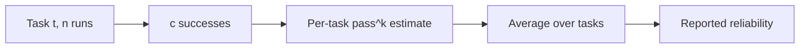

Agents are not deterministic. Run the same task twice and you may get different step sequences and different outcomes. So a single run of a task tells you little: it might have been lucky or unlucky. To measure an agent properly, run each task several times, and then you must decide what the repeated results mean. Two summaries answer very different questions.

Picture a basketball player taking free throws. One question is "can she hit at least one in four attempts?" The other is "will she hit all four?" The first is a measure of capability; the second is a measure of consistency. Customers care about the second, researchers often report the first.

## Two definitions

Suppose that on a given task the agent succeeds with probability $p$ on any one independent run. Take $k$ runs.

**pass@k** is the probability that **at least one** of the $k$ runs succeeds:

$$
\text{pass@}k = 1 - (1-p)^k
$$

**pass^k** is the probability that **all** $k$ runs succeed:

$$
\text{pass}^k = p^k
$$

pass@k answers "does it ever work?", which is the right measure when you can verify outputs and retry cheaply (generate several candidates and keep one that passes the tests). pass^k answers "does it always work?", which is the right measure when each run is delivered to a user with no safety net.

```steps
Worked example: p = 0.8
$k = 1$: pass@1 $= 0.8$ and pass^1 $= 0.8$. They agree for a single run.
---
$k = 4$: pass@4 $= 1 - 0.2^4 = 1 - 0.0016 = 0.9984$. At least one of four attempts nearly always works.
---
$k = 4$: pass^4 $= 0.8^4 = 0.4096$. All four runs succeeding happens only 41% of the time.
---
The same agent looks excellent (99.8%) or mediocre (41%) depending on the question. Reporting pass@4 for a customer-facing agent would be misleading, and reporting pass^4 for a code generator that is checked by tests would undersell it.
```

| $p$ | pass@1 | pass@4 | pass^4 | pass^8 |
|---|---|---|---|---|
| 0.5 | 0.500 | 0.938 | 0.063 | 0.004 |
| 0.8 | 0.800 | 0.998 | 0.410 | 0.168 |
| 0.9 | 0.900 | 1.000 | 0.656 | 0.430 |
| 0.95 | 0.950 | 1.000 | 0.815 | 0.663 |

Read the pass^k columns: even an agent that succeeds 90% of the time on a task completes it eight times in a row only 43% of the time. If your users repeat a task weekly, consistency is what they experience.

## Estimating from limited samples

You cannot observe $p$ directly. If you run a task $n$ times and see $c$ successes, the natural estimate is $\hat{p} = c/n$. For the pass@k metric with $c$ successes among $n$ samples (for $k \le n$), there is an unbiased estimator that avoids the bias of plugging $\hat p$ into the formula:

$$
\widehat{\text{pass@}k} = 1 - \frac{\binom{n-c}{k}}{\binom{n}{k}}
$$

This is the estimator introduced for code-generation benchmarks: the chance that a random subset of $k$ of your $n$ runs contains at least one success. For example, with $n = 10$ runs and $c = 4$ successes, pass@3 is $1 - \binom{6}{3}/\binom{10}{3} = 1 - 20/120 = 0.833$. For the all-succeed measure, a sample estimate of $\binom{c}{k}/\binom{n}{k}$ plays the same role: with $n = 10$, $c = 8$, $k = 3$: $\binom{8}{3}/\binom{10}{3} = 56/120 = 0.467$, compared with the plug-in value $0.8^3 = 0.512$.

## Averaging over tasks

Tasks differ: some the agent always solves, some never, some it solves half the time. Compute pass@k or pass^k **per task**, then average across tasks. Averaging first and then applying the formula hides the difference between "reliable on 80% of tasks" and "flaky on every task": both have an average success of 0.8, but the second has far lower pass^k.



## In practice

Run each evaluation task at least 3 to 5 times, and report both the average success (pass@1) and a consistency number such as pass^3 or the fraction of tasks solved on every run. A big gap between the two is a signature of nondeterministic failure: look for causes like sampling temperature, tool nondeterminism (live web results), and race conditions in parallel steps. Lowering temperature, pinning tool outputs in test environments and adding verification all raise pass^k more than they raise pass@1.

```quiz
{"q": "An agent succeeds on a task with probability 0.9 per run, independently. What is the probability it succeeds on all 5 of 5 runs?", "options": ["0.9", "0.59", "0.99999", "0.45"], "answer": 1, "explain": "pass^5 = 0.9⁵ = 0.59. The 0.99999 option is pass@5 (at least one success), a very different question."}
```

```quiz
{"q": "Which metric is more appropriate for a customer-facing agent where every run is delivered with no retry?", "options": ["pass@k for large k", "pass^k, because users experience every run", "Whichever is larger", "Neither; use only average length"], "answer": 1, "explain": "With no safety net each run counts, so consistency (all runs succeed) matters. pass@k suits settings where you can verify and select among several attempts."}
```
