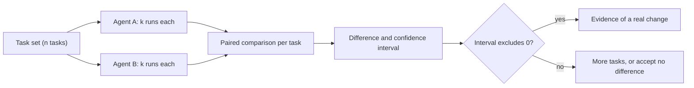

You evaluate a new version of your agent on 100 tasks and it scores 78%. The old version scored 70%. Is the new one better? It is tempting to say yes: eight points is eight points. But a success rate measured on 100 tasks is an estimate with real uncertainty, and an 8-point gap may be well within noise. Shipping on noise means you will sometimes make things worse while believing you improved them.

Think of tasting two soups from a single spoonful each. If one tastes a little saltier, you cannot tell whether the pots differ or whether you happened to get a salty spoonful. A bigger sample, many spoonfuls, tells you.

## Uncertainty of a single success rate

If $\hat{p}$ is the observed success rate over $n$ independent tasks, its **standard error** is

$$
\text{SE} = \sqrt{\frac{\hat p\,(1-\hat p)}{n}}
$$

and an approximate 95% confidence interval is $\hat p \pm 1.96\,\text{SE}$. (This normal approximation is fine when $n\hat p$ and $n(1-\hat p)$ are both comfortably above 10; for very small samples or rates near 0 or 1, use an exact or Wilson interval.)

```steps
Worked example: 70 successes in 100 tasks
$\hat p = 0.70$ and $n = 100$. Standard error: $\sqrt{0.7 \times 0.3 / 100} = \sqrt{0.0021} = 0.0458$.
---
95% interval half-width: $1.96 \times 0.0458 = 0.0898$, about 9 points. The interval is roughly $[61\%, 79\%]$.
---
So "70%" really means "somewhere between 61 and 79". With 400 tasks the half-width falls to $1.96\sqrt{0.21/400} = 0.045$, about 4.5 points. Halving the uncertainty costs four times the tasks, because SE shrinks with $\sqrt{n}$.
```

## Comparing two agents

For two agents evaluated on **different** samples of tasks, the standard error of the difference combines both:

$$
\text{SE}_\Delta = \sqrt{\frac{\hat p_A(1-\hat p_A)}{n_A} + \frac{\hat p_B(1-\hat p_B)}{n_B}}, \qquad z = \frac{\hat p_B - \hat p_A}{\text{SE}_\Delta}
$$

If $|z| > 1.96$, the difference is significant at the 5% level.

```steps
Worked example: 70% vs 78%, 100 tasks each
Difference: $0.78 - 0.70 = 0.08$.
---
$\text{SE}_\Delta = \sqrt{0.0021 + 0.78 \times 0.22/100} = \sqrt{0.0021 + 0.001716} = \sqrt{0.003816} = 0.0618$.
---
$z = 0.08 / 0.0618 = 1.29$. That is below 1.96: **not significant**. An 8-point gap on 100 tasks per arm could easily arise by chance.
---
How many tasks per arm would detect an 8-point gap reliably? For about 80% power at the 5% level, $n \approx 2\,(1.96 + 0.84)^2\,\bar p(1-\bar p)/\delta^2$, with $\bar p \approx 0.74$ and $\delta = 0.08$: $2 \times 7.84 \times 0.1924 / 0.0064 \approx 471$ tasks per arm.
```

The final line is the practical punchline: to resolve an 8-point improvement you need nearly 500 tasks per version, not 100. Smaller improvements need many more, since $n \propto 1/\delta^2$: halving the effect you want to detect quadruples the sample.

## Using the same tasks for both agents

If both agents run on the **same** tasks, you can use a **paired** comparison: look only at the tasks where results differ. Say on 100 tasks, A wins 12 (A passes, B fails) and B wins 20 (B passes, A fails), the rest tie. The difference is a net 8 tasks, and the question becomes whether 20 versus 12 among the 32 discordant tasks is consistent with a fair coin. The standard deviation of the count under a fair coin is $\sqrt{32}/2 = 2.83$ wins, and the observed deviation from 16 is 4, a $z \approx 1.41$: still not significant, but pairing sharpens the test because easy tasks that both always pass no longer add noise. Always prefer paired comparisons when you can run both on the same set.

## Repeated runs add noise too

Agents vary run to run, so a task's result has its own randomness on top of the choice of tasks. Running each task several times and averaging reduces that second source, but does not substitute for more distinct tasks: 100 tasks run 5 times each is not as informative as 500 distinct tasks run once, because the 5 runs of a task are correlated. Use both: a broad task set, and a few repeats per task.



## In practice

Decide before you run the evaluation what difference matters (say 5 points) and size the test set for it. Report intervals, not bare percentages. Keep a fixed evaluation set for comparisons over time and a separate, growing set from production failures for regression testing. And when two versions are within noise, choose the cheaper or simpler one: absence of evidence of a difference is a perfectly good reason not to ship a complication.

```quiz
{"q": "An agent passes 45 of 60 tasks. What is the approximate 95% confidence interval half-width for its success rate?", "options": ["About 11 points", "About 5 points", "About 1.96 points", "About 20 points"], "answer": 0, "explain": "p̂ = 0.75, SE = √(0.75 × 0.25 / 60) = √0.003125 = 0.0559; 1.96 × 0.0559 = 0.1096, about 11 points. Sixty tasks only pins the rate down to roughly 64 to 86%."}
```

```quiz
{"q": "You want to detect an improvement half as large as before. Roughly how does the number of tasks needed change?", "options": ["Doubles", "Quadruples", "Halves", "Stays the same"], "answer": 1, "explain": "Sample size scales with 1/δ², where δ is the difference to detect. Halving δ multiplies the required n by 4."}
```
