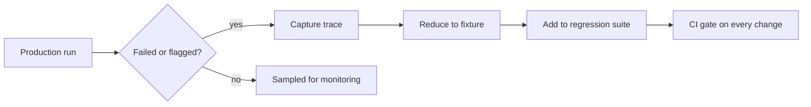

Evaluation before launch tells you how the agent behaves on tasks you thought of. Production brings tasks you did not think of, tools that change under you, and models that get updated. An agent that scored 85% on your test set in March can quietly sit at 70% by June without a single code change. Two practices keep you honest: **monitoring** live traffic, and turning every real failure into a **regression test**.

Think of a restaurant's quality system. The chef tastes dishes before service (pre-launch evaluation), the manager watches the dining room and the return rate during service (monitoring), and every complaint becomes a rule in the kitchen so that mistake never repeats (regression test).

## What to watch

Aggregates from traces are cheap and informative. A good dashboard has a small number of signals, each with a clear owner:

| Signal | Computed from | What a change means |
|---|---|---|
| Success proxy rate | A programmatic check or sampled grading | Quality drift |
| Steps per run, median and p95 | Number of model spans | Loops or harder tasks when rising |
| Stop reasons | Root span outcome | Share ending at the cap rising means stuck runs |
| Tool error rate by tool and class | Tool spans | A dependency has degraded |
| Cost per run and per success | Tokens times price | Context bloat or retry storms |
| Latency p50 and p95 | Span durations | Slow tool or model |
| Human escalation and thumbs-down rate | Product signals | Real user dissatisfaction |

You rarely have the true success label in real time, so you rely on **proxies**: explicit user feedback, whether the user rephrased the same request, whether a downstream action was reverted, or a sampled slice graded by humans or a judge model.

## Detecting a shift

A metric that bounces around needs a rule for what counts as a real change. If the baseline stop-at-step-cap rate is $\bar p = 3\%$ and you look at $n = 500$ runs per day, the daily standard error is $\sqrt{0.03 \times 0.97 / 500} = 0.0076$, about 0.76 points. A common alert threshold is three standard errors above baseline:

$$
\text{alert if } \hat p > \bar p + 3\sqrt{\frac{\bar p\,(1-\bar p)}{n}}
$$

```steps
Worked example: alerting on the step-cap rate
Baseline $\bar p = 0.03$, daily sample $n = 500$. Standard error $= \sqrt{0.03 \times 0.97 / 500} = \sqrt{0.0000582} = 0.00763$.
---
Alert threshold: $0.03 + 3 \times 0.00763 = 0.0529$, about 5.3%.
---
On Tuesday 31 of 500 runs hit the cap: $31/500 = 6.2\%$, above the threshold. Alert. The probability of this happening by chance when nothing changed is under 0.2%.
---
On Wednesday, 22 of 500 runs hit the cap: $4.4\%$, below the threshold. No alert, though it is above baseline; a persistent small rise would show up as several days above 3% and deserves a look at the trend.
```

With small volumes the noise is larger, so alerts need either longer windows or lower sensitivity. At 50 runs a day the same baseline has $\text{SE} = 0.024$, so a single day tells you almost nothing and you should aggregate over a week.

## From failure to regression test

Every failed production trace is a free test case. The procedure:

1. **Capture**: store the failing trace, including the exact inputs and tool results.
2. **Reduce**: make it replayable. Replace live tool calls with recorded results (a **fixture**) so the test does not depend on the outside world.
3. **Define the expectation**: what should have happened (final answer, or a property such as "never calls `refund` before `verify_identity`").
4. **Add to the suite**: it runs on every change to prompts, tools or model.
5. **Fix, and check the test now passes**, and that the earlier cases still do.

```python
def replay(trace, agent):
    """Run the agent with tool results replayed from a recorded trace."""
    recorded = {(s["tool"], s["args_key"]): s["result"] for s in trace["tool_spans"]}
    def fake_tool(name, args_key):
        return recorded[(name, args_key)]      # no network, deterministic
    return agent(trace["input"], tool=fake_tool)

def test_refund_window_regression(agent, trace):
    answer = replay(trace, agent)
    assert "30 days" in answer and "14 days" not in answer
```

Replay with fixtures makes tests fast, free and stable. Keep a few end-to-end tests against live tools too, because fixtures cannot catch a tool whose behaviour has changed.



## In practice

Teams that do this well keep two evaluation sets: a **stable benchmark** for tracking progress over months, and a **growing regression set** of past failures that must always pass. A change ships only if the regression set stays green and the benchmark does not drop beyond noise (previous topic). Review a sample of passing traces occasionally too: an agent can pass a test for the wrong reasons.

```quiz
{"q": "A metric has a baseline rate of 10% and you observe 400 runs a day. What is the three-standard-error alert threshold?", "options": ["About 14.5%", "About 13%", "About 10.5%", "About 16%"], "answer": 0, "explain": "SE = √(0.10 × 0.90 / 400) = √0.000225 = 0.015. Threshold = 0.10 + 3 × 0.015 = 0.145, or 14.5%."}
```

```quiz
{"q": "Why replay tool results from a recorded trace in a regression test?", "options": ["It makes the test deterministic, fast and free, independent of live services", "It makes the agent smarter", "Live tools are always forbidden in tests", "It lets the test skip the model"], "answer": 0, "explain": "Fixtures remove nondeterminism and cost from the test. The model still runs, but its inputs are exactly those of the failing case, so you can tell whether a fix works."}
```
