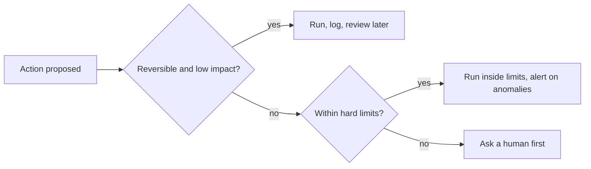

```callout-before
Before you start
This lesson pulls together the whole module. Everything so far said how agents fail; this lesson says how much freedom to give one given that it will sometimes fail.
```

A new employee does not get the company credit card on day one. They start by reading, then drafting, then sending routine messages, and only later approving spending, and each step up follows a track record. Nobody calls this distrust; it is how you match authority to demonstrated reliability while the cost of mistakes stays small.

An agent deserves the same ladder. The question is never "should the agent be autonomous?" but "for which actions, up to what impact, and with what checks?" A simple piece of arithmetic answers it.

## Expected loss

For any action the agent can take, let $e$ be the probability that the agent does it wrongly (wrong target, wrong amount, wrong moment) and $L$ the loss if it does. The expected loss per action is

$$
\mathbb{E}[\text{loss}] = e \cdot L
$$

Two actions can have the same expected loss for opposite reasons: a rarely wrong action with a huge loss and a frequently wrong one with a tiny loss. They call for different controls. The first needs prevention (approval, limits); the second can be left alone and monitored.

```steps
Worked example: a refund tool
The agent issues refunds. Measured error rate (wrong order, wrong amount): $e = 2\%$.
---
A 5-dollar refund: $\mathbb{E}[\text{loss}] = 0.02 \times 5 = 0.10$ dollars per action. Negligible; automate it.
---
An 80-dollar refund: $0.02 \times 80 = 1.60$ dollars per action. Nearly twenty times larger for the same error rate.
---
A 2,000-dollar refund: $0.02 \times 2{,}000 = 40$ dollars per action, and a single error is a real incident. The same agent, the same tool, very different treatment.
```

## The autonomy ladder

Autonomy is not a switch but a ladder, and each action sits on a rung according to its expected loss and how reversible it is:

| Level | Agent may | Typical actions |
|---|---|---|
| 0. Suggest | Propose; a human does it | Draft an email, suggest a refund |
| 1. Act with approval | Prepare the action; a human confirms each one | Send the email, issue a large refund |
| 2. Act within limits | Act alone inside hard limits; log everything | Refunds under 25 dollars, up to 10 an hour |
| 3. Act, then report | Act broadly; humans review afterwards | Low-impact, reversible internal edits |
| 4. Fully autonomous | Act with no per-action oversight | Rare; only for tightly sandboxed or fully reversible work |

Most production agents sit at levels 1 to 3 for different tools at once. Read-only tools are level 3 or 4; money-moving tools are level 1 or 2; destructive tools are level 0 or 1.



## What bounded means

Bounding has four ingredients, which the rest of the lesson takes in turn:

1. **Limits on effort**: steps, tokens, cost, time (next topic).
2. **Limits on authority**: what each tool may do and to whom (permission tiers).
3. **Humans at the right points**: approval where expected loss exceeds review cost.
4. **Containment**: sandboxes and rate limits, so that when something goes wrong the damage has a ceiling (the blast radius).

Each addresses a different failure. A runaway loop is an effort problem. A deleted production table is an authority problem. A fabricated refund amount is an approval problem. A compromised tool response that tries to exfiltrate data is a containment problem.

## In practice

Before writing any agent code, list every tool and fill in a table: tool name, what it can change, who is affected, whether it can be undone, estimated $e$ and $L$. The table decides each tool's rung. It will surprise you: tools that seemed harmless (an "update customer notes" tool that overwrites instead of appends) turn out to have an irreversible worst case, and tools that seemed scary (issue refund) turn out to be safe within a limit. Revisit the table whenever you add a tool, because the autonomy of the whole agent is set by its most dangerous tool.

```quiz
{"q": "An action has a 1% error rate and a 300-dollar loss when wrong. What is its expected loss per action?", "options": ["3 dollars", "0.30 dollars", "30 dollars", "300 dollars"], "answer": 0, "explain": "0.01 × 300 = 3 dollars per action. Multiply by the number of actions to see exposure: 1,000 such actions a day would be 3,000 dollars of expected daily loss."}
```

```quiz
{"q": "Which tool is best suited to full automation (no per-action approval)?", "options": ["A tool that permanently deletes records", "A read-only search tool over public documentation", "A tool that wires money to arbitrary accounts", "A tool that changes user permissions"], "answer": 1, "explain": "A read-only tool cannot change anything, so the loss from a wrong call is wasted time. The others are irreversible or privileged and need approval or strict limits."}
```
