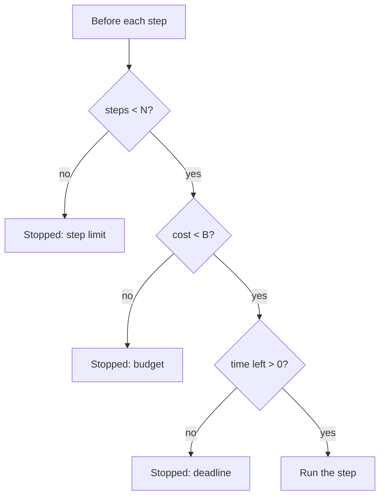

The cheapest safety feature an agent can have is a ceiling on how much it may do. A loop that cannot run more than $N$ steps, spend more than $B$ dollars or take longer than $D$ seconds has a worst case you can state in a sentence. Without ceilings, the worst case is whatever the cloud bill says at the end of the month.

A household electricity trip switch is the right image. It does not stop you using power; it cuts the circuit when the draw passes a level that normal use never reaches. A good agent limit does the same: it never fires in normal operation and always fires in a runaway.

## How bad can a runaway get

Recall from lesson 1 that input tokens grow quadratically with steps. With $c_0 = 5{,}000$ tokens, $\Delta = 1{,}500$ tokens per step and \$3 per million input tokens, the input cost of a run of $K$ steps is

$$
\text{cost}(K) = \frac{K c_0 + \Delta\,K(K-1)/2}{10^6} \times 3
$$

```steps
Worked example: the cost of a stuck agent
$K = 20$ (a long normal run): $20 \times 5{,}000 + 1{,}500 \times 190 = 100{,}000 + 285{,}000 = 385{,}000$ tokens, about \$1.16.
---
$K = 30$: $150{,}000 + 1{,}500 \times 435 = 802{,}500$ tokens, about \$2.41.
---
$K = 100$: $500{,}000 + 1{,}500 \times 4{,}950 = 7{,}925{,}000$ tokens, about \$23.78. Five times the steps cost twenty times as much as the normal run.
---
$K = 300$: about \$206 for a single stuck run. A hundred stuck runs in an incident is a five-figure bill, and the context would long since have overflowed any window, so in practice the run would fail, retry and repeat.
```

The quadratic term means that **step caps are also cost caps**, and that the tail matters far more than the typical run.

## Setting the numbers from data

Do not guess limits; measure them. Take the traces of successful runs and look at the distribution of steps, tokens, cost and time. A good starting point is to set each limit a modest margin above a high percentile of **successful** runs:

$$
\text{limit} = m \cdot P_{99}(\text{successful runs}), \qquad m \approx 1.5 \text{ to } 2
$$

If the 99th percentile of successful cost is \$1.16 (the 20-step run above), a cost limit of $1.5 \times 1.16 \approx \$1.73$ almost never cuts a healthy run and stops a runaway at about 24 steps' worth of spend. Repeat for steps, time and tokens. Tighten the limit as you learn more, or relax it for task types that legitimately need more.

| Limit | Guards against | Typical action when hit |
|---|---|---|
| Max steps | Loops, wandering | Stop, return partial result |
| Max tokens per run | Context bloat, huge observations | Compact if possible, else stop |
| Max cost per run | Runaway spend | Stop, alert if repeated |
| Wall-clock deadline | Slow dependencies, user abandonment | Return what is done so far |
| Max tool calls per tool | One tool being hammered | Disable that tool for the run |
| Per-user and per-day budgets | Abuse, many concurrent runaways | Reject new runs politely |

## Graceful ends

Hitting a limit should be a defined state, not a crash. The state machine from lesson 1 gets a transition to **Stopped** with a reason, and the final message comes from the state object: what was completed, what was not, and what the user can do. "I reached my limit before finishing. I verified the shipping address and the stock level, but could not confirm the payment" is far more useful than a blank screen, and it lets a human or a follow-up run pick up from there (checkpoints from the failures lesson).



Limits should be checked **before** each step, and cost limits should include the step about to run, so that a single huge call cannot overshoot far past the budget.

## In practice

Alert on limit hits, not just on the limits. A few hits a day is normal; a sudden climb means a tool broke or a prompt change confused the model. Enforce limits in the **orchestration code**, never in the prompt: telling a model "use at most 10 steps" is a request; a `for` loop with a cap is a guarantee. Finally, put the same ceilings on sub-agents individually, so that one stuck worker cannot consume the whole run's budget.

```quiz
{"q": "Successful runs have a 99th-percentile cost of 0.80 dollars. You set the cost limit at 1.5 times that. What is the limit?", "options": ["0.80 dollars", "1.20 dollars", "1.50 dollars", "2.40 dollars"], "answer": 1, "explain": "1.5 × 0.80 = 1.20 dollars. It leaves headroom above the 99th percentile so healthy runs are rarely cut off, while a runaway is stopped quickly."}
```

```quiz
{"q": "Why is a step limit also an effective cost limit?", "options": ["Because each step costs the same", "Because input tokens grow quadratically with steps, so capping steps caps the largest cost term", "Because models stop when cost is high", "It is not; they are unrelated"], "answer": 1, "explain": "Each call re-reads the growing history, so total input grows with K²; limiting K bounds that growth sharply. A stuck 100-step run costs about twenty times a 20-step run."}
```
