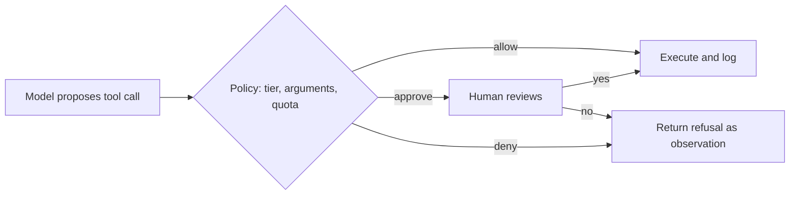

A hotel gives you a key card that opens your room, the gym and the lift to your floor. It does not open other rooms, the kitchen or the safe, even though you are a perfectly good guest. The card encodes **least privilege**: grant exactly the access the job needs and no more. If the card is lost or copied, the damage is bounded by what it could open.

An agent's tools are its key card. A model can be confused, manipulated by injected text in a web page, or just wrong. Whatever it is allowed to do, it may do at the worst possible moment, so what it is allowed to do should be sized for that moment.

## Four tiers

Group tools by what the worst misuse looks like:

| Tier | What it can do | Examples | Default policy |
|---|---|---|---|
| **0. Read-only** | Observe; change nothing | search docs, get_order, list_files | Allowed; rate-limit and log |
| **1. Reversible write** | Change state in a way that can be undone | add a note, draft an email, create a ticket | Allowed within limits; log with undo information |
| **2. Consequential write** | Change state with cost or hard-to-reverse effects | refund, send email to a customer, merge to main | Allowed only within hard limits, or with approval |
| **3. Privileged or destructive** | Delete data, change permissions, spend large sums, run arbitrary code | drop table, change roles, wire transfer | Human approval always, or not available to the agent at all |

Tier is a property of the **tool plus its arguments**, not the name alone. `update_record(id, notes)` is tier 1; `update_record(id, role="admin")` is tier 3. The policy should look at the arguments.

## Policy in code, not in the prompt

Put the policy in a function that every tool call passes through, between the model's request and the execution. The model proposes; the policy decides.

```python
TIERS = {"search_docs": 0, "get_order": 0, "add_note": 1, "refund_order": 2, "delete_account": 3}

def decide(tool: str, args: dict, ctx: dict) -> str:
    """Return 'allow', 'approve' (needs a human) or 'deny'."""
    tier = TIERS.get(tool)
    if tier is None:
        return "deny"                                   # unknown tools are denied by default
    if tier <= 1:
        return "allow"
    if tool == "refund_order":
        small = args["amount"] <= 25
        under_quota = ctx["refunds_this_hour"] < 10
        return "allow" if small and under_quota else "approve"
    return "approve" if tier == 2 else "deny"           # tier 3: not available without a human process

print(decide("get_order", {}, {}))                                                   # allow
print(decide("refund_order", {"amount": 10}, {"refunds_this_hour": 2}))              # allow
print(decide("refund_order", {"amount": 80}, {"refunds_this_hour": 2}))              # approve
print(decide("delete_account", {}, {}))                                              # deny
```

Three details matter. **Default deny**: an unknown tool or tier is refused, so adding a tool never silently grants power. **Argument-aware rules**: the amount decides between allow and approve. **Context-aware rules**: the quota uses the run's recent history, so many small refunds cannot add up to a large one.

## When approval pays: the break-even

A human review costs money and time. Review is worth it for an action when the expected loss it prevents exceeds the review cost. With error rate $e$, loss $L$, review cost $r$, and a reviewer who catches a fraction $c$ of the bad actions:

$$
\text{require approval if } \; c\,e\,L > r
$$

```steps
Worked example: the refund threshold
Error rate $e = 2\%$, careful reviewer catches $c = 90\%$ of errors, review cost $r = 0.50$ dollars (about 30 seconds of someone's time).
---
Break-even loss: $c\,e\,L = r$ gives $L^\star = r/(c\,e) = 0.50 / (0.90 \times 0.02) = 27.8$ dollars.
---
A 10-dollar refund: $0.9 \times 0.02 \times 10 = 0.18 < 0.50$. Review costs more than it saves; automate.
---
An 80-dollar refund: $0.9 \times 0.02 \times 80 = 1.44 > 0.50$. Review saves nearly three times what it costs; require approval.
---
So a threshold around 25 to 30 dollars is sensible, which is why the code above uses 25. Improve the agent's error rate to 0.5% and the break-even loss rises to $0.50/(0.9 \times 0.005) = 111$ dollars: **better reliability buys more autonomy**.
```

That last line is the link between this lesson and the rest of the module: every reliability improvement from the previous lessons (better tools, verification, retries) moves the thresholds in your favour, and the numbers tell you by how much.



## Credentials follow the same rule

The agent should never hold more credentials than its tools need. Give the order tool a database role that can read orders and nothing else, give the refund tool a payment-service token limited to refunds under a ceiling, and give each user's session that user's own permissions rather than a shared admin token. The policy function is one layer; the credentials are an independent second layer that holds even if the policy has a bug.

## In practice

Write the tier table down and review it like a security artefact, because it is one. Deny by default. Refuse in a way the model can use: the refusal text returned as an observation should say what was refused and why, and what the agent may do instead ("Refund of 80 dollars needs approval; request_approval is available"), as in the errors topic. And test the policy with adversarial inputs, such as arguments just under a threshold repeated many times, to see that the quota catches them.

```quiz
{"q": "Error rate 1%, reviewer catches 80% of errors, review cost 0.40 dollars. What is the break-even loss above which approval pays?", "options": ["50 dollars", "40 dollars", "32 dollars", "5 dollars"], "answer": 0, "explain": "L* = r / (c × e) = 0.40 / (0.80 × 0.01) = 50 dollars. Above that loss, the expected loss prevented by review exceeds its cost."}
```

```quiz
{"q": "Why should an unknown tool name be denied by default in the policy?", "options": ["Unknown tools are always malicious", "So that adding or misnaming a tool never silently grants new power", "To save tokens", "Because the model cannot call unknown tools anyway"], "answer": 1, "explain": "Default deny is fail-safe: a tool added without a tier assignment is refused until someone classifies it. The model can ask for a tool that does not exist or that was added by accident, so the policy must handle it."}
```
