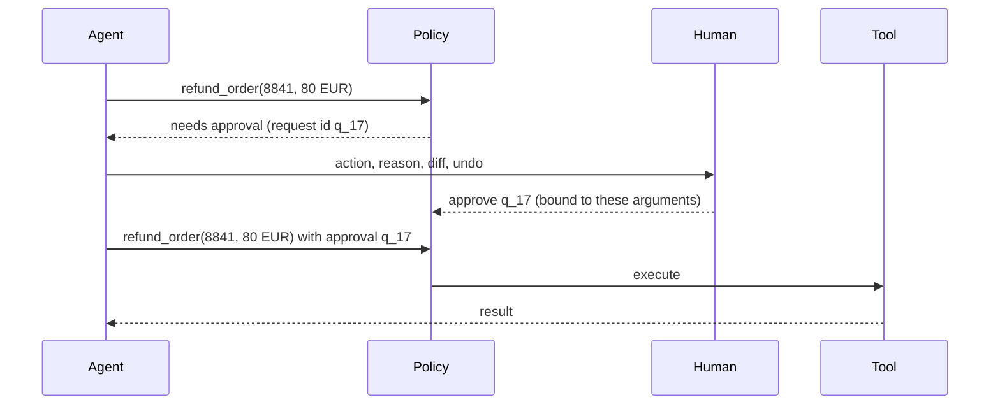

Putting a human in the loop sounds like the safe answer to everything. In practice an approval step is only as good as the attention behind it. A person who sees a hundred "Approve?" prompts a day, 99 of which are fine, soon clicks yes without reading. At that point you have the cost and delay of a human check and almost none of the protection.

A pilot's pre-flight checklist works because it is short, specific and tied to a moment that matters. A form that asks "Is everything OK? Yes/No" thirty times does not. The design goal for approval is the same: ask rarely, ask about the right things, and make the right answer easy to find.

## What an approval request should show

The reviewer needs to decide in seconds. A good request contains:

1. **The action in plain words**: "Refund 80.00 EUR to the card ending 4417 for order 8841."
2. **Why the agent wants to**: one or two lines of reasoning with the evidence ("order delivered 3 days late; policy section 4.2 allows a full refund").
3. **What will change**, as a diff or before and after: balances, records, recipients.
4. **How to undo it**, if it can be undone.
5. **Clear choices**: approve, reject with a reason that goes back to the agent, or edit the arguments.

A request that says only "The agent wants to call refund_order. Approve?" forces the reviewer to reconstruct the context themselves, which they will not do.

## Approval fatigue, quantified

Say the agent generates $n$ approval requests a day and a fraction $b$ of them are genuinely bad. A careful reviewer catches a fraction $c_\text{careful}$ of the bad ones; a fatigued reviewer, clicking through, catches a lower fraction $c_\text{tired}$. Bad requests caught per day is $n\,b\,c$.

```steps
Worked example: 200 requests a day, 2% bad
Bad requests per day: $200 \times 0.02 = 4$.
---
A careful reviewer who catches 90%: $4 \times 0.9 = 3.6$ bad actions stopped.
---
A fatigued reviewer who catches 40%: $4 \times 0.4 = 1.6$ stopped; $2.4$ bad actions go through despite the "human in the loop".
---
Now raise the automation threshold so that only the 100 highest-impact requests a day reach a human. Suppose the 100 trivial ones filtered out contain almost no bad actions, so all 4 bad requests sit among the 100 reviewed (a 4% bad share), and attention recovers to an 85% catch rate because each request now matters: $4 	imes 0.85 = 3.4$ stopped. That is better than the tired reviewer's 1.6, at half the review cost.
```

The moral is not "automate more" or "review more", but **send humans the requests where their attention is worth the most**: the high-impact, high-uncertainty ones. That is what the break-even rule from the last topic selects.

## Reviewer throughput

Approvals have a capacity limit. If a reviewer handles a request in $t$ seconds, one person completes $3600/t$ requests an hour. With $t = 30$ s that is 120 an hour. If the agent produces $n = 1{,}000$ actions a day and 12% need review, that is 120 reviews, or one hour of a reviewer's time: tractable. If 60% needed review, it would be 600 reviews, five hours a day, and the queue becomes a bottleneck that either delays users or pressures reviewers to rush. Always compute the review load before choosing thresholds.

$$
\text{reviewer hours per day} = \frac{n \cdot \text{(share needing review)} \cdot t}{3600}
$$

For the numbers above: $1000 \times 0.12 \times 30 / 3600 = 1.0$ hour.

## Other design points

- **Asynchronous approval.** The agent does not wait with the user watching a spinner for a human; it checkpoints (failures lesson), tells the user "I've asked a colleague to approve this refund", and resumes when the answer arrives.
- **Timeouts on requests.** An approval that sits for three days is probably stale. Expire it, and have the agent re-check the facts before acting on a late approval.
- **Approvals bind to specific arguments.** An approval for "refund 80 EUR on order 8841" must not authorise 800 EUR or another order. Sign or hash the approved arguments and check the match at execution.
- **Rejections are information.** Feed the rejection reason back to the agent as an observation so it can adapt; log it for evaluation.
- **Audit trail.** Record who approved what, when, and what they saw.



## In practice

Measure your approval flow like any other system: volume, approval rate, time to decision, and how often reviewers reject. An approval rate of 100% over thousands of requests is a warning, not a success: either those requests did not need review (raise the threshold) or reviewers are not looking. Spot-check by occasionally inserting a known-bad request and seeing whether it is caught; this tells you the real catch rate $c$ that feeds back into the break-even calculation.

```quiz
{"q": "An agent generates 600 actions a day. 15% need human review, taking 40 seconds each. How many reviewer hours per day is that?", "options": ["1.0 hour", "1.5 hours", "1.0 minute", "4.0 hours"], "answer": 0, "explain": "600 × 0.15 = 90 reviews; 90 × 40 s = 3,600 s = 1.0 hour."}
```

```quiz
{"q": "A reviewer has approved 3,000 consecutive requests without a single rejection. What is the most sensible conclusion?", "options": ["The agent is perfect", "Either the threshold sends too many easy cases or reviewers have stopped reading; test with a known-bad request", "Approval should be removed entirely", "The reviewer deserves a bonus"], "answer": 1, "explain": "A 100% approval rate is more likely a sign of low-value requests or fatigue than of a perfect agent. Inserting a known-bad request measures whether anyone is actually checking."}
```
