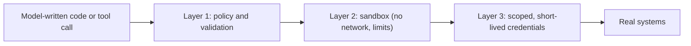

Some agents run code: a coding assistant executes tests, a data agent runs a Python snippet it wrote, a browser agent clicks around the real web. Code written by a model is code nobody has reviewed, executed with whatever authority the surrounding process has. Even without malice, a model can write `rm -rf` into the wrong directory or loop forever allocating memory. With a prompt injection in a web page, it can write something actively hostile.

A **sandbox** is a box in which such code can do its worst without reaching anything that matters. A chemistry lab does the same with a fume cupboard: you still run the reaction, but the fire stays inside the cupboard.

## What a sandbox restricts

| Resource | Restriction | Failure it prevents |
|---|---|---|
| Filesystem | A scratch directory only; the rest read-only or invisible | Deleting or reading files outside the task |
| Network | No access by default; allow-list specific hosts if needed | Data exfiltration, calling internal services |
| CPU time | A per-execution limit (say 10 s) | Infinite loops |
| Memory | A hard cap (say 512 MB) | Allocation bombs |
| Processes | A cap on children, no privilege escalation | Fork bombs, escaping the box |
| Credentials | None inside the sandbox, or short-lived and narrowly scoped | Stolen secrets |
| Lifetime | Created per run (or per step), destroyed afterwards | State leaking between users and runs |

Typical implementations are containers with resource limits and dropped capabilities, lightweight virtual machines, or language-level isolates. The tool you choose matters less than the discipline: **default deny, explicit grants, destroy after use**. Treat the sandbox boundary as the thing that must hold, since everything inside it is assumed hostile.

## Layers multiply protection

No single control is perfect, so you stack independent ones. Say an attempted harmful action must pass three layers and each stops it with probability $s_i$. If the layers fail independently, the attack gets through only if **all** miss:

$$
P(\text{blocked}) = 1 - \prod_{i=1}^{m} (1 - s_i)
$$

```steps
Worked example: three layers
Layer 1, the tool policy, blocks 70% of harmful actions: $s_1 = 0.7$. Layer 2, the sandbox with no network, blocks 80% of what gets past: $s_2 = 0.8$. Layer 3, scoped credentials, block 90% of what remains: $s_3 = 0.9$.
---
Probability all three miss: $(1-0.7)(1-0.8)(1-0.9) = 0.3 \times 0.2 \times 0.1 = 0.006$.
---
Blocked: $1 - 0.006 = 0.994$, or 99.4%, from three layers that are each only 70 to 90% effective.
---
The caveat is independence. If one flaw defeats two layers at once (for example, the policy and the sandbox both trust the same unvalidated path string), the product no longer holds. Choose layers that fail for different reasons: a rule in code, a kernel-level isolation boundary, and a credential the attacker never sees.
```

This is the same arithmetic as compounding reliability turned upside down: there, every step must succeed, so reliability multiplies down; here, every layer must fail for harm to occur, so safety multiplies up. It is why defence in depth works and why one clever prompt is never a defence.



## A simple execution wrapper

```python
import subprocess, tempfile, sys, os

def run_snippet(code: str, timeout_s: int = 5) -> dict:
    """Run untrusted Python in a throwaway directory with a time limit.
    (Illustration only: real isolation needs a container or VM, not just a subprocess.)"""
    with tempfile.TemporaryDirectory() as scratch:
        try:
            r = subprocess.run([sys.executable, "-I", "-c", code], cwd=scratch,
                               capture_output=True, text=True, timeout=timeout_s)
            return {"ok": r.returncode == 0, "stdout": r.stdout[-2000:], "stderr": r.stderr[-2000:]}
        except subprocess.TimeoutExpired:
            return {"ok": False, "stdout": "", "stderr": f"timed out after {timeout_s} s"}

print(run_snippet("print(sum(range(10)))"))
print(run_snippet("while True: pass", timeout_s=1))
```

The first call returns `ok: True` and `45`; the second is stopped after one second. Output is truncated so a huge result cannot flood the context, and the scratch directory vanishes afterwards. This is a **teaching sketch**: a plain subprocess still shares your network and filesystem permissions, so it does not satisfy the table above. In production you would run the same wrapper inside a container with no network, read-only mounts, memory limits and a non-privileged user.

## In practice

Test the sandbox the way an attacker would: have the agent (or a script) try to read `~/.ssh`, reach the internal metadata endpoint, write outside the scratch directory, fork repeatedly and allocate gigabytes. Each attempt should fail and be logged. Keep sandbox images minimal and rebuild them regularly. And remember what the sandbox does **not** cover: anything the agent can do through a tool that calls out to real systems is governed by the policy and credentials layers, not by the box.

```quiz
{"q": "Three independent layers block 60%, 75% and 90% of harmful actions respectively. What fraction gets through all three?", "options": ["1%", "10%", "0.1%", "40%"], "answer": 0, "explain": "(1−0.6)(1−0.75)(1−0.9) = 0.4 × 0.25 × 0.1 = 0.01, so 1% get through and 99% are blocked. The layers multiply because harm needs every layer to fail."}
```

```quiz
{"q": "Why can two layers that both validate the same user-supplied path string provide much less protection than the product formula suggests?", "options": ["The formula assumes independent failures; one bug in path handling can defeat both layers at once", "Path strings are always safe", "Layers cannot share data", "The formula only applies to three layers"], "answer": 0, "explain": "The product (1−s₁)(1−s₂) assumes the layers fail independently. A single shared flaw makes their failures perfectly correlated, so the real protection is closer to one layer's."}
```
