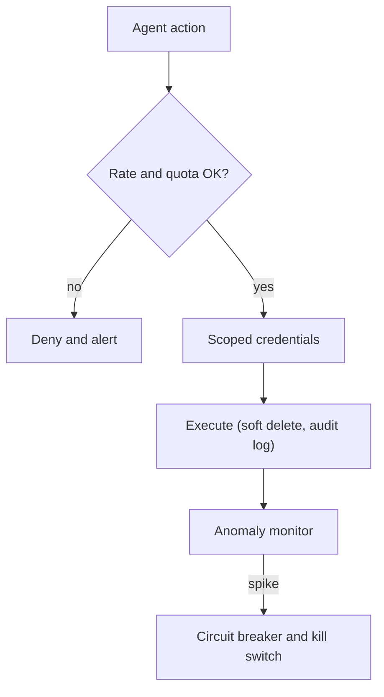

Every safeguard so far reduces the **chance** of harm. The last design question is different: when something goes wrong anyway, how much damage can it do before someone notices? That quantity is the **blast radius**, and good designs make it small by construction, so that even a badly misbehaving agent has a ceiling on what it can break.

Ships have watertight compartments for this reason. They do not assume the hull will never be breached; they make sure that a breach floods one compartment and not the whole vessel. An agent's compartments are rate limits, quotas, scoped credentials and kill switches.

## Bounding the worst case with rate limits

If an action has a maximum single impact $L_\text{max}$ and the agent may perform it at most $\rho$ times per hour, then the worst-case damage in a window of $T$ hours before intervention is

$$
\text{worst case} \le \rho\,T\,L_\text{max}
$$

```steps
Worked example: refunds
Policy: refunds are auto-approved only up to 25 dollars ($L_\text{max} = 25$) and at most $\rho = 10$ per hour.
---
Worst case in one hour: $10 \times 1 \times 25 = 250$ dollars. If the agent has gone completely wrong, the damage is capped at 250 dollars an hour.
---
Without the rate limit, a compromised agent processing 2 refunds a second would do $2 \times 3600 \times 25 = 180{,}000$ dollars in an hour: seven hundred times worse.
---
Add a daily cap of 1,000 dollars: even if nobody looks for 24 hours, the worst case is $\min(10 \times 24 \times 25, 1000) = \min(6{,}000, 1{,}000) = 1{,}000$ dollars.
---
If your alerting notices anomalies within 15 minutes, the realistic worst case before a human intervenes is about $10 \times 0.25 \times 25 = 62.50$ dollars. **Detection time is part of the blast radius.**
```

The same structure works for any resource: emails sent per hour, records modified per run, files deleted, API calls made, dollars of cloud spend. Choose limits so that the worst case is an annoyance and not an incident. You can reuse the token-bucket limiter from the production-systems module for exactly this: a bucket that refills slowly and holds a small burst.

## Containment techniques

| Technique | What it bounds |
|---|---|
| Rate limits and quotas (per run, user, day) | Volume of actions |
| Scoped credentials | Which systems and records are reachable |
| Per-tenant isolation | One customer's agent cannot touch another's data |
| Dry-run mode | Agent proposes changes; a diff is shown before anything is applied |
| Soft delete and versioning | Reversibility; mistakes can be undone |
| Kill switch | A single control that stops all agent actions or one tool immediately |
| Circuit breaker | Automatically disables a tool or the agent when error or anomaly rates spike |
| Full audit log | Reconstruction of what happened, for recovery and learning |

Two of these deserve emphasis. **Reversibility** shrinks the loss $L$ in the expected-loss formula: if a deleted record can be restored from a soft-delete table, a mistake costs minutes, not data. A **kill switch** shrinks the time window: if operators can stop the agent in seconds, the $T$ in the worst-case formula is small. Test it. A kill switch nobody has ever pressed is a hope, not a control.



## Try it: the support agent

The sandbox scenario below is a customer-support agent that looks up orders and policies before answering. It combines several ideas from this module: a step budget, per-step reliability and a tool with a failure rate.

```sandbox
support-agent
```

Work through three experiments. First, run it as given and note the success rate and latency. Second, raise the number of agent steps and see how success falls (the $p^n$ effect) while latency and cost rise. Third, add retries to the agent and compare the improvement against the extra calls it costs. After each change, ask what limit you would put on this agent in production: how many steps, what budget, and which of its actions would you require approval for.

## A pre-launch checklist

- Every tool has a tier, an error rate estimate and a worst-case impact written down.
- Limits on steps, tokens, cost and time are set from measured successful runs and enforced in code.
- Policy is in code with default deny; credentials are scoped to the tool's real needs.
- Approval requests show the action, reason, diff and undo, and are bound to the approved arguments.
- Code execution happens in a sandbox with no network by default.
- Rate limits and quotas bound the worst case per hour and per day; alerts fire within minutes.
- A kill switch exists and has been tested; a circuit breaker disables misbehaving tools.
- Traces are recorded for every run, and failed runs feed a regression set.

## In practice

Run a "red team" session before launch: give people an hour to make the agent do something it should not, using injection in documents, tricky user requests and odd tool outputs. Every successful attack becomes a new test and, usually, a tighter limit or a new default-deny rule. Then launch narrow: a small share of traffic, low-tier tools only, and widen as the trace data shows the error rates you assumed. Autonomy should be earned in steps, exactly as for the new employee at the start of this lesson.

```quiz
{"q": "Refunds are limited to 30 dollars each and 8 per hour. A kill switch can stop the agent within 10 minutes of an alert. What is the worst-case loss before intervention, assuming the limit is hit continuously and ignoring detection delay before the alert?", "options": ["About 40 dollars", "240 dollars", "30 dollars", "About 5,760 dollars"], "answer": 0, "explain": "In 10 minutes (1/6 hour) the agent can issue 8 × (1/6) ≈ 1.33 refunds, so at most about 1.33 × 30 = 40 dollars. A full hour would be 240 dollars; 5,760 would be a whole day at the hourly limit."}
```

```quiz
{"q": "Which change reduces blast radius without reducing the chance of an error?", "options": ["A better prompt", "Soft-deleting records so mistakes can be restored", "A larger model", "More tools"], "answer": 1, "explain": "Reversibility lowers the loss when an error occurs. The other options aim to make errors less likely (or add capability), but do nothing about how bad an error is."}
```
