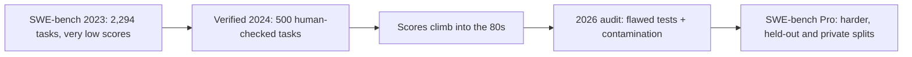

**SWE-bench** asks an agent to do a real software engineer's job: here is a repository and a GitHub issue, change the code so the issue is fixed. It became the most quoted agent benchmark of 2024 and 2025, and its history (launch, cleanup, saturation, retirement) is the clearest case study of how agent benchmarks work and how they wear out.

It is like grading apprentice plumbers by giving them real leak reports from real houses and checking afterwards, with a pressure test, whether the leak is gone and nothing else started leaking.

## How a task is graded

Each task comes from a real merged pull request that fixed an issue. The pull request's tests are split into two groups:

- **FAIL_TO_PASS**: tests that failed before the fix and pass after it. They check that the issue is actually solved.
- **PASS_TO_PASS**: tests that passed before and must still pass. They check that nothing else broke.

```steps
One SWE-bench task, end to end
Setup: a container with the repository at the commit just before the real fix. The agent sees the issue text and the code, but not the tests that will grade it.
---
Agent works: reads files, runs commands, edits code, perhaps writes its own tests. It produces a patch.
---
Harness applies the patch to a fresh copy and runs the FAIL_TO_PASS and PASS_TO_PASS tests.
---
Resolved only if the patch applies and every test in both groups passes. The score is the percentage of tasks resolved.
```

This is **outcome grading**: the agent can take any route; only the final state of the code matters.

## Version 1: hard and noisy

The original SWE-bench (2023) had 2,294 tasks from 12 popular Python repositories. At publication the best model resolved 1.96%. As scores rose, people noticed that some tasks were close to impossible regardless of skill: the issue text did not specify what the tests checked, or the tests demanded one particular implementation.

## Verified: human cleanup

In August 2024, OpenAI and the SWE-bench authors released **SWE-bench Verified**: professional developers reviewed samples from the original set for underspecified issues, unfair tests and broken environments, and kept 500 tasks judged solvable and fairly tested. At launch GPT-4o resolved 33.2% with an open-source scaffold. Over the following year and a half, scores on Verified climbed steeply, into the 70s and then low 80s.

## Retirement: flawed tests and contamination

In February 2026 OpenAI announced it would stop reporting SWE-bench Verified. Its audit focused on the problems models kept failing (27.6% of the set) and found that at least 59.4% of those had tests that reject functionally correct solutions. It also reported signs that frontier models had seen the tasks during training, which is hard to avoid when every task comes from a public repository with a public fix.

## The maths: a hidden ceiling

If a fraction $f$ of tasks cannot be passed by a correct solution, the best achievable score is about $1 - f$, and a model that truly solves a fraction $t$ of the fair tasks scores

$$
\text{score} \approx t \cdot (1 - f)
$$

From the audit's figures, at least $0.276 \times 0.594 = 0.164$ of all Verified tasks had such flawed tests, so the practical ceiling sat around $1 - 0.164 = 0.836$. Reported state of the art had moved from 74.9% to 80.9% in the preceding six months. Near a ceiling of about 84%, a further 2-point gain could reflect better engineering, lucky matches to idiosyncratic tests, or memorised fixes, and the score cannot tell you which. Add sampling noise: on 500 tasks at 80%, $\text{SE} = \sqrt{0.8 \times 0.2 / 500} = 0.018$, a 95% interval of about $\pm 3.5$ points.

## Pro: harder, partly private

OpenAI recommended **SWE-bench Pro** (Scale AI, 2025) as the replacement: 1,865 problems from 41 actively maintained repositories, including multi-file, long-horizon changes, split into a public set, a held-out set and a commercial set drawn from private codebases. Held-out and private tasks are the main defence against contamination. Scores at release were far lower than on Verified; note that the paper's own abstract changed between versions as new results came in, a reminder to cite the version you read.



## In practice

Read SWE-bench-family numbers as evidence about autonomous bug-fixing in Python-heavy open-source code, not about your codebase. Check which variant (original, Lite, Verified, Pro public, Pro commercial), which scaffold, and how many attempts. For your own coding agent, build a small private set from your repositories' past fixed issues, using exactly this FAIL_TO_PASS / PASS_TO_PASS design: it is cheap and it measures what you care about.

```quiz
{"q": "A patch makes all FAIL_TO_PASS tests pass but breaks one PASS_TO_PASS test. Is the task resolved?", "options": ["Yes, the issue is fixed", "No, resolution requires every test in both groups to pass", "Partially, it gets half credit", "Only if a judge agrees"], "answer": 1, "explain": "PASS_TO_PASS tests guard against regressions. A fix that breaks existing behaviour is not accepted, just as a code reviewer would reject it. SWE-bench has no partial credit."}
```

```quiz
{"q": "If 15% of a benchmark's tasks have tests that reject correct solutions, and an agent truly solves 90% of the fair tasks, roughly what score will it get?", "options": ["90%", "About 76.5%", "About 85%", "75%"], "answer": 1, "explain": "Score ≈ t(1 − f) = 0.90 × 0.85 = 0.765. 85% is the ceiling a perfect agent could reach, not this agent's score."}
```
