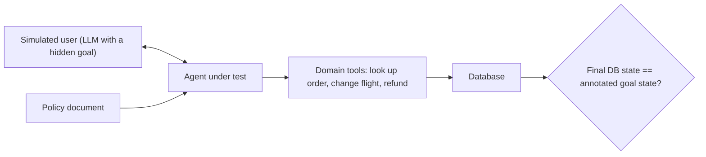

Coding benchmarks hand the agent a task and wait. Customer-facing agents work differently: the task unfolds through a conversation, the user reveals details a bit at a time, and the agent must follow a company policy while it uses tools. **τ-bench** (tau-bench, from Sierra, 2024) was built to test exactly this, and it introduced the reliability metric **pass^k** that is now widely used for agents.

Think of a mystery-shopper programme for a call centre. Trained actors phone in with scripted problems, the agent handles them with the real systems, and afterwards an auditor checks the account records: was the right booking changed, the right refund issued, and nothing else?

## How τ-bench works



- **Domains**: retail and airline in the original; τ²-bench (2025) added telecom.
- **Simulated user**: a language model plays the customer, given a goal and personal details it reveals only when asked, like a real caller.
- **Policy**: the agent must obey rules ("basic economy cannot be changed", "verify identity before refunds").
- **Grading**: compare the database at the end of the conversation with the annotated goal state. Talking well does not count; the right records must exist and nothing forbidden may have been done.

The headline finding at release: even strong function-calling agents succeeded on fewer than half the tasks, and were inconsistent: in retail, pass^8 was under 25%.

## Why pass^k, and how it is estimated

A customer-facing agent is used again and again. The question is not "can it solve this task once?" but "will it solve it **every time**?". pass^k is the probability that all $k$ independent trials of a task succeed. It is estimated per task from $n \ge k$ trials with $c$ successes, then averaged over tasks:

$$
\widehat{\text{pass}^k} = \frac{1}{T}\sum_{t=1}^{T} \frac{\binom{c_t}{k}}{\binom{n}{k}}
$$

The [pass@k and pass^k](/learn/agents/traces-and-evaluation/pass-at-k-and-pass-power-k) topic derives the formulas; here is why averaging per task matters for reading τ-bench results.

```steps
Same pass^1, very different reliability
Agent A succeeds on every task with probability 0.8. pass^1 = 0.8; pass^4 = $0.8^4 = 0.41$.
---
Agent B solves 80% of tasks every time and 20% never. pass^1 = $0.8 \times 1 + 0.2 \times 0 = 0.8$.
---
B's pass^4 = $0.8 \times 1^4 + 0.2 \times 0^4 = 0.8$. Its failures are predictable: route those 20% of task types to a human.
---
A's failures are random: any customer can be failed on any day. Same headline number, very different product. τ-bench's pass^k curve, falling with $k$, exposes the difference.
```

```sim
pass-at-k
{"p": 0.8, "k": 8}
```

With per-attempt success 0.8 and $k = 8$, compare passAtK (nearly 1) with passHatK (about 0.17). Raise $p$ to 0.95 and see pass^8 only reach about 0.66. Reliability at high $k$ needs per-trial success very close to 1.

## Dual control and simulator caveats

τ²-bench's telecom domain gives the **user** tools too: the customer must toggle a setting or restart a device when the agent asks. Performance dropped sharply when agents had to guide a user through actions rather than act alone, which matches real support work.

Simulated users are a strength and a weakness. They make conversational tasks repeatable and cheap. But the simulator can make mistakes (reveal the wrong detail, give up early), and those count against the agent. Part of any measured failure rate is simulator error, so read small differences between agents with caution and inspect failed transcripts before drawing conclusions.

## In practice

Copy τ-bench's design for your own support or operations agent: a policy document, sandboxed tools over a test database, a user simulator with hidden goals, and grading by database state. Run each task 4 to 8 times and report pass^1 and pass^k together. A large gap between them tells you to work on consistency (temperature, clearer policies, verification steps) rather than capability.

```quiz
{"q": "A task was run 6 times with 4 successes. What is the unbiased pass^2 estimate for that task?", "options": ["0.444", "0.400", "0.667", "0.933"], "answer": 1, "explain": "C(4,2)/C(6,2) = 6/15 = 0.40. Plugging p̂ = 4/6 into p² gives 0.444, which is biased upwards. 0.933 is pass@2."}
```

```quiz
{"q": "Why does τ-bench grade by comparing the final database state with a goal state rather than judging the conversation?", "options": ["Conversations are private", "What matters for the customer is what actually changed in the systems; a polite conversation that issues the wrong refund is a failure", "Judges are too expensive", "The simulated user cannot read the conversation"], "answer": 1, "explain": "Outcome grading checks the real effect, including forbidden side effects, and is objective. A judge reading the transcript could be swayed by fluent text and miss a wrong write."}
```
