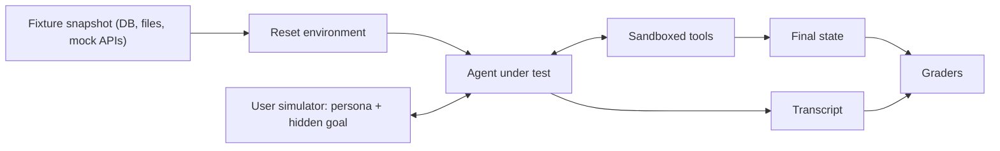

Most agents do not run in one shot. They talk to a person, call tools that change things, and read results that depend on what they did before. To evaluate that repeatably you need two pieces of infrastructure: a **simulated user** that plays the human side of the conversation, and an **environment** (tools plus data) that can be reset to a known state before every trial. τ-bench, WebArena and OSWorld are all built this way; your own agent eval should be too.

Flight simulators are the model. A pilot is not tested on a real flight with real passengers; the simulator recreates the cockpit, the weather and the air-traffic controller's voice, starts every session from the same conditions, and records everything.

## The harness



**Environment.** Every tool the agent can call has a sandboxed version backed by fixture data: a test database, a mock email server, a container with the repository. Before each trial the harness restores the snapshot. Anthropic's agent-evals guide stresses this isolation: shared state between trials (a file left over, a record already refunded) causes correlated failures or inflated scores that have nothing to do with the agent.

**User simulator.** A language model given a **persona** (tone, patience, how much they know), a **hidden goal** and private details it reveals only when asked. Its instructions must stop it from solving the task for the agent ("never tell the agent which tool to use") and tell it when to end the conversation.

| Persona dimension | Values to vary |
|---|---|
| Clarity | States everything up front / reveals details only when asked |
| Temperament | Patient / impatient / upset |
| Knowledge | Knows order number / does not |
| Behaviour | Changes mind mid-way / asks off-topic questions |
| Language | English / Spanish / mixed |

Vary these deliberately; a simulator that is always clear and patient makes every agent look good.

## The maths: simulator error is measurement error

The simulator is part of your measuring instrument, and it makes mistakes: it forgets a detail, contradicts its goal or ends the conversation early. If it derails a fraction $e$ of conversations, causing failures the agent could not prevent, and the agent's true success with a well-behaved user is $s$:

$$
\text{measured success} \approx s \cdot (1 - e)
$$

```steps
How much does a sloppy simulator cost?
True success $s = 0.85$, simulator derails $e = 0.05$ of conversations. Measured success $= 0.85 \times 0.95 = 0.8075$, about 81%.
---
Comparing two agents with true 0.85 and 0.88, the simulator scales both by 0.95: measured 0.808 and 0.836. The gap shrinks from 3 to 2.85 points, and the derailments add random noise on top.
---
Estimate $e$ directly: have a person review 100 simulated conversations and mark the ones where the simulator, not the agent, went wrong. 6 of 100 gives $\hat e = 0.06$ with $\text{SE} = \sqrt{0.06 \times 0.94 / 100} = 0.024$.
---
Fix the simulator's prompt until $e$ is small, then exclude or re-run trials flagged as simulator errors when you report agent success.
```

Tasks where the user must act too (restart the router, approve a payment), as in τ²-bench's dual-control setting, are harder for agents and for simulators alike; give the simulated user its own sandboxed tools and check its state as well.

## Fixtures versus live tools

| | Recorded fixtures / mocks | Live tools in a staging environment |
|---|---|---|
| Determinism | High: same input, same output | Lower: data and services change |
| Cost and speed | Cheap and fast | Slower, may cost money |
| Catches tool changes | No | Yes |
| Use for | CI gates, regression suites | Nightly or pre-release end-to-end runs |

Use both: deterministic fixtures for fast gates, a smaller live suite to catch the cases fixtures cannot.

## In practice

Version the fixtures, the simulator prompt and the simulator model together with the task set, since changing any of them changes scores. Run the simulator with a different model from the agent where possible, so they do not share blind spots. Spot-check simulated conversations every time you change the simulator, exactly as you calibrate a judge.

```quiz
{"q": "An agent's true success is 0.90. The user simulator derails 8% of conversations. What success will you measure?", "options": ["About 0.83", "0.90", "About 0.82", "0.98"], "answer": 0, "explain": "0.90 × (1 − 0.08) = 0.828. The simulator's errors show up as agent failures unless you detect and exclude them."}
```

```quiz
{"q": "Two trials of the same refund task run back to back without resetting the database. What can go wrong?", "options": ["Nothing; the agent is the same", "The second trial sees the first trial's refund already applied, so it may fail or pass for reasons unrelated to the agent's skill", "The database becomes faster", "The simulator stops working"], "answer": 1, "explain": "Shared state couples trials: results become correlated and can be inflated or deflated. Restoring the fixture before each trial keeps them independent."}
```
