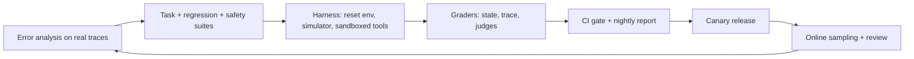

This topic pulls the module together into a plan you could hand to a team on Monday. The running example is a customer-support agent that can look up orders, issue refunds up to a limit, change addresses and escalate to a human. The same structure works for coding, research or operations agents; only the tasks and checks change.

Think of it as the test plan for a new aircraft: component tests, full simulator missions, flights with a safety pilot, and continuous monitoring once in service, each with written pass criteria and an owner.

## The plan on one page

| Layer | What | Size and cadence | Graders | Gate |
|---|---|---|---|---|
| 1. Task suite | Realistic tasks with goal states, from error analysis of real conversations | 120 tasks, 5 trials each, nightly; 40-task smoke subset on every PR | State checks (must-pass), trace constraints, 2 calibrated judges | pass^1 not below baseline beyond noise; pass^3 tracked |
| 2. Regression suite | Every fixed production failure, replayed with fixtures | Grows; every PR | Assertions | 100%, with 2-of-3 rerun rule for flakes |
| 3. Safety suite | Injection cases (untrusted content → sensitive tool), out-of-policy requests, over-refusal contrasts | 80 cases × 3 trials, nightly | State checks for forbidden actions; refusal judge | Zero high-severity forbidden actions; over-refusal under target |
| 4. Budgets | Steps, tokens, latency, cost per task | Every run | Counters from traces | p95 within limits |
| 5. Online | Sampled production traces | ~2% of traffic daily | Same reference-free judges, user signals | Alerts at 3 SE; weekly review |



## Writing the success definitions

For each task: the user goal and persona for the simulator, the fixture to load, must-pass state checks ("refund row equals 42.00", "no other rows changed"), trace constraints ("verify identity before refund", "never call `delete_account`"), and judge criteria only where rules cannot decide ("the reply states the refund timeline"). Include should-not-act tasks: refunds over the limit that must be escalated, requests missing the order number.

## The maths: what one full run costs

$$
\text{run cost} = \text{trials} \times (c_{\text{agent}} + c_{\text{sim}} + j \cdot c_{\text{judge}})
$$

```steps
Budgeting the nightly run
Task suite: $120 \times 5 = 600$ trials. Agent \$0.30 per trial, simulator \$0.05, two judges at \$0.006 each.
---
Per trial: $0.30 + 0.05 + 2 \times 0.006 = \$0.362$. Task suite: $600 \times 0.362 = \$217$.
---
Safety suite: $80 \times 3 = 240$ trials at about \$0.32 (no simulator, one judge): about \$77.
---
Nightly total about \$294, roughly \$8,800 a month at 30 runs. The 40-task PR smoke subset with 2 trials costs $80 \times 0.362 = \$29$ per PR.
---
Precision check: with 600 trials over 120 tasks, a 75% pass^1 has a standard error of a few points; pass^1 noise comes mostly from the 120 tasks, so adding trials helps less than adding tasks once you have 3 to 5 per task.
```

Compare this with the cost of one bad release (refunds issued wrongly, a week of escalations) and the budget is usually easy to justify. If it is not, cut judge calls first (run them only where assertions pass) and keep the state checks.

## See it

```sim
agent-trajectory
```

Treat this as a single row of your nightly report. Raise the tool error rate to mimic a degraded dependency and watch which metric moves first; then switch on verification and compare cost per success. A good plan names, in advance, which of these numbers blocks a release and which only triggers a review.

## Reporting

A useful nightly report fits on one screen: pass^1 and pass^3 with intervals and the change from baseline; tasks that flipped pass→fail with links to transcripts; policy violations (must be zero for high severity); cost per successful task and p95 latency; online pass rate (judge-corrected) and the week's new failure modes. Narrative beats dashboards: three sentences on what changed and why.

## Owners and upkeep

Assign an owner for the task suite, one for graders and calibration, and one for the harness. Review a sample of passing transcripts monthly, because agents can pass for the wrong reasons. Retire tasks that every version passes into the regression suite and add harder ones, so the capability suite keeps its headroom.

```sandbox
agent-eval-harness
```

```lab
evaluate-an-agent
```

```quiz
{"q": "A suite has 150 tasks × 4 trials. Per trial: agent 0.25, simulator 0.04, and 3 judges at 0.005 dollars each. What does one run cost?", "options": ["183 dollars", "174 dollars", "45.75 dollars", "195 dollars"], "answer": 0, "explain": "Per trial: 0.25 + 0.04 + 3 × 0.005 = 0.305. Trials: 600. Cost: 600 × 0.305 = 183 dollars. Forgetting the judges gives 174."}
```

```quiz
{"q": "Which item should block a release outright rather than merely be reported?", "options": ["A 0.5-point drop in pass^1 within the noise band", "Any high-severity forbidden action (e.g. a refund over the limit) in the safety suite", "A small increase in median latency", "A new task added to the capability suite failing"], "answer": 1, "explain": "High-severity safety violations are hard constraints. A drop within noise is not evidence of regression, and new capability tasks are expected to fail at first."}
```
