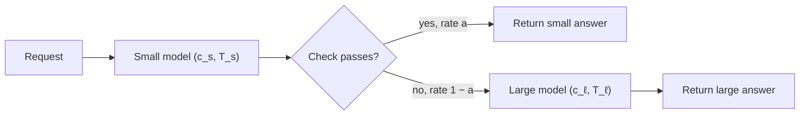

A **cascade** sends every request to a cheap model first. A check then decides whether that answer is good enough. If it is, you return it. If not, you **escalate**: call the large model and return its answer instead. It is how a help desk works: a first-line agent handles what they can and passes the hard tickets up.

The check can be the small model's own confidence (for example the average log-probability of its answer), a separate scoring model, a validator (does the JSON parse, does the code compile, do the cited sources exist) or a rule. Whatever it is, it produces one number for the system: the **acceptance rate** $a$, the fraction of requests answered by the small model alone.

## Expected cost

Every request pays for the small model. Only the escalated fraction $(1-a)$ also pays for the large one:

$$
\mathbb{E}[c] = c_s + (1 - a)\, c_\ell
$$

where $c_s$ is the cost of a small-model call and $c_\ell$ the cost of a large-model call (add the cost of the check if it is a separate model). With $c_s = \$0.001$, $c_\ell = \$0.010$ and $a = 0.7$:

$$
\mathbb{E}[c] = 0.001 + 0.3 \times 0.010 = 0.001 + 0.003 = \$0.004
$$

Large-only costs \$0.010, so the cascade saves 60%.

**When does a cascade pay at all?** It is cheaper than large-only exactly when

$$
c_s + (1-a)c_\ell < c_\ell \iff c_s < a\, c_\ell \iff a > \frac{c_s}{c_\ell}
$$

With a 10× price gap, the small model only needs to handle more than $0.001/0.010 = 10\%$ of traffic to break even. With a 2× gap it must handle more than half. Cascades shine when the price gap is large.

## Expected quality

Quality is a weighted average of two groups. Let $q_{\text{acc}}$ be the small model's pass rate on the requests it accepted, and $q_{\ell,\text{esc}}$ the large model's pass rate on the escalated ones:

$$
Q = a\, q_{\text{acc}} + (1-a)\, q_{\ell,\text{esc}}
$$

The escalated requests are the hard ones, so $q_{\ell,\text{esc}}$ is lower than the large model's overall score. Suppose $q_{\text{acc}} = 0.94$ and $q_{\ell,\text{esc}} = 0.85$:

$$
Q = 0.7 \times 0.94 + 0.3 \times 0.85 = 0.658 + 0.255 = 0.913
$$

Against a large-only score of $0.92$, you give up 0.7 points of quality for a 60% cut in cost. Whether that is a good trade is a product decision; the maths makes it explicit.

## Expected latency, and the tail

Escalated requests wait for both models in sequence:

$$
\mathbb{E}[T] = T_s + (1-a)\, T_\ell
$$

With $T_s = 0.8$ s and $T_\ell = 2.5$ s: $\mathbb{E}[T] = 0.8 + 0.3 \times 2.5 = 1.55$ s, faster on average than large-only. But the 30% of escalated users wait $0.8 + 2.5 = 3.3$ s, slower than large-only. A cascade improves the mean and hurts the tail: with 30% of requests escalated, the p95 and p99 are both escalated requests. If your SLO is on p95 latency, check that number directly.



## See it

```sim
model-cascade
```

Move the confidence threshold up and watch three things together: the share answered by the small model falls, cost rises toward large-only, and quality rises. Find the threshold where quality stops improving noticeably: that knee is usually where you want to operate. Then push the threshold very low and watch quality drop as the small model's wrong answers get through.

## In practice

The check is the whole game. A check that accepts confidently wrong answers silently lowers quality, and nobody notices because the system still returns something. Measure $q_{\text{acc}}$ directly on a labelled sample of accepted requests every week; do not assume it from the threshold. Validators that check structure (schema, citations, tests) are the most trustworthy checks because they do not depend on the model's opinion of itself.

```quiz
{"q": "Small calls cost \\$0.002 and large calls \\$0.010. The small model's answer is accepted 50% of the time. What is the expected cost per request?", "options": ["\\$0.007", "\\$0.006", "\\$0.005", "\\$0.012"], "answer": 0, "explain": "E[c] = c_s + (1 − a)c_ℓ = 0.002 + 0.5 × 0.010 = \\$0.007. \\$0.006 is what routing half the traffic to each model would cost; a cascade also pays the small call on every escalated request."}
```

```quiz
{"q": "Small calls cost \\$0.004 and large calls \\$0.010. What acceptance rate must the cascade exceed to be cheaper than calling the large model alone?", "options": ["40%", "60%", "4%", "25%"], "answer": 0, "explain": "The break-even is a > c_s/c_ℓ = 0.004/0.010 = 0.4. Below 40% acceptance, the extra small call on every request costs more than the escalations it avoids. 60% confuses a with 1 − a."}
```
