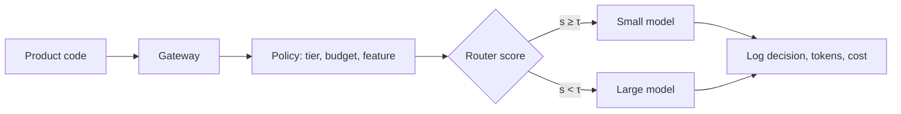

In a real system, routing lives in a **gateway**: one service that every LLM call passes through. Product code asks the gateway for "a summary of this ticket" and the gateway decides which model, which prompt version and which provider serve it. Centralising the decision means routing rules, budgets, fallbacks and logging are written once, not copied into every feature.



## Routing signals

Routers combine cheap signals before reaching for a learned score:

| Signal | Example rule | Why it works |
|---|---|---|
| Feature | classification and extraction go small | narrow tasks need less capability |
| Length | prompts over 20,000 tokens go to a long-context model | a capability limit, not difficulty |
| Customer tier | free tier always small | cost policy |
| Learned score | $s(x) \ge \tau$ goes small | difficulty prediction |
| Budget state | tenant over 90% of monthly budget goes small | spend control |

## Blended cost across tiers

Policies interact, so compute the blended cost. Suppose 80% of traffic is free tier, always served by the small model at \$0.001, and 20% is paid tier using the router from earlier at \$0.0047 per request:

$$
\mathbb{E}[c] = \sum_k w_k\, c_k = 0.8 \times 0.001 + 0.2 \times 0.0047 = 0.0008 + 0.00094 = \$0.00174
$$

where $w_k$ is the share of traffic in tier $k$ and $c_k$ its cost per request. At 3 million requests a month that is $3 \times 10^6 \times 0.00174 = \$5{,}220$, against \$30,000 if everything went to the large model. The weighted sum is the tool you will reuse for every mixed policy.

## Pin everything

A routing decision is only reproducible if you know exactly what served the request. Pin the **model version** (a dated snapshot rather than a moving alias such as "latest"), the **prompt version** and the **router version**, and log all three with every request. When quality drops on a Tuesday, the first question is "what changed?", and you can only answer it if the gateway recorded it.

```callout-warn
Moving aliases
If you call a model through an alias that the provider repoints to a new snapshot, your quality, cost and output length can change overnight with no deploy on your side. Use dated versions in production and upgrade deliberately, through the rollout process later in this module.
```

## A quality floor for the router

Because a router trades quality for cost, protect quality with a floor:

- Keep a **holdout** of about 1–5% of traffic that always goes to the large model, so you keep measuring what routing costs in quality.
- Sample routed-small responses for grading every day and alert if their pass rate falls below the level you measured offline.
- Let users or downstream validators trigger re-routing: a "regenerate" click on a small-model answer can be retried on the large model.

With a 2% holdout on the paid tier, the holdout traffic costs \$0.010 instead of \$0.0047, so the extra spend is $0.02 \times (0.010 - 0.0047) = \$0.000106$ per paid request: a small price for a continuous measurement.

## Practise

The lab gives you a traffic sample, two models and a quality floor, and asks you to find the cheapest routing policy that meets it. The sandbox lets you wire a router into a gateway and watch cost and quality as traffic changes.

```lab
route-the-traffic
```

```sandbox
model-router
```

```quiz
{"q": "90% of traffic costs \\$0.002 per request and 10% costs \\$0.020. What is the blended cost per request?", "options": ["\\$0.0038", "\\$0.0110", "\\$0.0020", "\\$0.0200"], "answer": 0, "explain": "0.9 × 0.002 + 0.1 × 0.020 = 0.0018 + 0.0020 = \\$0.0038. \\$0.011 is the unweighted average of the two prices, which ignores that most traffic is cheap."}
```

```quiz
{"q": "Quality dropped overnight and nobody deployed anything. What is the most likely cause to check first?", "options": ["The provider repointed a moving model alias to a new snapshot", "The router threshold changed by itself", "Token prices went up", "The evaluation set got harder"], "answer": 0, "explain": "With no deploy on your side, an upstream change is the prime suspect, and a moving alias makes that possible silently. Logging the exact model version with every request lets you confirm it in minutes. Price changes affect cost, not answer quality."}
```
