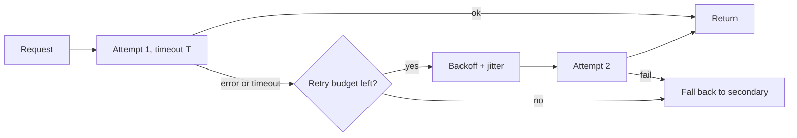

A fallback cannot start until you know the primary has failed. Errors tell you immediately; **hangs** do not. A request that neither succeeds nor fails just sits there, and the only way to turn it into a failure is a **timeout**: a limit on how long you will wait before giving up and trying something else.

## Choosing a timeout

Too short and you abandon requests that would have succeeded, paying for them twice. Too long and your users wait, and in-flight requests pile up. Look at the latency distribution of *successful* requests and set the timeout a little above its tail. Suppose measurements show:

| Percentile | Latency |
|---|---|
| p50 | 0.8 s |
| p95 | 2.0 s |
| p99 | 3.5 s |

A timeout of 4 s abandons well under 1% of healthy requests. A timeout of 2 s would abandon about 5% of them, each one then repeated on the fallback at extra cost. Because output length varies, many teams use a **streaming** time-to-first-token timeout (for example 2 s) plus a total timeout (for example 30 s) instead of one number.

## Failover time

When the primary hangs with probability $p$, the user pays the whole timeout $T$ before the fallback even starts. Let $L_1$ be the primary's normal latency, $L_2$ the fallback's latency:

$$
\mathbb{E}[T_{\text{total}}] = (1 - p)\,L_1 + p\,(T + L_2)
$$

With $p = 0.02$, $L_1 = 0.8$ s, $T = 3$ s and $L_2 = 1$ s:

$$
\mathbb{E}[T_{\text{total}}] = 0.98 \times 0.8 + 0.02 \times (3 + 1) = 0.784 + 0.08 = 0.864 \text{ s}
$$

The mean barely moves, which hides the problem. Because 2% of requests are slow, which is more than 1%, the **p99** is about $T + L_2 = 4$ s, five times the median. The tail is where timeouts hurt, and tail latency, not the mean, is what users complain about.

```sim
fallback-availability
{"timeoutMs": 3000, "primaryP50": 800}
```

Move the timeout from 3,000 ms down to 1,000 ms and note how the failover time falls but healthy requests start timing out. Then raise it to 8,000 ms and see the tail latency grow.

## Retries and amplification

For transient errors, retrying the same provider often works. Use **exponential backoff with jitter**: wait roughly $b \cdot 2^{k}$ seconds before retry $k$, with a random factor so that clients do not retry in lockstep. Retries are dangerous when layered. If each of $d$ layers of your stack makes up to $m$ attempts, a single user request can create up to

$$
m^{d} \text{ attempts at the bottom layer}
$$

With 3 attempts at each of 3 layers (client, gateway, SDK), that is $3^3 = 27$ calls to a provider that is already struggling: a **retry storm**. Two defences are standard:

- retry in **one** layer only, usually the gateway;
- use a **retry budget**: allow retries only up to 10% of recent first-attempt traffic. If 1,000 requests per second arrive, at most 100 retries per second are sent, however many fail.



## In practice

Respect the `Retry-After` header on a 429 and never retry non-idempotent actions blindly: a model call is safe to repeat, but a tool call that sends an email is not. The agents module covered idempotency keys for exactly this reason. Log every retry and every failover with a reason, because a rising retry rate is the earliest sign of a provider problem.

```quiz
{"q": "3% of requests hang and are cut off by a 3 s timeout, after which a 1 s fallback answers. The normal latency is 0.8 s. About what is the p99 latency?", "options": ["About 4 s", "About 0.8 s", "About 3 s", "About 1 s"], "answer": 0, "explain": "More than 1% of requests take timeout + fallback = 3 + 1 = 4 s, so the 99th percentile lands in that group. The mean (about 0.9 s) hides it, which is why you track percentiles."}
```

```quiz
{"q": "Your client, gateway and SDK each retry up to 4 attempts. What is the maximum number of calls one user request can send to the provider?", "options": ["64", "12", "16", "4"], "answer": 0, "explain": "Layered retries multiply: 4 × 4 × 4 = 64. Adding them (12) is the common mistake. Retrying in only one layer, with a budget, keeps the worst case at 4."}
```
