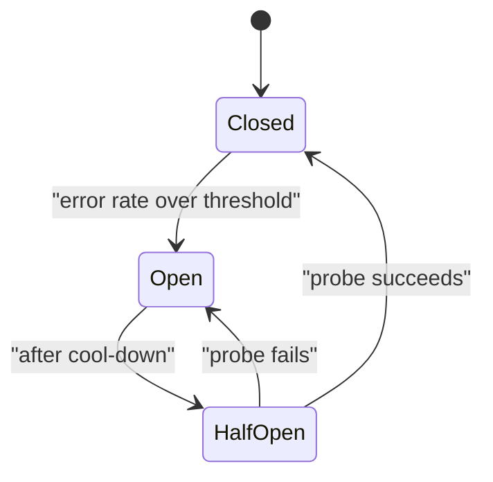

When a dependency is failing, the worst thing you can do is keep calling it. Every request waits for the timeout, workers pile up behind the slow calls, and soon your own service is down because it ran out of threads or connections, even though the fault was elsewhere. A **circuit breaker** is a small state machine that notices failure and starts failing fast, just like the electrical breaker that trips to protect the house.

## The three states



- **Closed**: normal operation. Calls pass through; the breaker counts successes and failures in a sliding window.
- **Open**: calls to the failing dependency are rejected immediately (or sent to the fallback) without trying. After a **cool-down** period the breaker moves on.
- **Half-open**: a small number of **probe** requests are let through. If they succeed, the breaker closes; if they fail, it opens again.

A typical rule: open when, in the last 20 or more requests, the error rate exceeds 50%. Keep the cool-down short at first (10 to 30 seconds) and back it off if probes keep failing.

## Why failing fast saves you: Little's law

**Little's law** says that the average number of requests in flight $N$ equals the arrival rate $\lambda$ times the average time each spends in the system $W$:

$$
N = \lambda\, W
$$

Take $\lambda = 100$ requests per second. Healthy, each request takes $W = 0.8$ s, so $N = 100 \times 0.8 = 80$ requests in flight. Now the provider hangs and every call waits for a 5 s timeout: $N = 100 \times 5 = 500$ in flight, more than six times as many. If your service can hold 300 connections or workers, it is exhausted in seconds and starts failing for everyone, including features that never use the LLM.

With an open breaker, calls fail in about 5 ms, or go to a fallback that answers in 1 s: $N = 100 \times 1 = 100$. Your service survives, and the problem stays confined to the one feature.

| Situation | Time per request $W$ | In flight $N = \lambda W$ at 100 req/s |
|---|---|---|
| Healthy | 0.8 s | 80 |
| Provider hangs, no breaker (5 s timeout) | 5 s | 500 |
| Breaker open, fallback answers | 1 s | 100 |
| Breaker open, fast failure | 0.005 s | 0.5 |

## Bulkheads and load shedding

Two companions to the breaker keep failures contained:

- A **bulkhead** gives each dependency its own pool of workers, so one slow provider can only exhaust its own pool. Ships have bulkheads for the same reason.
- **Load shedding** rejects low-priority work early when the system is overloaded, so high-priority requests still finish. Free-tier or background batch calls shed first.

## Tuning

The breaker should trip on **signals that matter to the user**: timeouts, 5xx and 429 responses, and also quality signals such as an abnormal rate of malformed outputs. Do not count client errors such as 400 (your bug, not the provider's). Set a **minimum request count** before judging the error rate, otherwise 1 failure out of 2 requests opens the breaker at 50%. Alert whenever a breaker opens: it is a cheap, accurate incident detector.

## In practice

Teams usually keep one breaker per **provider and model** pair, not per process, because a global state needs shared storage. Per-instance breakers are simpler and good enough: each instance learns about the outage within a few seconds. Test the breaker with a fault-injection tool that makes the provider time out, and verify that the half-open probes do not themselves create a thundering herd: send one probe, not hundreds.

```quiz
{"q": "Arrival rate is 50 requests per second. A provider outage makes every call wait for a 6 s timeout. How many requests are in flight on average?", "options": ["300", "50", "8.3", "56"], "answer": 0, "explain": "Little's law: N = λW = 50 × 6 = 300. Without a breaker, a hang multiplies in-flight work by the timeout; dividing 50 by 6 inverts the formula."}
```

```quiz
{"q": "A breaker opens when the error rate exceeds 50%, with no minimum request count. The service has just restarted and the first request fails. What happens?", "options": ["The breaker opens after one failure out of one request, wrongly", "Nothing, 100% is not over 50%", "The breaker waits for the half-open state", "The request is retried indefinitely"], "answer": 0, "explain": "1 failure out of 1 is a 100% error rate, so the breaker trips on a sample of one. A minimum request count (for example 20) prevents flapping on noise."}
```
