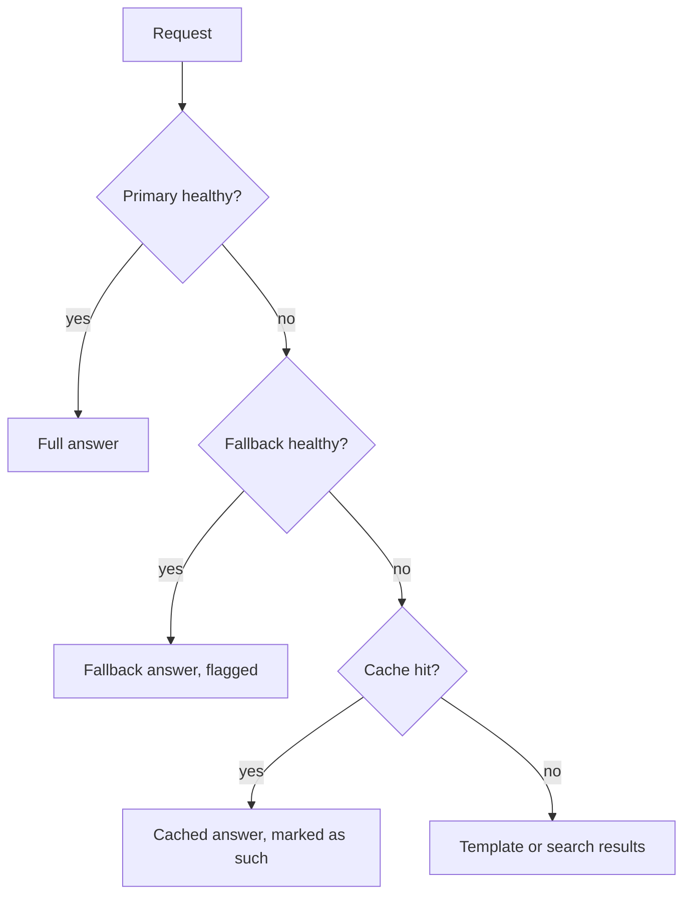

Fallbacks answer "what if the primary is down?" **Graceful degradation** answers the bigger question: "what is the most useful thing we can still do for the user?" Instead of a binary working/broken switch, you design a **ladder** of modes, each cheaper and more robust than the one above, and step down only as far as you must.

## A degradation ladder

| Rung | Mode | Quality | What it needs |
|---|---|---|---|
| 1 | Primary model, full context | 100% | primary provider |
| 2 | Fallback model on a second provider | about 90% | second provider |
| 3 | Smaller or self-hosted model, shorter context | about 75% | own capacity |
| 4 | Cached or precomputed answer for the same question | varies | cache |
| 5 | Non-LLM path: search results, template, FAQ link | about 40% | your own code |
| 6 | Honest error with a next step ("try again, or contact us") | 0% | nothing |

The bottom rungs depend on as few external systems as possible. A static "we are having trouble, here is a link" message has availability close to your web server's, regardless of any model provider.

## Expected quality

Weight each rung's quality by the share of requests it serves. Say the primary is up 99.5% of the time (quality 1.0). When it is down, the fallback (99% available, quality 0.9) serves the request; when both are down, a template answers with quality 0.2. Assuming independence:

$$
Q = A_1 \cdot 1.0 + (1 - A_1)A_2 \cdot 0.9 + (1 - A_1)(1 - A_2) \cdot 0.2
$$

where $A_1 = 0.995$ and $A_2 = 0.99$ are the availabilities from earlier. Plugging in:

$$
Q = 0.995 + 0.005 \times 0.99 \times 0.9 + 0.005 \times 0.01 \times 0.2 = 0.995 + 0.004455 + 0.00001 = 0.999465
$$

The system delivers 99.95% of full quality on average, while user-visible failures are only $(1 - A_1)(1 - A_2) = 0.005\%$ of requests, and even those get a template, not a stack trace. The point is not the average. It is that the worst case has been designed.

## Decide what to degrade



Degrade the features in order of how little users miss them:

1. **Optional enrichments** first: suggestions, citations, rewriting, personalization.
2. **Context size**: drop to fewer retrieved chunks or a shorter history, which cuts both latency and load.
3. **Model quality**: smaller or cheaper model.
4. **Capability**: read-only answers instead of actions, answers without tools.

Never degrade **safety**: if a guardrail service is down, the default for risky features is to fail closed (refuse or hand to a human), not to skip the check. The guardrails lesson covers this trade-off.

## Be honest with users and with yourself

Tell the user when they are on a degraded path (a short banner such as "limited mode, answers may be less detailed"), and tag every response in your logs with the rung that produced it. Otherwise a quiet slide down the ladder looks like "the model got worse" and nobody can find the cause.

## Practise

The provider-outage sandbox takes the primary down while traffic keeps arriving. Watch which rung is serving, how latency and cost move, and where your configuration is brittle.

```sandbox
provider-outage
```

## In practice

Write the ladder down per feature, and test each rung during game days, because the rung you never tested is the one that fails at 3 a.m. Set an alert on the **share of traffic below rung 1**, not just on errors: a system running at rung 3 all week has no errors and a lot of unhappy users.

```quiz
{"q": "Which should be degraded first when the system is overloaded?", "options": ["Optional enrichments such as suggestions", "The safety classifier", "The user's authentication", "The audit log"], "answer": 0, "explain": "Enrichments are the cheapest features to lose. Skipping safety checks, authentication or audit logging trades a visible slowdown for a hidden and much worse failure."}
```

```quiz
{"q": "Rung 1 serves 98% of traffic at quality 1.0, rung 2 serves 1.5% at quality 0.8, and rung 3 serves 0.5% at quality 0.2. What is the expected quality?", "options": ["0.993", "0.667", "1.0", "0.98"], "answer": 0, "explain": "0.98 × 1.0 + 0.015 × 0.8 + 0.005 × 0.2 = 0.98 + 0.012 + 0.001 = 0.993. The 0.667 option is the unweighted mean of the three qualities, ignoring how little traffic reaches the bottom rungs."}
```
