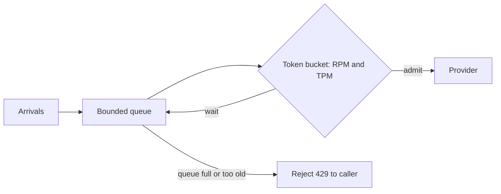

LLM providers apply rate limits to you, usually on two dimensions at once: **requests per minute** (RPM) and **tokens per minute** (TPM). Whichever you hit first is the binding limit. A limit is a token bucket too: the refill is the per-minute allowance, spread over time, and the capacity is a burst allowance.

Many providers count tokens at admission time using an **estimate**: your prompt tokens plus the `max_tokens` you asked for, because they must reserve room for the longest possible answer before they know how long it will be. When the real answer is shorter, the reservation is released afterwards. This has a practical consequence: an over-generous `max_tokens` uses up your quota even if the model never writes that much.

## Which limit binds?

The number of requests per minute you can sustain is the smaller of the two limits:

$$
\lambda_{\max} = \min\!\left(\text{RPM},\; \frac{\text{TPM}}{n_{\text{in}} + n_{\max}}\right)
$$

where $n_{\text{in}}$ is the average input tokens and $n_{\max}$ the `max_tokens` setting that is reserved per request. Take $\text{RPM} = 100$, $\text{TPM} = 200{,}000$, $n_{\text{in}} = 2{,}000$ and $n_{\max} = 1{,}000$:

$$
\frac{200{,}000}{2000 + 1000} = 66.7 \text{ requests per minute} \;<\; 100
$$

So TPM binds, and the sustainable rate is about 66 requests per minute. If the model's real answers average 400 tokens and you lower `max_tokens` to 500:

$$
\frac{200{,}000}{2000 + 500} = 80 \text{ requests per minute}
$$

A single configuration change raised throughput by 20% at no cost. Cutting the prompt to 1,000 tokens with $n_{\max} = 500$ gives $200{,}000/1500 = 133$, now above the RPM cap, so RPM binds at 100.

| $n_{\text{in}}$ | $n_{\max}$ | TPM-bound rate | Binding limit (RPM = 100) | Sustainable |
|---|---|---|---|---|
| 2,000 | 1,000 | 66.7 | TPM | 66 |
| 2,000 | 500 | 80 | TPM | 80 |
| 1,000 | 500 | 133 | RPM | 100 |

## Handling a 429

When you exceed a limit the provider returns **HTTP 429** (too many requests), often with a `Retry-After` header. The correct client response is:

1. Wait at least the advised time, with jitter.
2. Retry within a retry budget, as in the fallbacks lesson.
3. If the limit persists, shed or degrade traffic instead of retrying harder.

## Queueing when demand exceeds supply

If arrivals $\lambda$ stay above the admitted rate $\mu$, a queue grows without bound. Suppose demand is 90 requests per minute but only 66 are admitted: the backlog grows by $90 - 66 = 24$ per minute, and the wait for a newly arrived request after $t$ minutes is about

$$
W(t) = \frac{(\lambda - \mu)\, t}{\mu}
$$

minutes. After 10 minutes: $24 \times 10 / 66 \approx 3.6$ minutes of waiting. Queues turn a rate limit into latency and then timeouts. A bounded queue with a timeout is the right design, so excess load is rejected promptly rather than waiting forever.



## Prioritise inside your limit

Your quota is shared by every feature. A background summarisation job should not starve live chat. Give the gateway separate buckets (or priority queues) per feature, with interactive traffic first, and let batch work use leftover capacity or a cheaper asynchronous batch API. Ask for a higher limit before you need it: provider limit increases take days.

## In practice

Estimate tokens before sending, with the tokenizer, so that your gateway can shape traffic locally instead of discovering the limit through 429s. Track your **limit utilisation** (the share of RPM and TPM used at peak). Above about 70% sustained, you have no headroom for a launch or a retry wave.

```quiz
{"q": "RPM = 500 and TPM = 300,000. Requests average 1,500 input tokens and reserve max_tokens = 500. What is the sustainable request rate per minute?", "options": ["150", "500", "200", "300"], "answer": 0, "explain": "TPM-bound rate = 300,000/(1,500 + 500) = 150, below the RPM limit of 500, so TPM binds. 500 reads only the RPM limit."}
```

```quiz
{"q": "Which change most directly raises throughput when the TPM limit binds and answers are much shorter than max_tokens?", "options": ["Lower max_tokens to a realistic value", "Increase the number of retries", "Add a second API key from the same account", "Raise the temperature"], "answer": 0, "explain": "The reservation is n_in + max_tokens per request, so shrinking an unrealistic max_tokens frees quota. Extra retries consume more of the limit, and keys on the same account typically share it."}
```
