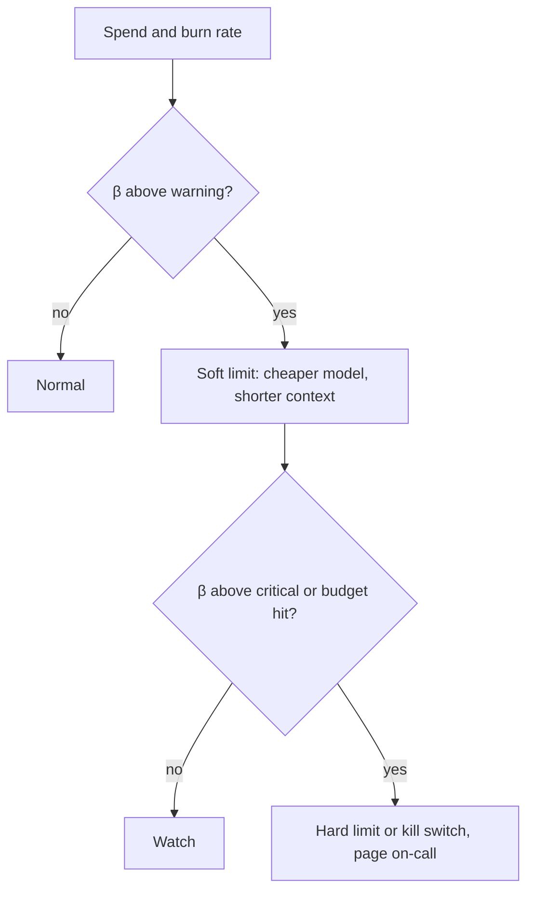

A monthly invoice is a terrible alarm: by the time it arrives the money is gone. LLM bills are unusual because a single bug (an agent stuck in a loop, a retry storm, a prompt accidentally including a whole database) can spend a month's budget in a night. You need alarms that fire in minutes, and a way to stop the spending when they do.

## Burn rate

The **burn rate** compares how fast you are spending with how fast the budget allows:

$$
\beta = \frac{S(t)/t}{B/T}
$$

where $S(t)$ is spend so far after $t$ days, $B$ is the budget for the period and $T$ its length in days. $\beta = 1$ means you are on track; $\beta = 2$ means you will exhaust the budget in half the period. Suppose a \$30,000 monthly budget ($T = 30$) and \$14,000 spent by day 10:

$$
\beta = \frac{14{,}000 / 10}{30{,}000/30} = \frac{1400}{1000} = 1.4
$$

At that pace the month ends at $1400 \times 30 = \$42{,}000$, and the budget runs out on day $30{,}000/1400 \approx 21.4$. Alert on burn rate, not on the raw total: a fixed "alert at \$25,000" fires too late when spending is steep and too early when it is not.

| Alert | Condition | Action |
|---|---|---|
| Info | spend reaches 50% of budget before day 15 | notify owner |
| Warning | $\beta > 1.2$ over 24 hours | page business hours |
| Critical | $\beta > 3$ over 1 hour | page on-call, consider kill switch |
| Budget exhausted | spend at 100% | automatic limit takes effect |

## Detecting anomalies quickly

Compare the latest hour's spend with the same hour on previous days, using the mean $\mu$ and standard deviation $\sigma$ of those values:

$$
z = \frac{x_{\text{now}} - \mu}{\sigma}
$$

If last week's 14:00 spend was \$40, \$44, \$38, \$42, \$46 on weekdays then $\mu = 42$ and $\sigma \approx 3.2$. An hour at \$120 gives $z = (120 - 42)/3.2 \approx 24$: no judgement needed, something is wrong. A threshold of $z > 4$ catches real incidents without paging for noise. Alert separately on **tokens per request** and **requests per user**: they show whether a spike is more traffic or a prompt blow-up.

## Runaway loops

An agent that retries a failing step forever shows how fast it goes wrong. Say each step sends an 8,000-token context at \$3 per million input tokens: $8000 \times 3/10^6 = \$0.024$ per step. A stuck run that loops 200 times costs $200 \times 0.024 = \$4.80$. If 1,000 users hit the same bug in an hour, that is \$4,800 in one hour from one defect. Per-request and per-run caps stop it at the source:

- a **maximum number of steps** and a **maximum token budget** per agent run;
- a **maximum output length** on every call;
- a per-user daily token cap;
- **idempotent de-duplication** so the same failing job is not retried endlessly.

## Soft limits, hard limits and the kill switch

A **soft limit** notifies and optionally degrades (route to a cheaper model, disable non-essential features). A **hard limit** refuses further calls once reached. A **kill switch** is a manual control that disables a feature or a whole route instantly, without a deploy: a feature flag the on-call can flip from a phone.



Decide in advance what a hard limit does. For a free feature, refusing is fine. For a paid customer's core workflow, hard-stopping on a budget bug is an outage. Often the answer is a high hard cap that is far above normal plus a lower alert, so you hear about it long before anything is refused.

## In practice

Use the provider's own spend limits as a last line of defence, but do not rely on them as the first: they are account-wide, coarse and often delayed. Per-feature and per-tenant budgets in your gateway are what let you stop one problem without taking down everything. Rehearse the kill switch: a switch nobody has flipped is a switch nobody trusts.

```quiz
{"q": "A \\$60,000 monthly budget (30 days). Spend is \\$26,000 after 10 days. What is the burn rate?", "options": ["1.3", "0.43", "2.6", "1.0"], "answer": 0, "explain": "β = (26,000/10)/(60,000/30) = 2,600/2,000 = 1.3. The 0.43 figure divides the spend by the budget alone (26,000/60,000) and ignores how much of the period has passed."}
```

```quiz
{"q": "Why alert on tokens per request in addition to total spend?", "options": ["It separates a prompt blow-up from a traffic increase", "It is cheaper to compute than spend", "Providers require it", "It replaces the need for a kill switch"], "answer": 0, "explain": "Spend rising can mean more users or much longer prompts or loops. Tokens per request isolates the second cause, which points to a bug rather than growth. It does not replace the ability to stop spending."}
```
