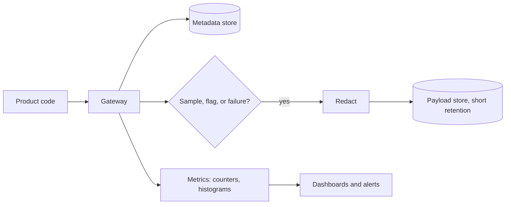

```callout-before
Before you start
No monitoring tools are assumed. If you know that a log is a line of structured data written when something happens, and that you can count and average such lines, you can follow everything here.
```

When a user says "the assistant gave me a strange answer yesterday", you need to answer three questions within minutes. What exactly was sent to the model? What came back? What else was going on at the time? **Observability** is the practice of recording enough about every request that those questions have answers. For LLM systems that means more than for ordinary APIs, because the same code can behave differently when a prompt, a model version or the retrieved context changes.

## A request record

One structured record per model call, written by the gateway, is the foundation:

| Field | Example | Why you need it |
|---|---|---|
| `request_id`, `trace_id` | `r-8f2a`, `t-19c0` | join logs, traces, user reports |
| `timestamp`, `tenant`, `feature` | 2026-10-25T14:03:11Z | slice by who and what |
| `model`, `model_version` | `large-2026-08-01` | find regressions from a model change |
| `prompt_version`, `router_version` | `support-v14`, `r3` | find regressions from your own changes |
| `input_tokens`, `output_tokens`, `cached_tokens` | 1500, 300, 1000 | compute cost exactly |
| `ttft_ms`, `total_ms` | 410, 6380 | latency percentiles |
| `status`, `finish_reason` | `ok`, `stop` / `length` | errors, truncation |
| `retries`, `fallback_used` | 0, false | hidden reliability cost |
| `guardrail_flags` | `["pii_redacted"]` | safety decisions |
| `cost_usd` | 0.0063 | spend by feature and tenant |

Notice what is **not** in the table: the prompt and the answer text. Those are the most useful and the most dangerous fields, because they may contain personal data. Store them separately, with stricter access, shorter retention and redaction, or sample them (next section). The privacy lesson in this module returns to this.

## How much does it cost to log?

Log volume is a straightforward multiplication. With $N$ requests per day and an average record size of $s$ bytes, daily storage is $N \cdot s$. Metadata-only records of about 1 KB at 1 million requests a day:

$$
10^6 \times 1\,\text{KB} = 1\,\text{GB per day}, \qquad 30 \text{ days} = 30\,\text{GB}
$$

Full payload records are far bigger: a 1,500-token prompt and a 300-token answer is about $1800 \times 4 \approx 7$ KB of text, so about 8 KB with metadata. Storing every one for 30 days is $10^6 \times 8\,\text{KB} \times 30 = 240$ GB. Sampling 5% of payloads cuts that to 12 GB, and still gives 50,000 examples a day, far more than any person will read.

```steps
Decide a logging policy
Always log the metadata record for 100% of requests. It is small and has no user text.
---
Log full prompt and answer for a 5% random sample, plus 100% of failures, low-rated answers and guardrail hits. Those are the cases you will investigate.
---
Redact before storage: names, emails, phone numbers and account numbers are replaced with typed placeholders.
---
Set retention separately: metadata 13 months for trend analysis, payloads 14 to 30 days.
---
Restrict access: payload logs need a named reason and are audited. Metadata is open to engineers.
```

## Tokens and prompts as first-class metrics

Two fields repay careful attention. **Token counts** (input, output, cached) turn into cost, and a sudden change in either is the earliest sign of trouble: a 40% jump in input tokens per request usually means a prompt or retrieval change. **`finish_reason`** tells you whether the model stopped naturally or hit the length cap; a rising share of `length` means truncated answers that users see as broken.



## In practice

Put logging in the **gateway**, not in each feature: then every call is recorded in the same schema, whoever wrote the feature. Include a `prompt_version` from day one. The most common regret in LLM teams is being unable to tell, after a quality drop, whether the prompt changed. Generate the `request_id` at the edge and return it to the user in the error message or support widget, so a bug report can be joined to its log in one search.

```quiz
{"q": "You log full payloads for a random 4% sample of 2 million requests per day. Each payload record is 9 KB. How much payload storage per day does that create?", "options": ["About 0.72 GB", "About 18 GB", "About 7.2 GB", "About 72 MB"], "answer": 0, "explain": "4% of 2,000,000 is 80,000 records; 80,000 × 9 KB = 720,000 KB ≈ 0.72 GB. The 18 GB figure logs every request, ignoring the sampling rate."}
```

```quiz
{"q": "Output quality drops after a deploy that only changed a prompt. Which logged field lets you confirm that quickly?", "options": ["prompt_version", "request_id", "cost_usd", "tenant"], "answer": 0, "explain": "Comparing quality grouped by prompt_version isolates the change. A request_id identifies one request, cost shows spend, and tenant only slices by customer."}
```
