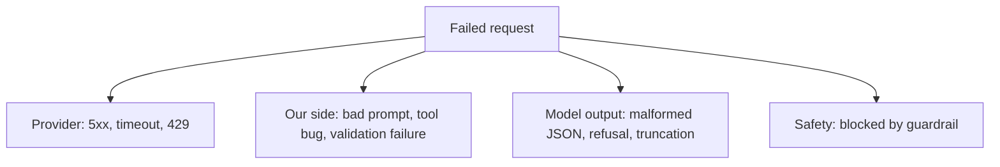

Three families of numbers tell you whether an LLM feature is healthy: how much it costs, how often it fails, and how those combine into the price of getting a good result. Each has a trap.

## Cost per request is not cost per outcome

Cost per request is easy to compute from logged token counts (see the first lesson). What the business cares about is **cost per successful outcome**: if a fraction $\sigma$ of attempts yields a good result, and a failed attempt is retried or redone by a human, then

$$
c_{\text{success}} = \frac{c_{\text{attempt}}}{\sigma}
$$

Suppose a task costs $c_{\text{attempt}} = \$0.010$. A small model solves it 70% of the time and a large model, at \$0.030 per attempt, 95% of the time:

$$
c_{\text{success}}^{\text{small}} = \frac{0.010}{0.70} = \$0.0143, \qquad c_{\text{success}}^{\text{large}} = \frac{0.030}{0.95} = \$0.0316
$$

The small model is still cheaper, but the gap is 2.2×, not the 3× that attempt prices suggest. If failures need a human at \$2 each, the comparison flips: add $0.30 \times 2 = \$0.60$ for the small model and $0.05 \times 2 = \$0.10$ for the large one, and the large model costs $0.030 + 0.10 = \$0.13$ per task against $0.010 + 0.60 = \$0.61$. Always include the cost of a failure.

## The cost dashboard

| Metric | Formula | Question it answers |
|---|---|---|
| Cost per request | spend / requests | is each call getting dearer? |
| Cost per tenant and per feature | grouped spend | who and what drives the bill? |
| Tokens per request (in, out) | tokens / requests | did a prompt or context change? |
| Cache hit rate | cached input / input | is caching working? |
| Retry and fallback rate | retries / requests | are we paying twice? |
| Cost per successful outcome | spend / successes | is quality worth the price? |

Show the **distribution** of cost per request, not only the mean: the top 1% of requests often account for 10% to 20% of spend, and these are the ones to cap.

## Error rates and how sure you are

The **error rate** is $\hat p = e/n$ where $e$ is the number of failed requests among $n$. Define failure to include timeouts and invalid outputs, not only HTTP errors. A small sample gives a noisy estimate. The standard error of a proportion is

$$
\text{SE} = \sqrt{\frac{\hat p\,(1 - \hat p)}{n}}
$$

and an approximate 95% interval is $\hat p \pm 1.96\,\text{SE}$. With $e = 3$ errors in $n = 100$ requests, $\hat p = 0.03$, and

$$
\text{SE} = \sqrt{\frac{0.03 \times 0.97}{100}} = \sqrt{0.000291} = 0.0171, \qquad 0.03 \pm 0.033
$$

so the true error rate could plausibly be anywhere from 0% to 6.3%. With 10,000 requests and 300 errors the same 3% has $\text{SE} = \sqrt{0.03 \times 0.97/10000} = 0.0017$, an interval of $3\% \pm 0.33$ points. Do not page anyone because a tenant with 40 requests had 2 errors.

## Classify errors

A single "error rate" hides causes with different fixes:



Provider errors go to the fallbacks lesson. Our-side errors are bugs. Model-output errors point to prompt, schema or constrained decoding. Guardrail blocks are intended behaviour, but a rising block rate can signal a bad threshold or an attack.

## In practice

Alert on **rates over a window with a minimum count**, never on single events. Group dashboards by `model_version` and `prompt_version`, because the commonest cause of a changed metric is a changed version. Review the top-5 most expensive requests each week; the cause is often a single pathological input such as a 100-page paste.

```quiz
{"q": "An attempt costs \\$0.02 and succeeds 80% of the time. Failures are simply retried until they succeed. What is the cost per successful outcome?", "options": ["\\$0.025", "\\$0.016", "\\$0.020", "\\$0.040"], "answer": 0, "explain": "c_success = c_attempt/σ = 0.02/0.8 = \\$0.025. Multiplying by 0.8 (\\$0.016) goes the wrong way: failures add cost, they do not reduce it."}
```

```quiz
{"q": "5 errors in 50 requests gives a 10% error rate. Roughly how wide is the 95% interval?", "options": ["About ±8 percentage points", "About ±1 percentage point", "About ±20 percentage points", "It is exactly 10%"], "answer": 0, "explain": "SE = √(0.1 × 0.9/50) = 0.042, so 1.96 × SE ≈ 0.083, about ±8 points. A small sample cannot pin the rate down; it could easily be 3% or 18%."}
```
