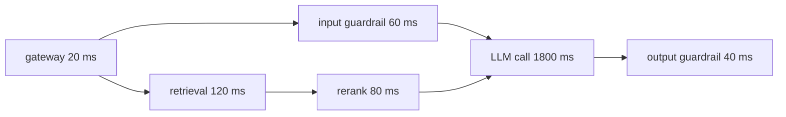

Metrics tell you that something is slow. A **trace** tells you where. A modern LLM request is not one call but a small pipeline: authenticate, retrieve documents, rerank, call the model, run guardrails, maybe call tools and call the model again. A trace records each step as a **span** with a start time, a duration and a parent, and links all the spans of one request by a shared `trace_id`.

## Anatomy of a trace

Consider a support-assistant request. The spans, with start offsets and durations in milliseconds, look like this:

| Span | Starts at | Duration | Notes |
|---|---|---|---|
| gateway (auth, routing) | 0 | 20 | |
| input guardrail | 20 | 60 | runs in parallel with retrieval |
| retrieval | 20 | 120 | vector search |
| rerank | 140 | 80 | after retrieval |
| LLM call | 220 | 1,800 | TTFT 400 ms plus decoding |
| output guardrail | 2,020 | 40 | after the answer |



Total latency is $2060$ ms: the request finishes when the last span ends. The input guardrail finished at 80 ms and the retrieval chain (retrieval plus rerank) at 220 ms, so the model call started at 220 ms.

## The critical path

The **critical path** is the chain of spans that determines the total time: the longest path from start to finish when spans can overlap. Speeding up anything off the critical path changes nothing. Here:

$$
T = t_{\text{gateway}} + \max\bigl(t_{\text{guard}},\; t_{\text{retrieval}} + t_{\text{rerank}}\bigr) + t_{\text{LLM}} + t_{\text{out guard}}
$$

where $t_{\text{guard}}$, $t_{\text{retrieval}}$ and so on are span durations. Plugging in:

$$
T = 20 + \max(60,\; 120 + 80) + 1800 + 40 = 20 + 200 + 1800 + 40 = 2060 \text{ ms}
$$

The LLM call is $1800/2060 = 87\%$ of the total. Halving the input guardrail from 60 to 30 ms saves **nothing**, because it is not on the critical path ($\max$ stays 200). Halving retrieval from 120 to 60 saves 60 ms, 3%. Cutting the model's output length so the call takes 1,200 ms saves 600 ms, 29%. Traces turn "make it faster" into a ranked list.

```steps
Find what to optimise
List spans in order and mark which run in parallel.
---
Compute the critical path: sum sequential spans, take the max over parallel branches.
---
Compute each span's share of the total on that path: LLM 87%, retrieval and rerank about 10%, the rest about 3%.
---
Estimate the best-case saving for each candidate change. Only work with a saving of at least 10% justifies a project.
---
Re-measure after the change. Parallelising or caching can move the critical path to a different span.
```

## What to put on LLM spans

Each model span should carry the attributes from the request log: model and prompt version, input, output and cached token counts, TTFT, finish reason and cost. For agents, make **one trace per task** with a child span per step (model call or tool call), so a 30-step agent run can be read from top to bottom. When a tool span fails, the error and the arguments belong on that span.

## Sampling traces

Tracing every request is often too costly. Two strategies work together:

- **Head sampling** decides at the start: keep 5% of all traces.
- **Tail sampling** decides after the request finishes: keep every trace that was slow, errored, flagged by a guardrail or rated badly, regardless of the base rate.

If 1% of requests fail and you head-sample 5%, you keep only $0.05 \times 1\% = 0.05\%$ of all requests as failure traces. Tail sampling keeps all 1%. Use both.

## In practice

Propagate the `trace_id` across every service the request touches, including your retrieval service and tool backends, and write it into every log line. The most common reason a trace is useless is a **broken trace**: a service that drops the id, so the tool call looks like a separate request. Test propagation with a synthetic request on each deploy.

```quiz
{"q": "Retrieval takes 150 ms and the input guardrail takes 90 ms, in parallel, then the model takes 1,500 ms. What is the total latency, ignoring everything else?", "options": ["1,650 ms", "1,740 ms", "1,590 ms", "240 ms"], "answer": 0, "explain": "Parallel steps contribute their maximum: max(150, 90) = 150, so 150 + 1,500 = 1,650 ms. Adding both (1,740) treats parallel work as sequential."}
```

```quiz
{"q": "In the same system, you make the input guardrail 3× faster. What is the effect on total latency?", "options": ["None: it is not on the critical path", "A 60 ms reduction", "A 3× reduction in total time", "Latency increases slightly"], "answer": 0, "explain": "The guardrail already finishes before retrieval does, so shortening it does not change the max. Optimise the spans on the critical path: here the model call."}
```
