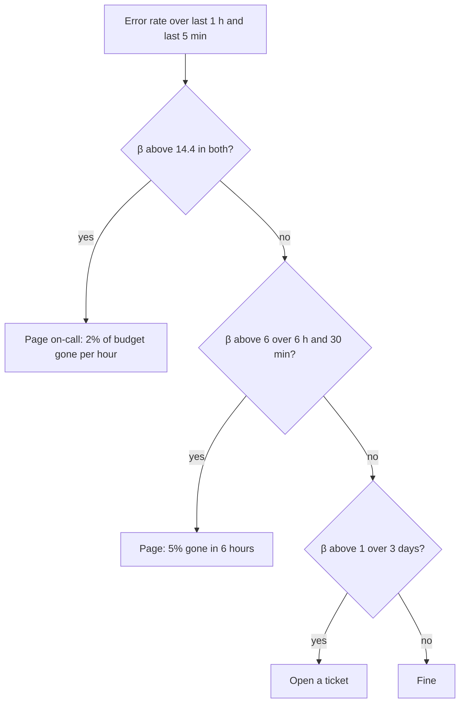

"The assistant should be reliable" cannot be tested. A **service level objective** (SLO) turns it into a number: a target for a **service level indicator** (SLI), measured over a period. An SLI is a ratio of good events to all events, for example "the fraction of requests that return a valid answer within 10 seconds". An SLO says what that ratio must be: "99.5% over 30 days".

## Choosing indicators for an LLM feature

| Dimension | Example SLI | Example SLO |
|---|---|---|
| Availability | valid answers / all requests | 99.5% over 30 days |
| Latency | requests with p95 TTFT under 1.2 s | 99% of requests under 1.2 s |
| Quality | sampled answers graded correct | at least 90% over a rolling week |
| Freshness | answers using documents under 24 h old | 95% |
| Safety | harmful outputs per 10,000 responses | at most 1 |

Keep the list short: three to five SLOs per feature that your users would recognise as "working". Define "good" precisely, including what counts as failure (timeouts, invalid output), and use the same definition in dashboards and in contracts.

## The error budget

An SLO of $S$ means you are allowed $1 - S$ of bad events. That allowance is the **error budget**. Over $T$ minutes:

$$
\text{budget} = (1 - S)\cdot T
$$

For $S = 99.9\%$ over 30 days ($T = 43{,}200$ min): $0.001 \times 43{,}200 = 43.2$ minutes of full outage. Counted in requests, with 5 million requests in the month: $0.001 \times 5{,}000{,}000 = 5{,}000$ failed requests allowed.

| SLO | Error budget | Minutes per 30 days | Failed requests per 5M |
|---|---|---|---|
| 99% | 1% | 432 | 50,000 |
| 99.5% | 0.5% | 216 | 25,000 |
| 99.9% | 0.1% | 43.2 | 5,000 |
| 99.99% | 0.01% | 4.32 | 500 |

The budget is a tool. If you have budget left, you can ship risky changes and run experiments. If it is exhausted, you stop and spend time on reliability. It replaces arguments about "is this change safe enough" with a shared number.

## How an incident spends the budget

An incident with error fraction $e$ for $d$ minutes uses $e \cdot d$ minutes of the budget (traffic assumed constant). A bad deploy raises failures to $e = 20\%$ for $d = 15$ minutes:

$$
\text{consumed} = 0.20 \times 15 = 3 \text{ minutes} \qquad \Rightarrow \qquad 3/43.2 = 6.9\% \text{ of the month's budget}
$$

A provider outage with 100% failures for 30 minutes uses 30 minutes, 69% of the budget, in half an hour.

## Burn-rate alerts

Alert on how fast you are consuming the budget. The **burn rate** is the observed error rate divided by the allowed error rate $(1 - S)$:

$$
\beta = \frac{\text{observed error rate}}{1 - S}
$$

At $\beta = 1$ you consume the budget exactly over the period. In a 30-day (720-hour) month, a burn rate of $\beta$ held for $h$ hours uses a fraction $\beta h/720$ of the budget. So:

$$
\beta = 14.4 \text{ for 1 hour} \;\Rightarrow\; 14.4 \times 1/720 = 2\% \text{ of the monthly budget}
$$

$$
\beta = 6 \text{ for 6 hours} \;\Rightarrow\; 6 \times 6/720 = 5\%
$$



Using two windows (a long one to confirm the problem is real and a short one to confirm it is still happening) stops pages for incidents that already ended. With $S = 99.9\%$, $\beta = 14.4$ means an error rate of $14.4 \times 0.1\% = 1.44\%$. A steady 1.44% error rate for an hour is serious, yet a plain "alert at 5% errors" rule would never fire.

## In practice

Set the SLO below what your providers deliver, with margin: a feature built on a 99.5% provider with a fallback can promise 99.9%, but not 99.99%. Write down the consequences: what the team does when the budget is gone (freeze launches, prioritise reliability work). An SLO nobody acts on is decoration.

```quiz
{"q": "An SLO of 99.95% over 30 days. How many minutes of full outage fit in the error budget?", "options": ["21.6", "43.2", "2.16", "216"], "answer": 0, "explain": "(1 − 0.9995) × 43,200 = 0.0005 × 43,200 = 21.6 minutes. 43.2 minutes is the budget for 99.9%, one nine fewer."}
```

```quiz
{"q": "An SLO of 99.9% is in force. The error rate is steadily 0.5%. What is the burn rate?", "options": ["5", "0.5", "50", "0.005"], "answer": 0, "explain": "β = observed/allowed = 0.5%/0.1% = 5. At 5× the allowed rate, the whole month's budget is gone in 6 days. The 0.5 figure is just the error rate, not divided by the allowance."}
```
