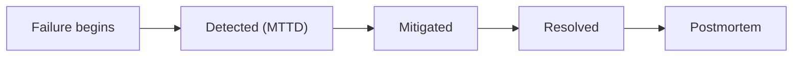

Every system fails eventually. What distinguishes mature teams is not that they avoid incidents, but that they find them quickly, fix them calmly and learn from each one. An **incident** is any event that threatens an SLO; an **incident response** is the practice of handling it; a **postmortem** is the written review afterwards.

## The lifecycle and its clocks



Three durations summarise how well you respond:

- **MTTD**, mean time to detect: failure begins to alert fires.
- **MTTM**, mean time to mitigate: alert to impact reduced (a rollback, a failover, a kill switch).
- **MTTR**, mean time to resolve: failure begins to full recovery.

Availability depends on how often you fail and how long each failure lasts. With mean time between failures $\text{MTBF}$ and mean time to repair $\text{MTTR}$:

$$
A = \frac{\text{MTBF}}{\text{MTBF} + \text{MTTR}}
$$

If failures arrive every 200 hours and each takes 1 hour to resolve, $A = 200/201 = 99.50\%$. Cut MTTR to 15 minutes (0.25 h) and $A = 200/200.25 = 99.875\%$, a 4× improvement without reducing the number of failures. For most teams, faster detection and mitigation is cheaper than preventing every failure.

## Mitigate first, diagnose second

In an incident the first goal is to **stop the harm**, not to find the root cause. Mitigations for LLM systems, roughly in order of speed:

1. Roll back the last change (prompt, model version, router, config). Most incidents follow a change.
2. Flip a feature flag or kill switch.
3. Fail over to the fallback provider or degraded mode.
4. Reduce load: shed low-priority traffic, tighten rate limits.
5. Only then investigate with traces and payload samples.

A useful first question is **"what changed?"**. This is why logs carry `model_version`, `prompt_version` and deploy markers. Plot deploys and provider announcements on the same timeline as your metrics.

## An example incident, quantified

At 14:00 a prompt change goes live. At 14:12 the rate of malformed JSON outputs rises from 0.5% to 18%. The alert fires at 14:20 (8 minutes after the errors began, so a time to detect of 8 min), the on-call rolls back at 14:31 (mitigated after 11 more minutes), and metrics return to normal at 14:35. Traffic is 400 requests per minute.

```steps
Measure the impact
Duration of elevated errors: 14:12 to 14:35, so 23 minutes.
---
Extra failure rate: $18\% - 0.5\% = 17.5\% = 0.175$.
---
Affected requests: $400 \times 23 \times 0.175 \approx 1{,}610$ failed requests.
---
Budget consumed with a 99.9% SLO and about 17.3 million requests per 30 days: $1610 / 17{,}280{,}000 \approx 0.0093\%$, which is $0.0093\%/0.1\% \approx 9.3\%$ of the month's budget.
---
Detection gap: the fault ran 8 minutes before the alert fired (14:12 to 14:20) and 11 more minutes passed before mitigation. Both gaps are action items.
```

## The blameless postmortem

A good postmortem is written within a few days, shared widely and is **blameless**: it asks "what about our system allowed this?" instead of "who did it?". People who fear blame hide information, and hidden information makes the next incident worse.

| Section | Contents |
|---|---|
| Summary | what happened, impact, duration, in three sentences |
| Impact | users, requests, money, SLO budget consumed |
| Timeline | timestamped events from the first symptom to resolution |
| Root causes and contributing factors | including "why did our checks not catch it?" |
| What went well and what went badly | detection, response, tooling |
| Action items | each with an owner, a due date and a priority |

Use the **five whys** to go beyond the trigger. The prompt change broke JSON output. Why was it shipped? No schema test in the pipeline. Why? Evaluation set had no structured-output cases. Why? Nobody owned the set. Each answer yields an action: add schema cases, make the evaluation gate mandatory, assign an owner.

## LLM-specific causes

| Cause | Symptom | Prevention |
|---|---|---|
| Moving model alias repointed | quality or style change with no deploy | pin dated versions |
| Prompt or retrieval change | format or accuracy drop | evaluation gate, canary |
| Provider degradation | latency and 5xx rise | fallbacks, breakers |
| Context blow-up | cost and latency spike | token limits, alerts |
| Prompt injection campaign | odd outputs, tool misuse | guardrails, least privilege |

## In practice

Track postmortem action items to completion; the commonest failure of the process is a list of good ideas that nobody does. Review the pattern across incidents quarterly: if three incidents had the same contributing factor, fix that factor first.

```quiz
{"q": "Failures arrive every 100 hours on average and each takes 30 minutes to resolve. What is the availability?", "options": ["About 99.50%", "About 99.00%", "99.70%", "About 99.95%"], "answer": 0, "explain": "A = MTBF/(MTBF + MTTR) = 100/100.5 = 0.9950. Treating 30 minutes as 0.3 hours instead of 0.5 gives 99.70%; forgetting to add MTTR to the denominator would give 100%."}
```

```quiz
{"q": "What should the on-call engineer do first when a prompt deploy is followed by a spike in errors?", "options": ["Roll back the change, then investigate", "Find the root cause before touching anything", "Increase the provider rate limit", "Wait to see whether it resolves"], "answer": 0, "explain": "Mitigation comes first: most incidents follow a change, and a rollback is fast and reversible. Deep diagnosis can be done afterwards from logs and traces, once users are no longer being harmed."}
```
