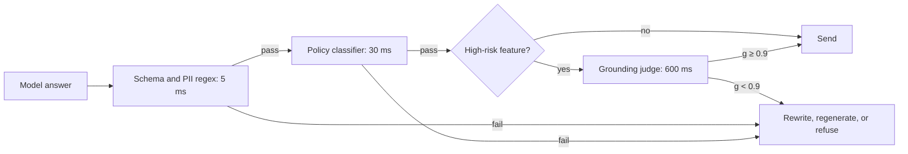

Input checks look at what the user sent. **Output checks** look at what the model wrote, which is the thing the user will actually see. They catch failures that no input filter could predict: a polite question that leads the model to invent a policy, leak a document it retrieved or produce a format your code cannot parse.

## What to check on the way out

| Check | Catches | Typical method |
|---|---|---|
| Format and schema | malformed JSON, missing fields, forbidden values | deterministic validator |
| Policy and safety | toxic, harmful or off-brand text | learned classifier |
| PII and secrets | emails, card numbers, keys appearing in answers | regex plus a detector |
| Grounding | claims not supported by the retrieved sources | judge or entailment model |
| Scope | answers outside what the product should do | classifier, topic filter |
| Citations | links or sources that do not exist | deterministic lookup |

Start with the deterministic checks. They are fast, have no learning error, and catch a surprising share of real failures.

## Grounding as a score

A **groundedness check** asks, for each claim in the answer, whether the retrieved context supports it. The answer's score is the fraction of supported claims:

$$
g = \frac{\text{supported claims}}{\text{total claims}}
$$

Suppose an answer makes 5 claims and the checker finds 4 supported by the retrieved passages:

$$
g = 4/5 = 0.8
$$

With a policy "block or rewrite if $g < 0.9$", this answer is caught. The threshold has the same precision and recall trade-off as any classifier. Set it high for medical, legal or financial answers, where an unsupported claim is costly, and lower for casual chat. Checking claim by claim, not whole answers, is what makes the score informative: one invented number in an otherwise good answer is still an invented number.

## The cost of checking

Every check costs latency and money, and each can wrongly block a good answer. If you run $k$ checks and each independently has a false-block rate $f$, the chance that a good answer is wrongly stopped is

$$
1 - (1 - f)^{k}
$$

Five checks at $f = 1\%$ each gives $1 - 0.99^5 = 1 - 0.951 = 4.9\%$, nearly 1 good answer in 20. Add the latency: if the model takes 1,800 ms and checks run one after another at 40, 60, 80, 50 and 120 ms, that adds 350 ms. Run independent checks **in parallel**, and the added latency is only the slowest, 120 ms.

| Strategy | Added latency | Notes |
|---|---|---|
| Five checks in sequence | $40 + 60 + 80 + 50 + 120 = 350$ ms | simple |
| Five checks in parallel | $\max = 120$ ms | needs the full answer first |
| Cheap checks first, expensive only on a flag | about 40 ms typical | the usual design |



## Streaming makes it harder

Users like streamed text because it feels fast, but you cannot check an answer that has not been written yet. Choices, from safest to snappiest:

1. **Buffer the whole answer**, check it, then send. Safe, slowest, loses the benefit of streaming.
2. **Stream in chunks**: check each sentence or paragraph before releasing it. Adds a short delay per chunk and can still cut a response off halfway.
3. **Stream first, retract if flagged**. Fast, but the user may have already read the bad text.

For high-risk features use 1 or 2. For low-risk chat, 3 combined with a post-hoc check and logging is common.

## What to do when a check fails

Do not just return an error. Options in order of user friendliness: **regenerate** with a stricter instruction (one retry only, to limit cost), **repair** (redact the offending span), **fall back** to a canned or retrieved answer, or **refuse** with a clear, non-accusing message and a way to reach a human. Always log the failure and the reason; clusters of failures reveal prompt problems.

## In practice

Measure each output check separately: its block rate, its precision on a reviewed sample and its latency. A check that blocks 3% of traffic with 20% precision is mostly an annoyance. Review blocked samples weekly. Put the strictest and most expensive checks on the features that need them rather than on everything.

```quiz
{"q": "An answer contains 8 claims and the checker finds 6 supported. The policy blocks answers with groundedness below 0.8. What happens?", "options": ["It is blocked: 6/8 = 0.75 < 0.8", "It passes: 6 of 8 is most of them", "It passes: 0.75 rounds to 0.8", "It is blocked because every claim must be supported"], "answer": 0, "explain": "g = 6/8 = 0.75, below the 0.8 threshold, so the policy applies. The policy is a threshold, not an all-claims rule, and 0.75 does not round up for the purposes of the comparison."}
```

```quiz
{"q": "Four independent output checks each wrongly block 2% of good answers. Roughly what share of good answers is wrongly blocked?", "options": ["About 7.8%", "About 8%", "2%", "About 0.000016%"], "answer": 0, "explain": "1 − 0.98⁴ = 1 − 0.9224 = 7.76%, about 7.8%. The plain sum of 8% is close here but overcounts, and gets worse as rates grow; 0.000016% is the chance that all four fire on the same answer."}
```
