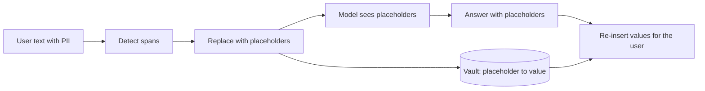

**Personally identifiable information** (PII) is anything that identifies a person: names, emails, phone numbers, addresses, account and card numbers, government ids, and sometimes combinations of innocuous fields. Users paste it into prompts without thinking. If it flows unchecked into prompts, logs, caches and third-party APIs, every one of those becomes a store of personal data with its own risks and obligations. **Redaction** replaces sensitive spans with placeholders before data travels further.

## Two ways to detect

| Method | Good at | Weak at | Cost |
|---|---|---|---|
| Patterns (regex, checksums) | structured ids: emails, phone numbers, card numbers | names, free-form addresses | microseconds |
| Learned entity recognition (NER) | person and place names, context | rare formats, new languages | milliseconds |
| LLM-based detection | odd or context-dependent PII | cost and latency | hundreds of ms |

Use patterns first, add a learned model for names and addresses, and keep the expensive detector for high-risk flows.

## A checksum as a precision filter

A 16-digit number in a message might be a card number or an order id. Card numbers satisfy the **Luhn checksum**: starting from the rightmost digit, double every second digit (subtracting 9 if the result exceeds 9), then add everything; the total must be divisible by 10. Test the well-known sample number 4111 1111 1111 1111:

```steps
Luhn check on 4111111111111111
Number the digits from the right: positions 1 to 16. Digits at odd positions (1, 3, ..., 15) are all 1: eight of them, sum $= 8$.
---
Double the digits at even positions. Positions 2 to 14 (seven digits) are 1, doubled to 2 each: $7 \times 2 = 14$.
---
Position 16 is the leading 4, doubled to 8 (no subtraction needed since 8 is not above 9).
---
Total $= 8 + 14 + 8 = 30$. Since $30 \bmod 10 = 0$, the number passes the checksum.
---
A random 16-digit order id passes only about 1 time in 10, so the checksum removes about 90% of false matches at no cost.
```

That last step is a cheap way to raise the precision of a pattern from, say, 30% to roughly 80%: a random 16-digit string passes with probability $1/10$ instead of $1$.

## How much leaks through?

No detector has perfect recall. The PII that slips through is the **residual leakage**. Let $N$ be messages per day, $p$ the fraction containing PII and $r$ the detector's recall (per message):

$$
L = N \cdot p \cdot (1 - r)
$$

With $N = 1{,}000{,}000$ and $p = 3\%$, 30,000 messages contain PII. A redactor with $r = 95\%$ leaks $30{,}000 \times 0.05 = 1{,}500$ messages a day. Improving to $r = 99\%$ cuts that to $300$, five times fewer, but not zero. Over a 30-day retention window the 95% detector leaves $1{,}500 \times 30 = 45{,}000$ stored messages with PII in them.

| Recall $r$ | Leaked per day | Leaked over 30 days |
|---|---|---|
| 90% | 3,000 | 90,000 |
| 95% | 1,500 | 45,000 |
| 99% | 300 | 9,000 |
| 99.9% | 30 | 900 |

Two lessons follow. Because leakage is never zero, **redaction is not a substitute for access control and short retention**: assume the stored text still contains some PII and protect it accordingly. And every point of recall is worth buying where logs live longest.

## Placeholders that keep meaning

Replace each span with a **typed, consistent placeholder** so the text remains useful: "Email [EMAIL_1] about order 4417" is still readable and the model can still reason about it. Within one conversation map each entity to the same placeholder ([PERSON_1] stays [PERSON_1]). For features that must show the real value back to the user, keep a separate **token vault** that maps placeholders to values, with strict access and short retention, and re-insert after the model answers.



## Where to redact

1. **Before logging**: the cheapest and most important place. Logs outlive and out-spread everything else.
2. **Before sending to a third-party model**, if your policy or contract requires it, and where the task does not need the value.
3. **In model output**, in case the model repeats something it should not (for example PII in retrieved documents).
4. **Before using data for evaluation or training sets.**

Over-redaction has a cost too: removing a product name that looks like a person's name can ruin an answer. Measure both leakage (recall) and damage (precision) on a labelled sample.

## In practice

Build a labelled PII test set from your own traffic types, including adversarial formats (digits with spaces, emails written as "name at domain dot com"), and track recall per type. Re-test after every change to the detector. Remember languages: a detector trained mostly on English can have much lower recall on other scripts.

```quiz
{"q": "A service handles 500,000 messages per day, 2% contain PII, and the redactor has 98% recall. How many messages with PII are stored unredacted per day?", "options": ["200", "10,000", "9,800", "2,000"], "answer": 0, "explain": "L = N·p·(1 − r) = 500,000 × 0.02 × 0.02 = 200. 10,000 is the number of messages that contain PII at all, and 9,800 is the number that were successfully redacted."}
```

```quiz
{"q": "Why is redaction alone not enough to make logs safe?", "options": ["Detectors have recall below 100%, so some PII remains", "Redacted text cannot be searched", "Placeholders reveal the original value", "Logs are always encrypted anyway"], "answer": 0, "explain": "Residual leakage L = N·p·(1 − r) is never zero, so stored text must still be protected with access controls and short retention. Placeholders are designed not to reveal values, and encryption does not remove the need for minimisation."}
```
