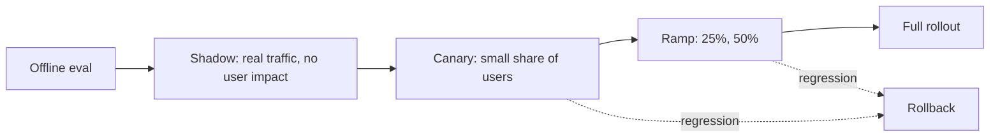

```callout-before
Before you start
You should know what an evaluation set is (a fixed list of test inputs with a way to grade the answers) and that a pass rate is the fraction of cases passed. If you have built one, you already have the starting point for this lesson.
```

In ordinary software, a change that passes its tests is usually safe to ship. In an LLM system the tests are weaker evidence, for three reasons. The input space is open-ended: users write things you never imagined. The output is graded by judgement, not by equality. And small edits have large, unpredictable effects: a reworded sentence in a prompt can change tone, format or accuracy for a whole category of requests.

## What counts as a change

Many different edits change behaviour, and teams often treat only code deploys as "changes":

| Change | Example | Typical hidden effect |
|---|---|---|
| Prompt text or template | add a safety paragraph | longer answers, more refusals |
| Model or model version | upgrade to a newer snapshot | different style, formats, cost, latency |
| Sampling parameters | temperature 0.2 to 0.7 | less consistent outputs |
| Retrieval | new chunk size or embedding model | different documents reach the model |
| Router thresholds | $\tau$ 0.7 to 0.6 | more traffic to the weaker model |
| Tools and schemas | rename a tool parameter | calls fail or go to the wrong tool |
| Guardrail thresholds | tighten injection filter | more false blocks |

Each deserves the same controlled rollout as a code deploy, and each must carry a version number in the logs so you can tell which was live when quality moved.

## Why the offline set is not enough

An offline evaluation set of $n$ cases gives a pass rate with a margin of error. The standard error of a pass rate $\hat p$ is $\sqrt{\hat p(1 - \hat p)/n}$. With $n = 200$ and $\hat p = 0.90$:

$$
\text{SE} = \sqrt{\frac{0.9 \times 0.1}{200}} = 0.0212, \qquad 95\%\text{ interval} = 0.90 \pm 1.96 \times 0.0212 = 0.90 \pm 0.042
$$

A 200-case set cannot reliably distinguish 90% from 87%. To detect a true drop from 90% to 87% with 95% confidence and 80% power, the sample needed per version is about

$$
n \approx \frac{(z_{\alpha/2} + z_\beta)^2\,\bigl[p_1(1 - p_1) + p_2(1 - p_2)\bigr]}{(p_1 - p_2)^2} = \frac{(1.96 + 0.84)^2 \times (0.09 + 0.1131)}{0.03^2} = \frac{7.84 \times 0.2031}{0.0009} \approx 1{,}769
$$

where $z_{\alpha/2} = 1.96$ and $z_\beta = 0.84$ correspond to 95% confidence and 80% power. Your offline set is likely an order of magnitude smaller, and it does not reflect the long tail of real requests. It is a necessary gate, not a sufficient one. The production-style methods in this lesson fill the gap by testing on **real traffic**.

## The ladder of exposure



Each rung exposes the change to more reality and more users. Going from one rung to the next requires evidence that the previous rung was safe. The rungs trade **realism** for **risk**:

| Stage | Real inputs | Users affected | Detects |
|---|---|---|---|
| Offline eval | no, a fixed set | none | gross regressions |
| Shadow | yes | none | output differences, cost, latency, crashes |
| Canary | yes | a small share | real user-visible failures |
| Full | yes | everyone | nothing new, only confirms |

```steps
The shape of a safe change
Make the change behind a **version** (a prompt id, a model alias pinned to a dated snapshot, a config flag), not by editing in place.
---
Run the offline evaluation gate: the change must not lower the pass rate beyond a stated margin on any slice.
---
Run shadow traffic and compare with the current version on real requests.
---
Canary to a small share, watch guard metrics, and ramp only if they stay healthy.
---
Keep the previous version one click away until the new one has run cleanly for a defined period.
```

## In practice

The commonest mistake is shipping "just a prompt tweak" directly to 100% because nothing in the code changed. Treat prompts as code: in version control, reviewed, tested and released through the same pipeline. The prompt versioning lesson covers regression tests, and this lesson covers the release itself.

```quiz
{"q": "An offline set of 100 cases gives a pass rate of 80%. What is the approximate 95% margin of error?", "options": ["About ±8 points", "About ±1 point", "About ±16 points", "About ±4 points"], "answer": 0, "explain": "SE = √(0.8 × 0.2/100) = 0.04, and 1.96 × 0.04 ≈ 0.078, about ±8 points. A 5-point regression is well inside the noise of a set this small."}
```

```quiz
{"q": "A team changes a retrieval chunk size and ships it directly because 'no prompts or models changed'. What is wrong with that reasoning?", "options": ["Retrieval changes alter what the model sees, so they change behaviour like any other change", "Retrieval changes never matter", "Only model changes need versioning", "Chunk sizes can only be tested in production"], "answer": 0, "explain": "The model's output depends on its context, so changing retrieval is a behavioural change and needs the same gates. Offline tests, shadow and canary all apply."}
```
