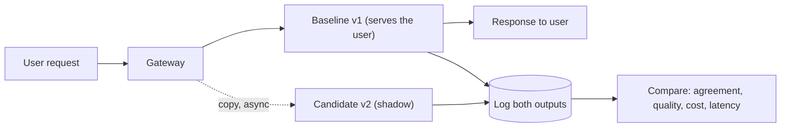

**Shadow traffic** means sending a copy of real production requests to a candidate version, recording its output, and discarding it: the user only ever sees the baseline's answer. It is a dress rehearsal on the live audience's script, with nobody in the seats.



## What shadow reveals

Because the candidate sees genuine inputs, it surfaces problems no hand-written test set contains:

- **Crashes and format failures** on odd inputs (very long, empty, other languages, code).
- **Cost and token changes**: a prompt that adds 400 tokens per request is visible within an hour.
- **Latency** under real load, including tail percentiles.
- **Output differences**: how often does the candidate answer differently, and is it better or worse?

What it cannot reveal is how users **react** to the new answers, since they never see them, and it cannot test anything with side effects (see below).

## What shadow costs

Every shadowed request is an extra model call. If a fraction $s$ of $N$ daily requests is shadowed at cost $c$ each:

$$
\text{extra cost per day} = s\,N\,c
$$

With $N = 1{,}000{,}000$, $s = 10\%$ and $c = \$0.006$: $0.1 \times 1{,}000{,}000 \times 0.006 = \$600$ per day. Run it for 3 days to collect 300,000 shadow requests and the cost is \$1,800, a small price against shipping a regression to every user. Because shadow is asynchronous, it adds **no** latency to the user, but it does consume rate limit and capacity, so account for it in your quota (10% extra tokens per minute here).

## Comparing outputs

Run both versions on the same inputs and compare in layers:

1. **Automatic checks** on 100% of pairs: valid format, length, guardrail flags, cost, latency.
2. **Pairwise judging** on a sample: show a judge model (or a person) both answers in random order and ask which is better, or whether they are equivalent.
3. **Human review** of a small stratified sample, plus every case where the two versions disagree strongly.

The summary number is the **win rate** with ties counted as half. If out of 600 judged pairs the candidate wins 270, ties 180 and loses 150:

$$
\text{win rate} = \frac{270 + 0.5 \times 180}{600} = \frac{360}{600} = 0.60
$$

The standard error is about $\sqrt{0.6 \times 0.4/600} = 0.020$, so the 95% interval is $0.60 \pm 0.039$, roughly 56% to 64%. Excluding 50% means the candidate is probably better. Compare the **wins and losses**, not only the average: 150 losses (25%) deserve to be read before shipping, because a version that is better overall may still be much worse on one customer's requests.

| Metric | Baseline | Candidate | Decision rule |
|---|---|---|---|
| Valid-output rate | 98.9% | 99.2% | no worse than baseline minus 0.3 points |
| Median output tokens | 310 | 285 | informational |
| p95 latency | 4.1 s | 3.6 s | no worse than baseline plus 10% |
| Cost per request | \$0.0062 | \$0.0058 | no worse than baseline plus 5% |
| Pairwise win rate | n/a | 60% (56% to 64%) | lower bound above 50% |

## Handle side effects

If the candidate can call tools, a shadow run must not send emails, charge cards or write to databases. Give shadow runs **read-only or mocked tools**, or record the tool calls the candidate *would* make and compare them with the baseline's real ones. A shadow system with live write access is not a shadow: it is an unannounced canary.

## Use real data carefully

Shadow copies real user data into another pipeline. Apply the same redaction, retention and access rules, and do not send a copy to a provider that your policies do not allow. Keep shadow logs on a short retention schedule.

## In practice

Run shadow traffic long enough to cover the weekly cycle (weekday and weekend traffic differ) and special cases such as month-end spikes if they matter. Review the **disagreement set** more than the agreement set: when two versions give the same answer you learn little, and the disagreements are where the change lives. Stratify by feature and customer so the numbers are not dominated by the biggest tenant.

```quiz
{"q": "A candidate model is shadowed on 5% of 2,000,000 daily requests at \\$0.01 per request. What is the extra daily cost?", "options": ["\\$1,000", "\\$100", "\\$10,000", "\\$20,000"], "answer": 0, "explain": "0.05 × 2,000,000 = 100,000 shadow requests, and × \\$0.01 = \\$1,000. \\$20,000 would shadow every request; \\$100 loses a factor of ten."}
```

```quiz
{"q": "Of 400 judged pairs, the candidate wins 160, ties 120 and loses 120. What is the win rate with ties counted as half?", "options": ["55%", "40%", "50%", "60%"], "answer": 0, "explain": "(160 + 0.5 × 120)/400 = 220/400 = 0.55. Counting only outright wins gives 40%, which ignores that a tie is not a loss."}
```
