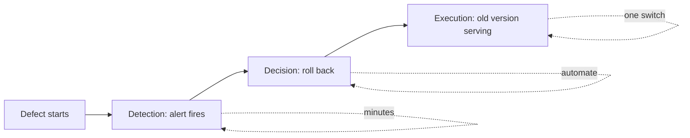

Detection is only half the story. Once you know a change is bad, how fast can you undo it? **Rollback** returns the system to the last known good version. The speed of rollback, more than the care of the rollout, decides how much damage a bad change does.

## Harm is rate times time

The number of users harmed by a defect is roughly

$$
H = \lambda\, s\, p\, T
$$

where $\lambda$ is total traffic (requests per minute), $s$ the share of traffic on the bad version, $p$ the fraction of its requests that go wrong, and $T$ the minutes until the bad version stops serving. Take a bad defect with $p = 5\%$ at $\lambda = 2{,}000$ per minute.

| Scenario | Share $s$ | Time to roll back $T$ | Harmed requests $H$ |
|---|---|---|---|
| Straight to 100%, manual rollback | 100% | 30 min | $2000 \times 1 \times 0.05 \times 30 = 3{,}000$ |
| Straight to 100%, automatic rollback | 100% | 6 min | $2000 \times 1 \times 0.05 \times 6 = 600$ |
| 5% canary, manual rollback | 5% | 30 min | $2000 \times 0.05 \times 0.05 \times 30 = 150$ |
| 5% canary, automatic rollback | 5% | 6 min | $2000 \times 0.05 \times 0.05 \times 6 = 30$ |

The two levers multiply: a small share cuts $H$ by 20, fast rollback cuts it by another 5, and together the harm falls from 3,000 requests to 30, a factor of 100. Time to roll back has three parts: detection (the alert fires), decision (a person or controller acts) and execution (the old version is serving again). Automating decision and making execution a single switch are the cheapest ways to reduce $T$.



## Make rollback a switch, not a deploy

A rollback that needs a code revert, a build and a deployment can take an hour. Design so that behaviour is selected at runtime:

- **Prompts and configs as versioned data**, loaded by id. Rolling back means pointing the id at the previous version.
- **Pinned model versions**. Rolling back means changing a config value, not retraining anything.
- **Feature flags** that route a share of users to the new path, with the old path kept alive and tested.
- **Kill switches** that turn the feature off entirely or fall back to a non-LLM path.

Keep the old version **warm**: deployed, tested and with capacity reserved. A rollback onto a version that has been cold for a month may itself fail, for example because a provider deprecated the old model snapshot. Check deprecation notices and keep a tested escape route.

## What cannot be rolled back

Some changes leave residue that a rollback does not clear:

| Change | Residue | What to do |
|---|---|---|
| New embedding model | vectors in the new space are incompatible with the old index | build the new index alongside; keep the old one live until cut-over is proven |
| Data written by the new version | records in a format the old code cannot read | write both formats, or use expand-then-contract migrations |
| Caches | answers generated by the bad version remain cached | include `prompt_version` in cache keys, or flush on rollback |
| Emails or payments already sent | cannot be recalled | keep irreversible actions behind approval during a canary |
| Memory or summaries stored for users | contain bad content | version stored artefacts and be able to regenerate them |

The rule of thumb: **make changes backward compatible** so that old and new versions can run together, then rollback is always available.

## Automatic rollback triggers

An automatic rollback needs a clear, conservative trigger: a guard metric beyond its threshold for a short window, for example error rate above baseline plus 1 point for 3 consecutive minutes with at least 200 canary requests. Rolling back should itself be safe and idempotent: running it twice, or while another rollback is in flight, does no harm. After any rollback, freeze further rollouts until someone has reviewed what happened.

```steps
A rollback drill
Start a canary of a deliberately broken version in a staging environment (for example, a prompt that returns invalid JSON 20% of the time).
---
Time how long until the alert fires: this is detection.
---
Trigger the rollback and time how long until traffic is fully back on the old version: this is execution.
---
Check the side effects: caches, queues, partial conversations, stored data.
---
Record the total in minutes, compare it with the goal (for example under 10), and file fixes for the slowest part.
```

## Practise

The bad-rollout sandbox ships a faulty change to a simulated service. Try different canary sizes, thresholds and rollback speeds, and compare how many users are harmed.

```sandbox
bad-rollout
```

## In practice

Run a rollback drill every quarter, like a fire drill. Teams that have never rolled back in anger often discover that the previous version no longer exists, that the flag system itself is slow, or that nobody has permission to flip the switch at 3 a.m.

```quiz
{"q": "Traffic is 1,000 requests per minute. A bad version serves 10% of traffic, fails 20% of its requests and stays live for 15 minutes. How many requests fail?", "options": ["300", "3,000", "30", "1,500"], "answer": 0, "explain": "H = λsp T = 1,000 × 0.10 × 0.20 × 15 = 300. Ignoring the 10% share gives 3,000, treating the whole fleet as bad."}
```

```quiz
{"q": "Which design most reduces the time to roll back a bad prompt?", "options": ["Prompts stored as versioned data selected by a flag", "Prompts hard-coded in source and redeployed", "Editing the prompt in place in production", "Waiting for user complaints to confirm the problem"], "answer": 0, "explain": "A runtime switch turns rollback into a config change that takes seconds. Hard-coded prompts need a build and deploy, and in-place edits destroy the previous version you want to return to."}
```
