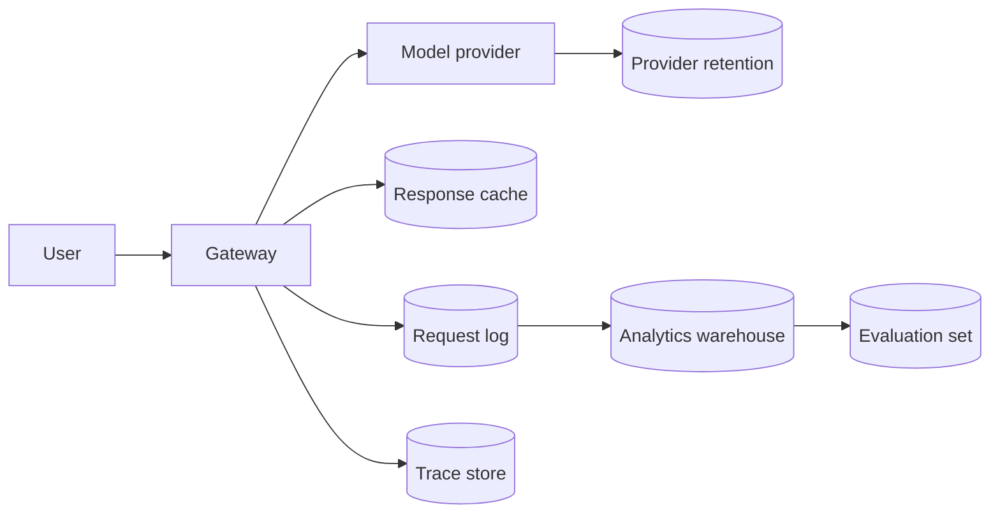

```callout-warn
Principles, not legal advice
This lesson describes engineering practice. Privacy and security law varies by country, sector and contract, and it changes. Use these ideas to ask better questions of your legal, security and compliance colleagues, not to replace them.
```

A user types "My card ending 4417 was charged twice, please fix it" into your assistant. Where does that sentence go? Most teams cannot answer without a search. It goes to your gateway, probably into a request log, into a prompt sent to a model provider, perhaps into the provider's own logs, into a response cache, into an analytics warehouse, into a trace system and into an evaluation dataset. Each stop is another **copy**, and each copy is something that can leak, be subpoenaed, be retained too long or be accessed by someone who should not.

Privacy engineering starts with a plain **data-flow map**: for each feature, draw every place user data is sent or stored.



## Classify the data

Not all data deserves the same protection. A small number of **classes** with rules attached keeps decisions simple:

| Class | Examples | Typical rules |
|---|---|---|
| Public | published docs, marketing pages | no restriction |
| Internal | internal wikis, product plans | employees only, no third parties without approval |
| Confidential | customer contracts, source code | named access, encrypted, approved vendors only |
| Restricted | personal data, health, financial, credentials | minimise, redact before logging, short retention, audited access |

Tag each store with the **highest class** of data that can end up in it. A request log that might contain pasted personal data is Restricted, whatever the intention. Tag by what can happen, not by what you hope will happen.

## Counting exposure

A simple measure of how much risk you are holding is the number of **sensitive records stored at once**. For a store that receives $R$ sensitive records per day and keeps them $D$ days, the steady-state number is $R \times D$. Summing over stores:

$$
E = \sum_{s} R_s \, D_s
$$

where $R_s$ is the daily sensitive-record inflow to store $s$ and $D_s$ its retention in days. Suppose a million messages a day, 3% containing PII, so $R = 30{,}000$ sensitive messages arrive every day, and four stores keep them for different lengths of time:

| Store | Retention $D_s$ | Sensitive records held ($30{,}000 \times D_s$) |
|---|---|---|
| Request log | 30 days | 900,000 |
| Trace store | 30 days | 900,000 |
| Analytics warehouse | 90 days | 2,700,000 |
| Evaluation set archive | 365 days | 10,950,000 |
| **Total** | | **15,450,000** |

Check: $30 + 30 + 90 + 365 = 515$ days, and $30{,}000 \times 515 = 15{,}450{,}000$. The archive holds 71% of the exposure (10.95/15.45), on its own. Cutting its retention to 30 days brings the total to $30{,}000 \times (30 + 30 + 90 + 30) = 5{,}400{,}000$, a **65% reduction** with one policy change and no new technology.

## Where LLM systems add copies

Beyond the usual stores, LLM features create some less obvious ones:

- **Provider-side retention.** Providers may keep prompts and outputs for abuse monitoring for some period, with options (such as zero-retention terms) that depend on the contract. Read what yours says.
- **Caches.** A response cache stores answers (and so often questions) keyed by content.
- **Vector indexes.** Embeddings are derived from text, and they can leak information about it.
- **Evaluation and fine-tuning datasets.** Real traffic sampled for these becomes long-lived copies.
- **Conversation memory.** Summaries stored to personalise future answers.

```steps
Build a data-flow map
List every feature that sends user text to a model.
---
For each, list every store and every external service that receives the text or something derived from it (embeddings, summaries, logs, traces).
---
Write the class, retention and access list next to each store.
---
Mark the stores with the largest exposure $R \times D$. Those get attention first.
---
Review the map when a new feature, vendor or store is added, not once a year.
```

## In practice

Keep the data-flow map as a living document next to the architecture diagram, and make "update the map" part of the checklist for adding any new vendor or datastore. In a security review, a current map is the single most useful artefact: it answers most of the questions before they are asked.

```quiz
{"q": "A store receives 10,000 sensitive records per day and keeps them for 60 days. How many sensitive records does it hold at steady state?", "options": ["600,000", "10,000", "60,000", "6,000,000"], "answer": 0, "explain": "Steady-state holdings = inflow × retention = 10,000 × 60 = 600,000. Holding only one day's worth (10,000) forgets that records accumulate until they expire."}
```

```quiz
{"q": "Which store usually deserves the first look when you want to cut sensitive-data exposure?", "options": ["The one with the longest retention and a large inflow", "The one with the shortest retention", "The one that is easiest to explain", "The one the model provider hosts, always"], "answer": 0, "explain": "Exposure is inflow times retention, so a long-retention store dominates the total even when its inflow is the same as the others. Shortening it gives the biggest reduction for the least engineering effort."}
```
