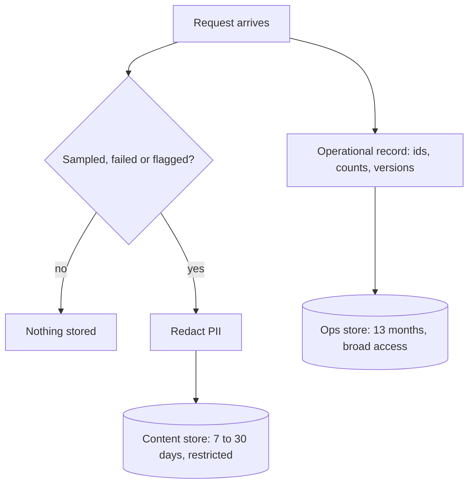

Data you do not have cannot be breached, leaked, subpoenaed or misused. **Retention** is the length of time you keep each kind of data, and a **retention policy** writes it down: for each store, how long, why, and how it is deleted. The default for engineers is to keep everything "in case it is useful". The default for privacy is to keep only what you can justify.

## Why shorter is safer

Think of each stored record as a small liability that grows the longer you hold it. Two things scale with retention: the number of records held, and the chance that at least one breach, mistaken access or legal demand touches them. If the annual probability of a damaging incident involving a given store is $q$, the chance of at least one in $Y$ years is

$$
P = 1 - (1 - q)^{Y}
$$

where $q$ is the yearly incident probability and $Y$ the years of exposure. Taking an illustrative $q = 2\%$: over 1 year $P = 2.0\%$; over 5 years $P = 1 - 0.98^5 = 1 - 0.904 = 9.6\%$. And the damage when it happens is proportional to how much is held. A rough **expected loss** is

$$
\mathbb{E}[\text{records exposed per year}] \approx q \times (\text{records held})
$$

With 15,450,000 records held (the previous topic's example) and $q = 2\%$ per year, the expectation is $0.02 \times 15{,}450{,}000 = 309{,}000$ records a year. After cutting the retention so only 5,400,000 are held, it is $108{,}000$. The numbers are illustrative, but the structure is real: shorter retention lowers both how likely a bad event touches you and how bad it is.

## A policy, by data type

Retention should differ by purpose. Metadata (counts, latencies, costs) has little privacy risk and long value for trends. Full prompt and answer text has the opposite profile.

| Data | Purpose | Suggested default | Notes |
|---|---|---|---|
| Aggregated metrics | trends, capacity | 13+ months | no user content |
| Request metadata (ids, tokens, latency, cost, versions) | debugging, billing | 13 months | pseudonymous ids |
| Redacted prompt and answer samples | quality review | 14 to 30 days | sampled, redacted |
| Raw prompt and answer text | incident investigation | 7 days or none | restricted access |
| Evaluation sets built from traffic | regression tests | until superseded | redact, review, minimise |
| Conversation memory for users | product feature | as long as the user wants it | user can view and delete |
| Security and audit logs | investigation, compliance | 12 months or as required | tamper-evident |

Treat these as starting points. Your sector, contracts and regulators may set minimums (for example for financial records) or maximums (for example for personal data), so check them with the right team.

## A logging policy

Logging is the commonest way personal data spreads. A short **logging policy** prevents most trouble:

1. **Never log secrets**: API keys, tokens, passwords. Enforce with a log scrubber and tests.
2. **Do not log raw text by default.** Log ids, counts and versions. Log text only for samples and failures, redacted, with a short retention.
3. **Separate** content logs from operational logs, with different access and retention.
4. **Redact at the source**, before the log line is written, not in a nightly job that leaves a window.
5. **Access is purposeful**: viewing a content log requires a reason, and the access is itself logged.
6. **Developer machines and tickets count.** Do not paste real user text into chat threads, tickets or notebooks without the same care.



## Deletion has to be real

A retention period is a promise that data is gone afterwards. Make deletion **automatic** (time-to-live on records, lifecycle rules on object storage) and verify it with tests that check old data is absent. Remember the copies: backups, search indexes, caches, replicas and derived datasets. A common gap is a warehouse table built from logs that never expires even though the log does.

```steps
Audit a retention policy
Pick one store from the data-flow map and read its configured retention.
---
Compare with the policy table. If it is longer, find out why; if there is no good reason, shorten it.
---
Check that deletion is automatic, and query for the oldest record: it should be no older than the policy allows.
---
Follow the data downstream: derived tables, backups, caches, evaluation sets. Each needs its own expiry.
---
Record the result and a date for the next check.
```

## In practice

Start by turning off raw-text logging in production and seeing what you actually miss. Most teams find that metadata, a redacted sample and failure traces cover nearly all debugging needs. When you do need raw text for an incident, enable it for a short time on a narrow slice, with approval and an expiry.

```quiz
{"q": "A store has a 3% chance per year of a damaging incident. What is the chance of at least one in 4 years?", "options": ["About 11.5%", "12%", "About 3%", "About 88.5%"], "answer": 0, "explain": "1 − 0.97⁴ = 1 − 0.885 = 0.115. The 12% answer adds 3% four times, which slightly overcounts; 88.5% is the chance of no incident."}
```

```quiz
{"q": "Which logging practice best limits the spread of personal data?", "options": ["Log ids and counts by default, and text only for redacted samples and failures", "Log all prompts and answers, then delete them after a year", "Log everything but restrict access to developers", "Stop logging entirely"], "answer": 0, "explain": "Metadata plus a small redacted sample supports debugging with far less stored personal data. Logging everything and relying on access control holds the full exposure, and no logs at all removes your ability to investigate incidents."}
```
