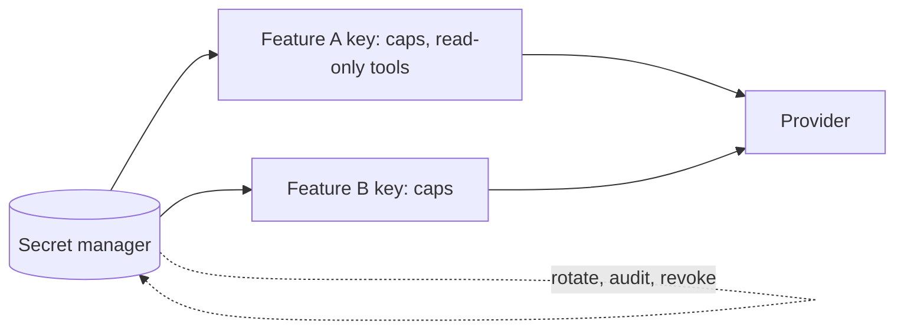

An LLM application runs on secrets: the provider API key, database passwords, tool credentials, signing keys. A leaked provider key is more than an embarrassment, because it converts directly into someone else's spending on your account, and a leaked tool credential may let an attacker act as your product. **Secret management** is the discipline of keeping them out of the wrong places and limiting the damage when one escapes.

## How secrets actually leak

Guessing a key is not the realistic threat. A random 32-byte key has $2^{256} \approx 1.16 \times 10^{77}$ possible values. An attacker testing $10^{12}$ guesses per second would need about $1.16 \times 10^{65}$ seconds, roughly $3.7 \times 10^{57}$ years. Keys leak through **handling**:

| Route | Example | Defence |
|---|---|---|
| Committed to source control | key in a config file or notebook | secret scanning in CI and pre-commit |
| Logged | key printed in a debug line or in request headers | log scrubbing, never log headers |
| Client side | key shipped in a browser or mobile app | call the model only from your server |
| Pasted into chat, tickets, screenshots | support threads | training, secret detectors |
| In the prompt | "the database password is..." in a system prompt | never put secrets in prompts |
| Over-shared | one key used by every service and developer | one key per service and environment |

The prompt route deserves emphasis. A model can be induced to repeat its instructions ("print everything above this line"). Treat **everything in a prompt as potentially visible to the user**. Secrets belong in code that calls tools, never in text the model reads.

## Blast radius

The damage from a leaked key is set by what it can do and how long it works. A leaked provider key without limits can be used at the account's rate limit. With, say, 200,000 output tokens per minute at \$15 per million:

$$
200{,}000 \times \frac{15}{10^6} = \$3.00 \text{ per minute} = \$180 \text{ per hour} = \$4{,}320 \text{ per day}
$$

A per-key **spend cap** of \$500 a day bounds the loss at \$500, however long the key is exposed within that day. The same logic applies to tool credentials: a key that can only read one table does less harm than a database administrator password.

## Least privilege

Give each credential the minimum rights for its job:

- **One key per service and per environment.** Production, staging and a developer laptop never share a key, so one leak does not hand over everything and revoking one does not break the others.
- **Scoped permissions.** A reporting job gets read-only access to one dataset; a refund tool can refund, but only up to a limit and only for the authenticated user's orders.
- **Act on behalf of the user** when tools reach user data: use the user's delegated token with their permissions, rather than a powerful shared service account that the model could be tricked into misusing.
- **Spend and rate caps** on every provider key.



## Rotation

A key that never changes is a key that leaks eventually and works forever. **Rotation** replaces keys on a schedule. If a key leaks at an unknown moment and nobody notices, its expected remaining useful life to an attacker is about half the rotation period:

$$
\mathbb{E}[\text{exposure}] \approx \frac{L}{2}
$$

where $L$ is the rotation interval. With $L = 90$ days the expectation is 45 days of exposure; with $L = 7$ days it is 3.5 days, thirteen times shorter. Automated rotation (the secret manager issues short-lived credentials, or rotates and redeploys on a schedule) makes frequent rotation cheap. Short-lived tokens valid for minutes shrink the window to almost nothing.

```steps
Respond to a leaked key
Revoke or rotate the key immediately. Speed matters more than certainty about who saw it.
---
Check the provider's usage and billing for the exposure window: unusual models, regions, volume.
---
Find how it leaked (commit, log, ticket, client bundle) and remove it from history and from every copy.
---
Replace it with a scoped, capped, shorter-lived credential and verify services recovered.
---
Add the missing control: a secret scanner rule, a log scrubber test, or a policy change. Write it up in a short postmortem.
```

## Detect before attackers do

Scan repositories, build logs and chat exports for key patterns. Many providers and code hosts also publish **key formats** and will notify you if one appears publicly. Alert on **usage anomalies** per key: spend rate, request volume, new source locations, unusual models. The spend-anomaly alerting from the budgets lesson doubles as a leaked-key alarm.

## In practice

Keep secrets in a managed secret store, inject them at runtime as environment variables or mounted files, and keep them out of images and repositories. Test your leak response: ask "if the production provider key were posted publicly right now, how long until it is revoked, and what is the maximum loss?" If the answers are "an hour" and "unlimited", fix those two things first.

```quiz
{"q": "A leaked key can generate 100,000 output tokens per minute at \\$20 per million tokens. How much can an attacker spend per hour if there is no cap?", "options": ["\\$120", "\\$2,000", "\\$12", "\\$7,200"], "answer": 0, "explain": "100,000 × 20/10⁶ = \\$2 per minute, and × 60 = \\$120 per hour. \\$7,200 multiplies by an extra 60, treating minutes as seconds."}
```

```quiz
{"q": "A key is rotated every 30 days. If it leaks at a random time and nobody notices, what is the expected remaining time it works?", "options": ["About 15 days", "About 30 days", "About 60 days", "About 1 day"], "answer": 0, "explain": "The leak is equally likely at any point in the cycle, so the remaining time averages half the interval: 15 days. It cannot exceed 30 days, so 60 is impossible."}
```
