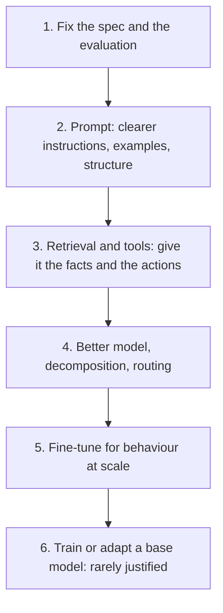

```callout-before
Before you start
You should know that fine-tuning means further training a model on your own examples so that its weights change, and that retrieval means fetching relevant text at question time and putting it in the prompt. Neither is assumed to be better. The goal of this lesson is to choose.
```

When a model feature underperforms, the instinctive reaction is "we should fine-tune it". Sometimes that is right. Often it is the slowest, dearest and riskiest way to fix a problem that a prompt change or a retrieval step would solve in a day. The discipline is to **diagnose first**, then take the cheapest intervention that addresses the diagnosed cause.

## Three kinds of failure

Sample real failures and sort them. Most fall into three kinds, and each has a natural fix:

| Kind of failure | What it looks like | Natural fix |
|---|---|---|
| **Knowledge**: the model lacks or has stale facts | wrong policy, outdated price, unknown internal term | retrieval (RAG), or put the facts in the prompt |
| **Behaviour**: the model knows enough but responds in the wrong way | wrong format, tone, verbosity, ignores house style | better prompt and examples first; fine-tuning if that is not enough |
| **Capability**: the task is beyond the model's reasoning | multi-step maths, long chains of logic | a stronger model, decomposition, tools |
| Other | ambiguous requirements, label errors, pipeline bugs | fix the spec, the data or the code |

Fine-tuning mostly addresses behaviour. It is a poor way to add facts (they are learned unreliably, cannot be cited, and go stale) and it cannot add much capability beyond the base model.

## The ladder



Move down a rung only when the one above has been tried and measured. Each step costs more in time, money and ongoing maintenance than the last, and each is harder to undo.

## Expected gain from failure shares

You can estimate the value of each intervention before building it. Let $F$ be the current failure rate, $s_k$ the share of failures of kind $k$ and $\phi_k$ the fraction of that kind an intervention is expected to fix. The expected improvement in pass rate is

$$
\Delta = F \cdot s_k \cdot \phi_k
$$

where $F$ is a fraction of all traffic, $s_k$ a fraction of failures and $\phi_k$ a fraction of that kind. Suppose a feature passes 80% of the time ($F = 0.20$). You read 100 failures and sort them: 45 knowledge, 25 format and style, 15 reasoning, 10 ambiguous or mislabelled, 5 pipeline bugs.

| Intervention | Targets | Share $s_k$ | Assumed fix rate $\phi_k$ | Gain $\Delta = 0.20 \cdot s_k \cdot \phi_k$ |
|---|---|---|---|---|
| Retrieval over the policy documents | knowledge | 0.45 | 0.70 | $0.20 \times 0.45 \times 0.70 = 6.3$ points |
| Better prompt and examples | format and style | 0.25 | 0.50 | $0.20 \times 0.25 \times 0.50 = 2.5$ points |
| Fine-tune on 3,000 examples | format and style | 0.25 | 0.85 | $0.20 \times 0.25 \times 0.85 = 4.25$ points |
| Stronger model on hard cases | reasoning | 0.15 | 0.40 | $0.20 \times 0.15 \times 0.40 = 1.2$ points |
| Fix the pipeline bugs | bugs | 0.05 | 1.00 | $0.20 \times 0.05 \times 1.00 = 1.0$ point |

Retrieval looks like the biggest win (80% to 86.3%). Fixing bugs is the cheapest and gets 1 point for nearly nothing. The fine-tune beats the prompt change on the same failures (4.25 vs 2.5 points) but costs an order of magnitude more, so it comes after the prompt has been exhausted. The fix rates are estimates: test each with a quick experiment on the failing cases before investing.

```steps
Decide what to do about a failing feature
Collect 100 to 200 real failures, not hypothetical ones, and write one line on why each failed.
---
Sort them into knowledge, behaviour, capability and other. Count each.
---
For each group, list the cheapest intervention and try it on the failing cases as a quick experiment. Record the fix rate.
---
Compute $\Delta = F \cdot s_k \cdot \phi_k$ for each. Rank by gain per unit of cost and effort.
---
Do the top item, re-measure on a fresh sample, and repeat. Consider fine-tuning only when behaviour failures remain a large share after prompts and retrieval have been tuned.
```

## In practice

A useful rule: if you cannot say in one sentence what **behaviour** you want the fine-tuned model to learn, you are not ready to fine-tune. "Answer in our JSON schema with short, neutral sentences, 95% of the time" is a fine-tuning target. "Know our product" is a retrieval target. "Be smarter" is a model-selection target.

```quiz
{"q": "A feature fails 25% of the time. 40% of failures are knowledge gaps and retrieval is expected to fix 60% of those. What pass-rate gain should you expect?", "options": ["6 points", "10 points", "15 points", "24 points"], "answer": 0, "explain": "Δ = F × s × φ = 0.25 × 0.40 × 0.60 = 0.06, six points. Ten points is the whole knowledge share (0.25 × 0.40) without applying the fix rate."}
```

```quiz
{"q": "Which problem is fine-tuning best suited to?", "options": ["Making outputs consistently follow a specific format and tone", "Teaching the model this week's prices", "Making the model cite sources", "Giving different customers access to different documents"], "answer": 0, "explain": "Fine-tuning shapes behaviour. Changing facts and per-customer permissions are retrieval problems: they must be updatable and enforceable per request, which weights cannot offer."}
```
