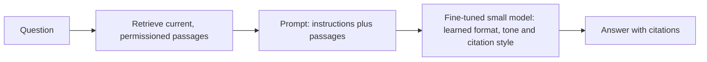

"Should we fine-tune the model on our documents?" is one of the most common questions in LLM projects, and for **knowledge** the answer is usually no. The reasons are practical: facts in weights are learned unreliably, cannot be cited, go stale and cannot respect per-user permissions. Retrieval (RAG) keeps the facts outside the model, where you can update, cite and control them.

## Side by side

| Property | Retrieval (RAG) | Fine-tuning on documents |
|---|---|---|
| Updating a fact | re-index the changed document, minutes | retrain, hours to days, then re-evaluate |
| Citing sources | natural: show the retrieved passage | not possible: the source is gone |
| Deleting data (privacy request, expired document) | delete from the index | cannot reliably remove from weights |
| Per-user or per-tenant permissions | filter at query time | impossible: weights are shared |
| Reliability of recall | high when retrieval works, auditable | can blur or invent details (hallucination) |
| Cost to change | cents to dollars | hundreds to thousands of dollars |
| Teaches style and format | weakly | strongly |
| Latency | adds retrieval time and longer prompts | none added, shorter prompt |

Each row favours retrieval for factual and changing data, and fine-tuning for stable behaviour.

## Staleness arithmetic

Suppose a fraction $x$ of the facts in your knowledge base changes each week. A model fine-tuned on a snapshot has, after $w$ weeks, the following fraction of facts out of date (assuming changes hit different facts independently):

$$
\text{stale}(w) = 1 - (1 - x)^{w}
$$

With $x = 2\%$ per week and $w = 13$ weeks (one quarter): $1 - 0.98^{13} = 1 - 0.769 = 23.1\%$. Nearly a quarter of the facts are wrong or outdated after three months, and the model gives no signal about which. A retrieval system re-indexes changed documents and is current within minutes.

## Refresh cost arithmetic

To keep a fine-tuned model reasonably current you must retrain regularly. Say each refresh costs \$800 for training plus \$200 of evaluation and engineering time, \$1,000 in total, and you do it weekly. Retrieval re-indexing the changed documents costs about \$5 of embedding and compute a week.

| Approach | Cost per refresh | Refreshes per year | Annual cost |
|---|---|---|---|
| Fine-tune weekly | \$1,000 | 52 | \$52,000 |
| Fine-tune quarterly (and accept staleness) | \$1,000 | 4 | \$4,000 |
| RAG re-index weekly | \$5 | 52 | \$260 |

Retrieval costs 200 times less to keep current, and weekly refresh is the sensible comparison, because the quarterly fine-tune is stale 23% of the time on average at the end of each quarter.

## A mixed design is common

The two combine well, because they fix different things:



Retrieval supplies the facts, and the tuned model supplies behaviours that are expensive to prompt: consistently cite passages in a house format, refuse politely when the passages lack the answer, use the company's terminology. Fine-tuning for *how to use retrieved context* is more robust than fine-tuning to memorise the context itself.

## When fine-tuning for knowledge is reasonable

There are some cases:

- **Stable domain language**, such as medical terminology or legal drafting conventions, where the base model is weak and the vocabulary does not change weekly.
- **A very large, rarely changing corpus** where retrieving enough context would be too slow or expensive per request.
- **Offline or latency-critical settings** where you cannot call a retriever at all.

Even then, measure against a strong retrieval baseline first. Often retrieval with a good reranker matches or beats the fine-tune on factual accuracy and wins on everything else in the table above.

## In practice

Run the cheap experiment before debating: build a basic RAG pipeline over the same documents, evaluate on the failing questions, and compare with the fine-tune candidate on the same evaluation set. The retrieval lesson in the RAG module shows how to measure recall and groundedness, and tells you whether remaining errors are retrieval errors (fix the index) or generation errors (fix the prompt or consider tuning for behaviour).

```quiz
{"q": "3% of a knowledge base changes each week. After 8 weeks, about what fraction of the facts in a fine-tuned snapshot is stale?", "options": ["About 22%", "24%", "About 3%", "About 78%"], "answer": 0, "explain": "1 − 0.97⁸ = 1 − 0.784 = 0.216, about 22%. Multiplying 3% × 8 = 24% slightly overcounts, since a fact can change more than once; 78% is the fraction still correct."}
```

```quiz
{"q": "A customer asks you to remove their documents from the assistant's knowledge. Which design lets you comply most reliably?", "options": ["Retrieval: delete their documents from the index", "A model fine-tuned on all customers' documents", "Adding 'forget this customer' to the prompt", "Waiting until the next fine-tune"], "answer": 0, "explain": "Deleting from an index removes the data from what the system can use. Information absorbed into weights cannot be reliably extracted, and a prompt instruction does not erase it."}
```
