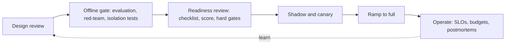

This module has covered routing, fallbacks, budgets, observability, guardrails, rollouts and privacy. Before a feature faces real users, you want to know where it stands on all of them at once. A **production-readiness review** is a structured walk through a checklist, with a number at the end and a clear rule for what blocks launch.

## The checklist

Each item is a yes or a no, with evidence.

| Area | Item | Where to learn it |
|---|---|---|
| **Quality** | An evaluation set from real use exists, with a target pass rate and a measured baseline | [Evaluation module](/learn/evaluation/success-criteria) |
| | Failures were sorted into causes, and the cheapest fixes were tried first | [Decision ladder](/learn/production-systems/when-to-fine-tune) |
| **Models** | Candidates compared on the quality, cost and latency frontier; versions pinned | [Routing](/learn/production-systems/model-routing) |
| | Routing or cascade validated against random and oracle baselines (if used) | [Routing](/learn/production-systems/model-routing) |
| **Reliability** | Fallback provider or degraded mode tested, availability computed with correlation | [Fallbacks](/learn/production-systems/fallbacks) |
| | Timeouts, retry budget and circuit breaker configured; failover rehearsed | [Fallbacks](/learn/production-systems/fallbacks) |
| **Cost** | Cost per request measured; monthly forecast with scenarios; budget agreed | [Budgets](/learn/production-systems/budgets-and-rate-limits) |
| | Rate limits, per-tenant quotas, spend alerts and a kill switch exist | [Budgets](/learn/production-systems/budgets-and-rate-limits) |
| **Observability** | Every request logged with versions, tokens, latency, cost, status | [Observability](/learn/production-systems/observability) |
| | Traces across all steps; dashboards for p50, p95, p99, errors, cost | [Observability](/learn/production-systems/observability) |
| | SLOs and error budget defined; burn-rate alerts route to a named on-call | [Observability](/learn/production-systems/observability) |
| | Production quality sampled and graded on a schedule | [Observability](/learn/production-systems/observability) |
| **Safety** | Threat model written; guardrails at input, output and action layers | [Guardrails](/learn/production-systems/guardrails) |
| | Thresholds chosen from cost at the real base rate; red-team set passes | [Guardrails](/learn/production-systems/guardrails) |
| | High-risk actions need approval; fail-open or closed decided per feature | [Guardrails](/learn/production-systems/guardrails) |
| **Release** | Change is versioned; shadow and canary plan with guard metrics written | [Rollouts](/learn/production-systems/rollouts) |
| | Rollback is one switch and has been rehearsed | [Rollouts](/learn/production-systems/rollouts) |
| **Privacy and security** | Data-flow map, classification and retention policy exist and are enforced | [Privacy](/learn/production-systems/privacy-and-compliance) |
| | PII redaction before logging; tenant isolation tests pass; secrets managed and capped | [Privacy](/learn/production-systems/privacy-and-compliance) |
| | Vendor terms checked; deletion requests can be honoured end to end | [Privacy](/learn/production-systems/privacy-and-compliance) |
| **Operations** | Runbooks, an on-call rota, an incident process and postmortem template | [Observability](/learn/production-systems/observability) |
| | System documentation (purpose, limits, versions, owners) is current | [Privacy](/learn/production-systems/privacy-and-compliance) |

## Scoring it

Not every area is equally important to every product. Give each area a **weight** $w_i$ (how much it matters here) and a **score** $s_i$ from 0 (nothing) to 4 (done, tested and evidenced). The overall readiness is the weighted fraction of the maximum:

$$
R = \frac{\sum_i w_i\, s_i}{4 \sum_i w_i}
$$

Take eight areas for a customer-facing assistant:

| Area | Weight $w_i$ | Score $s_i$ | $w_i s_i$ |
|---|---|---|---|
| Model choice and routing | 1 | 3 | 3 |
| Fallbacks and reliability | 2 | 2 | 4 |
| Budgets and limits | 2 | 4 | 8 |
| Observability | 3 | 2 | 6 |
| Guardrails | 3 | 3 | 9 |
| Rollout and rollback | 2 | 1 | 2 |
| Privacy and security | 3 | 2 | 6 |
| Evaluation and quality | 3 | 3 | 9 |
| **Total** | **19** | | **47** |

$$
R = \frac{47}{4 \times 19} = \frac{47}{76} = 61.8\%
$$

A readiness of 62% says "not yet", but the more useful output is the **lowest-scoring weighted areas**: rollout and rollback (1), fallbacks (2), observability (2) and privacy (2). Those are the work plan.

## Gates beat averages

A single average can hide a fatal gap: a feature scoring 4 everywhere except "no rollback path" could still reach 90%. Use the score for planning and **hard gates** for the launch decision. Any of these blocks launch regardless of the score:

- No evaluation of quality on realistic inputs.
- No way to turn the feature off quickly.
- Personal data flowing somewhere your policy forbids.
- No guardrail or approval on an irreversible or high-value action.
- No tenant isolation test where multiple customers share infrastructure.
- No one on call who can act on an alert.



## Launch in tiers

Match the audience to the readiness. A common progression:

| Tier | Audience | Minimum readiness |
|---|---|---|
| Internal dogfood | the team | gates for safety and kill switch; observability basics |
| Limited beta | invited customers, human review of risky outputs | most items scored 2 or more; rollout and rollback in place |
| General availability | all users | no hard-gate failures; $R$ above an agreed bar such as 80%; SLOs and on-call live |
| Regulated or high-stakes use | sensitive domains | GA plus extra review, documentation and approvals |

## After launch

Readiness decays. New features add data flows, prompts grow, vendors change terms, the team turns over. Re-run the review every quarter and after any large change, and feed the postmortem action items back into the checklist. The aim is not a perfect score but a system whose weaknesses you know, have priced and have a plan for.

## In practice

Keep the checklist in the repository and make the review a pull request: each item links to evidence (a dashboard, a test, a document). It makes the review fast and honest, and it makes it easy for the next team to see what "ready" meant when this feature shipped.

```quiz
{"q": "Three areas have weights 2, 3 and 1 and scores 4, 2 and 3 out of 4. What is the readiness R?", "options": ["About 71%", "75%", "About 50%", "About 90%"], "answer": 0, "explain": "Weighted sum = 2×4 + 3×2 + 1×3 = 17. Maximum = 4 × (2 + 3 + 1) = 24. R = 17/24 = 70.8%. The plain average of the scores, (4 + 2 + 3)/3 = 3 out of 4 = 75%, ignores the weights, so it hides that the heavily weighted area scored only 2."}
```

```quiz
{"q": "A feature scores 90% on the readiness checklist but has no way to disable it quickly. What should the launch decision be?", "options": ["Do not launch until a kill switch exists", "Launch: 90% is above the bar", "Launch to everyone and add a kill switch later", "Average the gate failure into the score"], "answer": 0, "explain": "A hard gate is not an average: some gaps are unacceptable whatever the rest looks like. Without a fast off switch, any incident lasts as long as a code deploy takes."}
```
