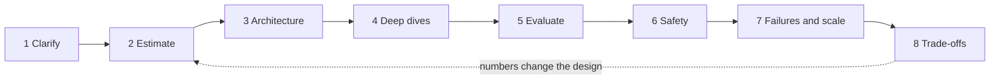

```callout-before
Before you start
This lesson is about method, not new machine learning. You should know roughly what an LLM request costs and what RAG is. Every price is hypothetical; the habit of computing is what transfers.
```

An interviewer says: "Design a chatbot for our product." Candidates fail this prompt in two opposite ways. Some start drawing boxes (vector database! gateway! cache!) before they know who the users are. Others stay vague forever and never commit to a number. A **framework** fixes both: it is a fixed order of questions, so you always know what to do next and the interviewer can follow your reasoning.

Real design work has the same shape. An architecture reviewed without traffic numbers, a quality target or a failure plan is a drawing, not a design.

## The eight steps



| Step | Question it answers | Output you can point at | Typical time (45 min) |
|---|---|---|---|
| 1 Clarify | What are we building, for whom, how good, how fast? | Requirements, SLOs, non-goals | 5 min |
| 2 Estimate | How big is it? | QPS, tokens/day, cost, GPUs, storage | 7 min |
| 3 Architecture | Which components, and how does a request flow? | One diagram, one traced request | 7 min |
| 4 Deep dives | Where is the hard part? | 2 or 3 components designed in depth | 12 min |
| 5 Evaluate | How do we know it works? | Offline set, online metrics | 5 min |
| 6 Safety | What must never happen? | Guardrails, permissions, data rules | 3 min |
| 7 Failures and scale | What breaks at 10x or at 3 a.m.? | Failure table, fallbacks | 4 min |
| 8 Trade-offs | What did we give up, and why? | Explicit alternatives | 2 min, but woven through |

The dotted arrow matters: estimates are not a ritual. When the estimate says self-hosting needs 100 GPUs, you go back and reconsider model size. Designs improve through that loop.

## Why order matters: the cost of a wrong early decision

Decisions made early constrain everything after. A simple way to see it is to give each step an **error multiplier**: the factor by which a wrong answer there shifts the final cost. Suppose you misjudge the user count by 10x ($m_1 = 10$), pick a model 4x too large ($m_2 = 4$), and skip caching that would have saved 40% of spend ($m_3 = 1/0.6 \approx 1.67$). Errors multiply:

$$
M = m_1 \cdot m_2 \cdot m_3 = 10 \times 4 \times 1.67 \approx 67
$$

Here $M$ is the overall overspend factor. A system 67 times more expensive than needed is not a tuning problem. The expensive mistakes sit in steps 1 and 2, which is why they come first and why the framework spends time there before any box is drawn.

## The running example

The next topics carry one prompt through every step so you can verify the arithmetic:

> A consumer app with **2 million daily active users**. Each user sends **5 messages a day**. A request carries **1,500 input tokens** (system prompt, history, retrieved context) and produces **300 output tokens**.

By the end you will know this is 10 million requests a day, about 116 QPS on average and 347 at peak, \$810,000 a month at hypothetical API prices, about 100 GPUs if self-hosted, and what to do about each number.

```steps
One pass through the framework on the running example
Clarify: consumer chat over a product knowledge base, answers must cite sources, p95 time to first token under 1.5 s, 99.9% availability.
---
Estimate: $2\text{M} \times 5 = 10\text{M}$ requests per day, so 116 QPS average and 347 at peak, with 15B input and 3B output tokens per day.
---
Architecture: gateway, retrieval, model tier, cache, logging. Trace one request from the app to the streamed answer.
---
Deep dives: retrieval quality (is the right chunk found?), model choice (small first, large on escalation), serving (batching and KV memory), caching (prefix cache for the system prompt).
---
Evaluate and protect: golden set plus online feedback; injection filter, PII redaction, permission checks.
---
Break it: provider outage, queue overload, bad prompt release. Then state the trade-offs you chose: cost versus quality, latency versus recall.
```

## In practice

Strong candidates say the framework out loud at the start ("I will clarify, estimate, sketch, then go deep on two areas") and keep a visible running list of assumptions. Interviewers notice when you revisit an assumption after an estimate ("at 100 GPUs I would rather try a cascade"). They are looking for judgement, and judgement shows up as changing your mind for a reason.

Another common slip is spending 25 minutes on retrieval and none on evaluation. Time-box deliberately. The case studies that follow, such as [the support assistant](/learn/llm-system-design/design-support-assistant) and [the LLM platform](/learn/llm-system-design/design-llm-platform), use the same proportions.

```quiz
{"q": "You estimate a design at 100 GPUs and conclude a 70B model is unaffordable. What does the framework tell you to do?", "options": ["Proceed to the deep dives with the 70B model and hope", "Return to the architecture and model choice (for example a small model with escalation) and re-estimate", "Skip the estimate in the interview", "Reduce the number of users"], "answer": 1, "explain": "Estimates exist to change designs. The loop from estimate back to architecture is the point. Proceeding unchanged wastes the work; cutting users changes the requirements without justification."}
```

```quiz
{"q": "Which mistake multiplies most badly in the error-multiplier view?", "options": ["Naming a component slightly wrongly in the diagram", "A 10x error in user count at the start, with later choices sized from it", "Forgetting to label an arrow", "Using different box colours"], "answer": 1, "explain": "Early numeric errors propagate: every later step is sized from them, so errors multiply. Labelling and naming slips affect clarity, not the scale of the whole system."}
```
