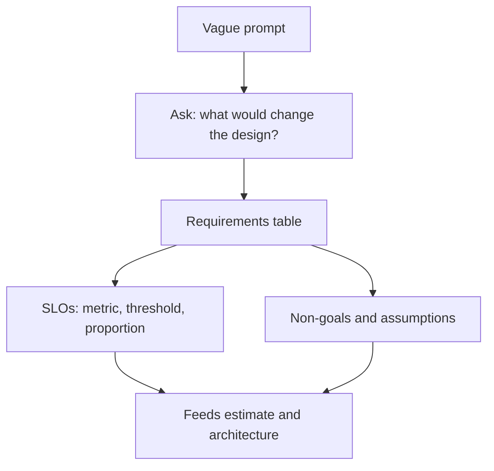

The first five minutes decide the quality of the next forty. An LLM product prompt is deliberately underspecified, and the interviewer wants to see whether you can find the missing pieces. Think of it as filling in a form with five sections. Each missing answer becomes a documented **assumption** that you state aloud.

## The five sections

| Section | Questions to ask | Why the answer changes the design |
|---|---|---|
| Function | Who are the users? What tasks? Which inputs (text, files, voice)? Which languages? | Decides modality, context size, tools |
| Quality | What counts as a correct answer? What does a wrong one cost? | Decides model tier, grounding, human review |
| Latency | Streaming? Time to first token versus total time? Interactive or batch? | Decides model size, serving setup, caching |
| Scale and cost | Daily users, requests per user, budget per request or month? | Feeds the estimate |
| Risk | Private data? Permissions? Regulated domain? Abuse likely? | Decides guardrails, logging, hosting |

Do not ask all 25 possible questions. Ask the ones where the answer would change your architecture, and **propose a default** when the interviewer shrugs: "I will assume English only and a 1.5 s p95 time to first token; tell me if that is wrong."

## From words to measurable targets

A vague goal such as "fast" or "accurate" is useless. Convert each into a **service level objective (SLO)**: a measurable target over a window. A **service level indicator (SLI)** is the measured fraction of good requests, and the SLO says it must stay above a threshold $s$:

$$
\text{SLI} = \frac{\text{good requests}}{\text{total requests}} \ge s
$$

The **error budget** is what remains: a fraction $1 - s$ of requests may miss the target.

Worked example. The target is "99.9% of requests succeed and stream a first token within 1.5 s." Over a 30-day month with 300 million requests ($10\text{M} \times 30$), $s = 0.999$ gives an error budget of

$$
(1 - 0.999) \times 300{,}000{,}000 = 300{,}000 \text{ requests}
$$

or, as total downtime, $0.001 \times 30 \times 24 \times 60 = 43.2$ minutes. A single 20-minute provider outage burns almost half of the budget. That one calculation justifies the fallback design you present later.



## Quality needs a definition and a cost

"Accurate" must be tied to the task. For a support bot, say **resolution without escalation** with a wrong-answer rate below 2%. For extraction, field-level F1. For a code assistant, acceptance rate. Then attach a cost to errors, because that decides how conservative to be. The expected cost of an error rate $e$ per request is $e \times c_{wrong}$, where $c_{wrong}$ is the cost of one wrong answer. Compare it with the per-request cost of the control you are considering.

For the running example, suppose 4% of answers are wrong and each costs \$0.50 in rework: $0.04 \times 0.50 = \$0.02$ per request. At hypothetical large-model prices the model cost is $1500 \times 10^{-6} + 300 \times 4 \times 10^{-6} = \$0.0027$ per request. The error cost is about seven times the model cost. Quality, not tokens, dominates the economics, and you only discover it by asking the quality question.

## Non-goals

Say what you will not build: "No fine-tuning in version one, no multilingual support, no voice." Non-goals protect you from scope creep and show product sense. In real projects, an explicit non-goals list is one of the cheapest documents you can write.

## In practice

Teams often discover too late that the real requirement was a latency number or a data-residency rule nobody wrote down. Put requirements in a table with an owner and revisit it whenever an estimate surprises you. A good table fits on one screen, has at least one number per row, and marks each row as given or assumed.

```quiz
{"q": "SLO: 99.9% of 300 million monthly requests must succeed. How many failures does the error budget allow?", "options": ["30,000", "300,000", "3,000,000", "999,000"], "answer": 1, "explain": "(1 - 0.999) × 300,000,000 = 300,000. 30,000 would be a 99.99% target; 3 million is 99%."}
```

```quiz
{"q": "The interviewer says the bot must be 'accurate'. What is the best next move?", "options": ["Choose the biggest model", "Define accuracy for the task, set a numeric target, and ask what a wrong answer costs", "Ignore it and move to the diagram", "Ask for the training data"], "answer": 1, "explain": "A measurable target and an error cost let you decide model tier, grounding and review. The biggest model is an expensive guess; ignoring the word leaves the key requirement undefined."}
```
