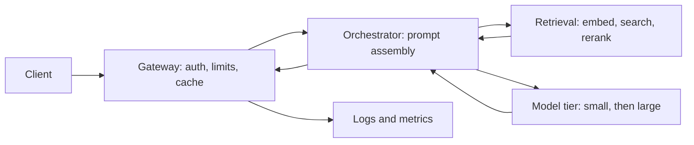

With numbers in hand, draw one diagram and trace one request through it. Then choose where to go deep. You cannot cover everything in 12 minutes, so the rule is: **go deep where the numbers say the risk or the money is**. For a RAG chat product that usually means retrieval quality, model choice, serving, and caching.

## A default architecture



Each box has one job. The **gateway** handles identity, rate limits and cached answers. The **orchestrator** builds the prompt from the system instructions, the conversation history and retrieved chunks. **Retrieval** finds evidence. The **model tier** generates. **Logging** records every step so you can debug and evaluate later.

```steps
One request, end to end
The client sends a message. The gateway authenticates the user, checks the rate limit and looks for an exact-match cached answer (miss).
---
The orchestrator embeds the query and runs hybrid search; the reranker keeps the top 5 chunks of 200 tokens each.
---
It assembles the prompt: system prompt 300 tokens, history 200, chunks 1,000. Total 1,500 input tokens, which is exactly our running example.
---
The small model answers first, streaming tokens back. A confidence check decides whether to escalate to the large model.
---
The output filter checks for leaked personal data and unsupported claims, then the response completes and the full trace is logged.
```

## Deep dive 1: retrieval and the cost of recall

For RAG the answer can only be right if the evidence was retrieved and the model used it. A useful first-order model multiplies the two probabilities:

$$
\text{accuracy} \approx \text{recall@}k \times f
$$

where recall@$k$ is the fraction of questions whose evidence appears in the top $k$ chunks, and $f$ is the **faithfulness**: the probability the model answers correctly given the evidence is present. Suppose dense retrieval has recall@5 of 0.78 and hybrid with reranking has 0.90, and $f = 0.95$. Accuracy is $0.78 \times 0.95 = 0.741$ versus $0.90 \times 0.95 = 0.855$: eleven points for adding BM25 and a reranker.

More chunks also raise recall, but each costs tokens. Going from $k = 5$ to $k = 10$ with 200-token chunks adds 1,000 input tokens: $1{,}000 \times 10^{-6} = \$0.001$ per request, which is 37% on top of \$0.0027, or \$300,000 per month at 10M requests a day. If recall rises to 0.93, accuracy becomes $0.93 \times 0.95 = 0.8835$, a gain of 2.85 points: roughly \$105,000 per percentage point. Compare that with the hybrid change, which costs almost nothing per request. Cheap fixes first.

```sim
rag-pipeline
{"k": 5, "chunkTokens": 200}
```

Switch the retriever between BM25, dense and hybrid at k = 5 and note recall and accuracy. Then raise k to 15 and watch context tokens, cost and latency climb while recall flattens.

## Deep dive 2: model choice

Pick the cheapest model that meets the quality target, and escalate only when needed. The expected cost of a **cascade** that tries the small model on every request and escalates a fraction $e$ to the large one is

$$
c_{cascade} = c_{small} + e\,c_{large}
$$

With small-model cost $1500 \times 0.1 \times 10^{-6} + 300 \times 0.4 \times 10^{-6} = \$0.00027$ and large cost \$0.0027, escalating $e = 30\%$ gives $0.00027 + 0.3 \times 0.0027 = \$0.00108$, which is 60% cheaper than always using the large model: \$324,000 versus \$810,000 per month. The catch is that the confidence signal must really identify the hard requests; test that in the evaluation step.

```sim
model-cascade
```

Move the confidence threshold up and down and read escalation rate, quality and savings. A threshold that escalates 30% of traffic saves most of the money; one that escalates 80% saves little.

## Deep dive 3: serving and 4: caching

Serving is where the latency budget lives. Break time to first token (TTFT) into parts that add up: network 40 ms, gateway 10 ms, retrieval 90 ms, queue 75 ms, prefill 60 ms, first decode step 25 ms, total **300 ms**. Then per-token time (TPOT) of 25 ms for 300 tokens adds 7.5 s, giving the 7.8 s end-to-end used for concurrency earlier.

| Cache | Key | Saves | Risk |
|---|---|---|---|
| Exact response | Hash of normalised prompt | Whole request | Stale answers, cross-user leakage |
| Prefix (prompt) cache | Shared prompt prefix | Prefill time and input cost | Needs stable prompt ordering |
| Semantic cache | Embedding of the query | Whole request for near-duplicates | Wrong match returns a wrong answer |
| Retrieval cache | Query embedding | Search time | Staleness after index updates |

## In practice

Pick two or three deep dives and say why: "Retrieval, because recall caps accuracy; cascading, because model cost dominates." Naming what you are skipping ("I will not go deep on the UI or the ingestion pipeline unless you want me to") is itself a sign of seniority.

```quiz
{"q": "Hybrid retrieval raises recall@5 from 0.78 to 0.90 with faithfulness 0.95. What is the new estimated answer accuracy?", "options": ["0.741", "0.855", "0.90", "0.95"], "answer": 1, "explain": "Accuracy ≈ recall × faithfulness = 0.90 × 0.95 = 0.855. 0.741 is the old value; 0.90 and 0.95 each ignore the other factor."}
```

```quiz
{"q": "A cascade runs the small model on every request (cost 0.00027) and escalates 30% to the large model (cost 0.0027). What is the average cost per request?", "options": ["0.00081", "0.00108", "0.00297", "0.0027"], "answer": 1, "explain": "0.00027 + 0.3 × 0.0027 = 0.00108. 0.00081 forgets that the small model also runs on the escalated requests; 0.00297 adds the full large cost for everyone."}
```
