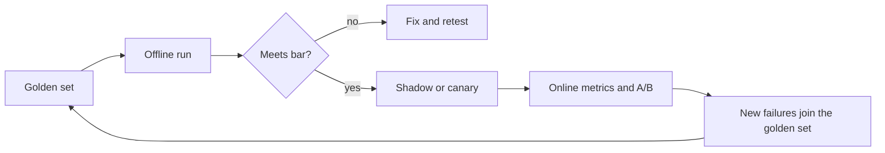

A design that cannot say how it will be measured, what it must never do and how it will break is incomplete. These three steps are where candidates most often run out of time, so practise delivering each in about three minutes with at least one number.

## Evaluation: offline first, then online

**Offline evaluation** runs the system on a fixed golden set with known good answers before any user sees a change. **Online evaluation** watches real traffic: thumbs, escalations, retention, and A/B tests. You need both: offline is fast and repeatable but narrow; online is real but slow and noisy.

How big must the golden set be? A pass rate $\hat{p}$ measured on $n$ examples has a 95% confidence half-width of roughly

$$
h = 1.96\sqrt{\frac{\hat{p}(1-\hat{p})}{n}} \quad\Rightarrow\quad n = \frac{1.96^2\,\hat{p}(1-\hat{p})}{h^2}
$$

Worked example: you expect $\hat{p} = 0.80$ and want $h = 0.03$ (plus or minus 3 points). Then $n = 3.84 \times 0.16 / 0.0009 \approx 683$ examples. To detect a 2-point improvement between two systems you need several thousand; that is why a 50-question hand-picked set cannot tell two candidate prompts apart.



The loop at the end is the habit that matters: every production failure becomes a test case.

| Layer | Metric | Example target |
|---|---|---|
| Retrieval | recall@5 | at least 0.90 |
| Generation | grounded-answer rate (judge plus human spot checks) | at least 0.95 |
| Task | resolution without escalation | at least 70% |
| Operations | p95 time to first token, availability | under 1.5 s, 99.9% |
| Business | cost per resolved conversation | under \$0.10 |

## Safety: what must never happen

List the worst outcomes first (leaking another user's data, executing a destructive tool call, giving regulated advice), then place a control against each: input filters for injection, permission checks before retrieval, output filters for personal data, confirmation steps before actions. Controls have a price, and the price depends on **base rates**.

Suppose 0.5% of messages are attacks ($\pi = 0.005$), your classifier catches 95% of them (recall $0.95$) and wrongly flags 2% of benign messages (false-positive rate $0.02$). Precision by Bayes' rule:

$$
\text{precision} = \frac{\pi \cdot \text{recall}}{\pi \cdot \text{recall} + (1-\pi)\cdot \text{FPR}} = \frac{0.005 \times 0.95}{0.005 \times 0.95 + 0.995 \times 0.02} = \frac{0.00475}{0.02465} \approx 0.19
$$

Only about **19% of blocked messages are real attacks**; the other 81% are legitimate users you just refused. A strong-sounding classifier is weak when attacks are rare. That is why you tier controls (cheap filter, then a stronger check only on flagged traffic) and why blocking is not the only action: you can also log, rate-limit or add friction.

```sim
guardrail-threshold
{"baseRate": 0.005}
```

Slide the block threshold and watch false blocks and missed attacks trade off. Then lower the base rate to 0.1% and see precision collapse even though the classifier did not change.

## Failure modes and scaling

Walk the diagram and ask of every box: what if it is slow, wrong or down?

| Failure | Detection | Mitigation |
|---|---|---|
| Provider outage or 429s | error rate, latency alert | Fallback provider, queue, degrade to cached or smaller model |
| Retrieval returns nothing relevant | low similarity scores | Say "I could not find that", escalate to a human |
| Prompt release regresses quality | canary metrics | Roll back automatically |
| Traffic spike (3x peak) | queue depth | Autoscale, shed low-priority load |
| Runaway agent or token loop | per-request token cap | Hard limits on steps and tokens |

Fallbacks pay off enormously. If the primary provider is 99.9% available and a fallback is 99.5%, and failures are independent, combined availability is $1 - 0.001 \times 0.005 = 99.9995\%$. Independence is the optimistic assumption: shared dependencies (the same cloud region, the same gateway) correlate failures, so say so.

For scaling, state what changes at 10x: the GPU count, the index sharding, the log volume, and which component hits a limit first.

## In practice

Teams skip the evaluation set and rely on demos, then cannot tell whether a prompt change helped. Build the golden set before the feature, and wire an alert on the metric that matters most. The [production-systems module](/learn/production-systems/guardrails) covers the control mechanics in depth.

```quiz
{"q": "A classifier has recall 0.95 and false-positive rate 0.02, and 0.5% of traffic is malicious. Roughly what fraction of blocked messages are truly malicious?", "options": ["95%", "98%", "19%", "50%"], "answer": 2, "explain": "Precision = 0.00475 / (0.00475 + 0.0199) ≈ 0.19. 95% is the recall, a different quantity. With rare attacks, the large benign population produces many more false positives than there are true attacks."}
```

```quiz
{"q": "You want a pass rate measured to within plus or minus 3 points at 95% confidence, expecting about 80%. Roughly how many evaluation examples do you need?", "options": ["About 70", "About 170", "About 680", "About 6,800"], "answer": 2, "explain": "n = 1.96² × 0.8 × 0.2 / 0.03² ≈ 683. 70 would give an interval about ±9 points wide."}
```
