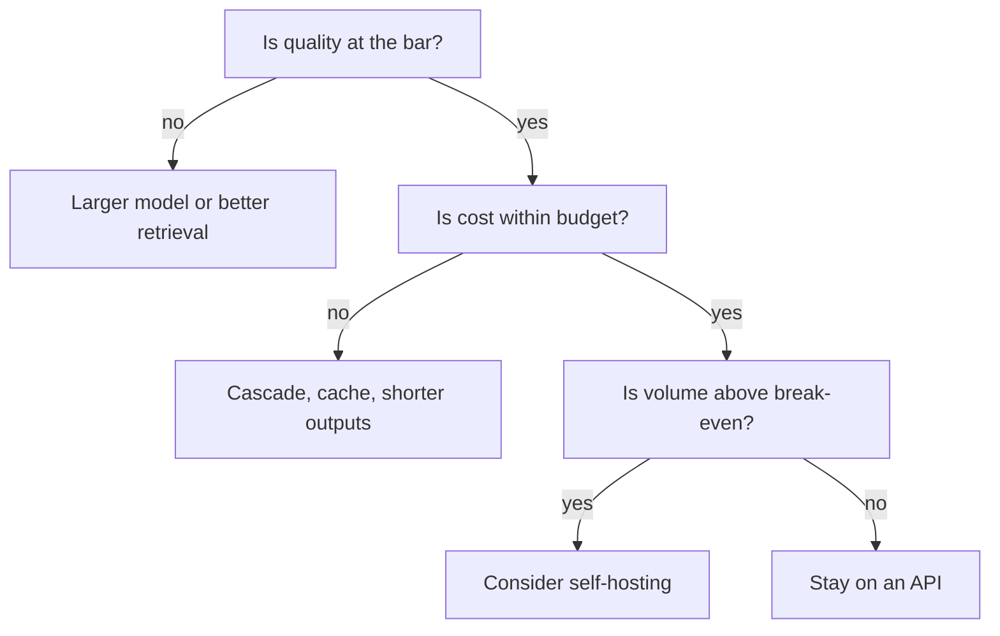

Every design decision gives something up. A trade-off is not an apology; it is the content of the design. When you say "I chose a cascade", the interviewer's next thought is "against what, and why?" Answer before they ask, and the whole conversation moves in your favour.

The shape of a good trade-off statement is four parts: the **choice**, the **alternative**, the **number** that separates them, and the **condition** that would flip the decision. "I would self-host above about 6 million requests per day, because below that the API's per-token price beats the fixed GPU bill."

## Build versus buy, with a break-even

Self-hosting has a fixed cost (GPUs run whether or not requests arrive) and an API has a variable cost. Let $F$ be the fixed monthly GPU bill, $v$ the API cost per request and $R_m$ requests per month. Self-hosting wins when

$$
F < v\,R_m \quad\Longleftrightarrow\quad R_m > \frac{F}{v}
$$

Worked example with the running numbers. The self-hosted 8B deployment costs $F = \$326{,}675$ per month. The large API model with 60% prefix caching costs $v = 567{,}000 / 300{,}000{,}000 = \$0.00189$ per request. The break-even is $326{,}675 / 0.00189 = 172.9$ million requests per month, about 5.8 million a day. We are at 10 million a day, so self-hosting wins on cost, **if** the 8B model meets quality.

Now against a small API model at \$0.00027 per request: break-even is $326{,}675 / 0.00027 = 1.21$ billion requests per month, about 40 million a day. At our volume the small API model (\$81,000 per month) is far cheaper than running GPUs. The conclusion flips with the alternative you compare against, which is why you always name it.

| Option | Monthly cost | Quality | Operational burden |
|---|---|---|---|
| Large API, no cache | \$810,000 | Highest | Lowest |
| Large API, prefix cache | \$567,000 | Highest | Low |
| Cascade (small, 30% escalate) | \$324,000 | High if the gate is good | Medium |
| Small API only | \$81,000 | Lower | Low |
| Self-hosted 8B | \$326,675 | Lower, tunable | Highest |

## A weighted decision matrix

When several criteria compete, make the weighting explicit. Score each option from 1 (poor) to 5 (excellent) per criterion, multiply by the weight $w_j$ and sum: $S = \sum_j w_j s_j$ with $\sum_j w_j = 1$.

With weights cost 0.4, quality 0.3, latency 0.2, operations 0.1:

| Option | Cost | Quality | Latency | Ops | Score |
|---|---|---|---|---|---|
| Large API | 1 | 5 | 3 | 5 | $0.4 + 1.5 + 0.6 + 0.5 = 3.0$ |
| Cascade | 4 | 4 | 4 | 3 | $1.6 + 1.2 + 0.8 + 0.3 = 3.9$ |
| Self-hosted 8B | 5 | 2 | 4 | 1 | $2.0 + 0.6 + 0.8 + 0.1 = 3.5$ |

The cascade wins here. But the point is the sensitivity: raise the quality weight to 0.6 (and cut cost to 0.1) and the large API wins. Say so: "if this is a medical product, quality outweighs cost and I would flip to the large model." The scores are judgement, not data, so use the matrix to structure the argument rather than as a proof.



## The recurring tensions

| Tension | One side | Other side | What decides it |
|---|---|---|---|
| Cost and quality | Big model everywhere | Cascade | Cost of a wrong answer |
| Latency and recall | Fewer chunks, no reranker | More chunks, reranker | Latency SLO |
| Freshness and cost | Reindex continuously | Nightly batch | How fast facts change |
| Safety and usability | Block aggressively | Allow and monitor | Base rate and harm size |
| Control and effort | Self-host, fine-tune | Managed API | Team size and volume |

## Communicating the design

Structure helps the listener more than detail does. Announce the plan, summarise at each transition ("so, at 347 peak QPS we need about 125 GPUs at full utilisation"), and finish with a two-minute recap: requirements, headline numbers, architecture, the two biggest risks, and what you would build first. Label assumptions as assumptions. When you do not know a number, say "I would measure this, and my working figure is X", then proceed. Inventing certainty is worse than admitting a range.

Handle challenges calmly. If the interviewer changes a requirement (say, latency must halve), treat it as a gift: re-run the relevant estimate out loud and show what moves. Staying inside the framework under pressure is exactly the skill being tested.

```steps
A two-minute closing recap
Requirements: 2M users, 5 messages a day, p95 TTFT under 1.5 s, 99.9% availability, cited answers.
---
Numbers: 10M requests per day, 347 peak QPS, \$567,000 per month on a cached large-model API versus \$324,000 for a cascade.
---
Architecture: gateway, orchestrator, hybrid retrieval with reranking, small-then-large models, prefix cache, full tracing.
---
Biggest risks: retrieval recall, a weak escalation gate, provider outage. Controls: golden set plus canary, fallback provider, per-request token caps.
---
First build: a thin end-to-end slice behind the gateway, with evaluation wired in before any optimisation.
```

## In practice

Real teams do the same dance in design documents: a "Alternatives considered" section is the written form of this topic. The gateway pattern appears in every case study; the [LLM platform lesson](/learn/llm-system-design/design-llm-platform) designs it in full, and the sandbox below lets you operate one.

```sandbox
llm-gateway
```

```quiz
{"q": "Self-hosting costs \\$300,000 a month. The API costs \\$0.002 per request. At roughly what monthly volume does self-hosting break even on cost?", "options": ["15 million", "150 million", "600 million", "1.5 billion"], "answer": 1, "explain": "R = F / v = 300,000 / 0.002 = 150 million requests per month. Below that volume the API is cheaper; above it the fixed GPU bill is spread over more requests."}
```

```quiz
{"q": "Which is the best form of trade-off statement?", "options": ["A cascade is better.", "I would use a cascade rather than the large model alone: it is about 60% cheaper at 30% escalation, unless wrong answers are very costly, when I would flip.", "There are pros and cons to both.", "Whatever the team prefers."], "answer": 1, "explain": "It names the choice, the alternative, a number and the condition that would change the decision. The others state a conclusion without evidence or avoid committing."}
```
