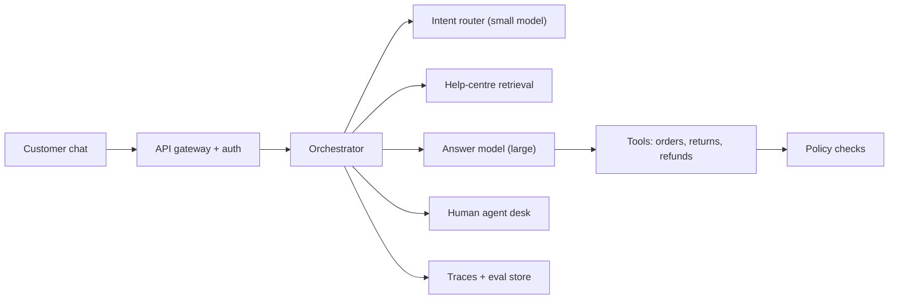

A support assistant is three systems wearing one chat bubble. It is a **question answerer** that reads the help centre, an **action taker** that touches orders and refunds, and a **router** that knows when to step aside for a human. Drawing them as separate boxes early makes the rest of the interview easier, because each box has its own failure modes, its own latency and its own owner.

The piece that ties them together is the **orchestrator**: ordinary backend code (not a model) that loads the conversation, decides which steps run, calls the model, executes tools, applies policy checks and writes everything to a trace. Keeping control flow in code, and using the model only for the judgements code cannot make, is the single most defensible choice in this design.



## What each box owns

| Component | Job | Typical latency | Main failure |
|---|---|---|---|
| Gateway | Auth, rate limit, session id | 10–20 ms | Abuse, bot traffic |
| Orchestrator | Load state, run the plan, write traces | 5–15 ms | Bugs in control flow |
| Intent router | Classify: FAQ, account action, complaint, needs human | 100–200 ms | Misroutes angry customers |
| Retrieval | Embed query, search, rerank top chunks | 100–150 ms | Wrong or stale article |
| Answer model | Write the reply, choose tools | 500–700 ms to first token | Ungrounded claims |
| Tools + policy | Read orders, create returns, refunds within limits | 100–500 ms | Wrong order, unsafe refund |
| Human desk | Takes escalations with a summary | minutes | Customer repeats themselves |

## The latency budget

The SLO from the requirements is p95 time to first token under 1.5 s. Budget it as a sum, because in a sequential pipeline latencies add:

$$
\text{TTFT} = t_{net} + t_{gw} + t_{state} + t_{route} + t_{retr} + t_{prefill}
$$

where $t_{net}$ is client network time, $t_{gw}$ the gateway, $t_{state}$ loading the session, $t_{route}$ the intent classifier, $t_{retr}$ retrieval and $t_{prefill}$ the answer model's time to first token. With $100 + 20 + 15 + 150 + 130 + 600 = 1{,}015$ ms at the median, there is about 0.5 s of headroom for the tail. Two levers buy more: run routing and retrieval **in parallel** (the slower of 150 and 130 ms, not their sum, saving 130 ms), and skip retrieval entirely for turns the router labels as pure account actions.

A turn that calls a tool is slower: one model call to choose the tool (about 600 ms to first token plus 30 tokens of arguments at 25 ms, so 1,350 ms), the tool itself (300 ms), and a second call to write the reply (600 ms). That is about 2.25 s before the first real word, which breaks the SLO. The fix is product, not infrastructure: stream a short status line ("Checking order 4471...") as soon as the tool is chosen, so the customer sees progress inside the budget.

## One turn, end to end

```steps
"Where is my order? It was meant to arrive Tuesday."
The gateway authenticates the session and attaches the customer id. The orchestrator loads the last four turns and a running summary of older ones, keeping history under about 700 tokens.
---
In parallel, the small router labels the turn `order_status` (confidence 0.94) and retrieval fetches the top chunks for "late delivery" from the help centre: the delivery-delay policy and the compensation rules.
---
The orchestrator builds the prompt: system prompt (cached prefix), tool definitions, the two policy chunks with ids, the history, the new message. About 2,500 tokens. The answer model returns a tool call `get_order_status(customer_id, latest=true)`.
---
The orchestrator streams "Checking your latest order..." to the customer, runs the tool with the customer's own id (never an id the model typed), and appends the result: carrier delay, new estimate Friday.
---
Second model call: the reply explains the delay, quotes the policy chunk on delay compensation and offers the voucher the policy allows. A grounding check confirms every policy claim cites a retrieved chunk.
---
The reply streams out. The trace (prompt version, chunk ids, tool calls, latencies, tokens: about 5,200 input and 230 output across both calls) is written for evaluation and cost attribution.
```

Notice step four. The tool receives the customer id from the authenticated session, not from the model. That one rule removes a whole class of attacks where a prompt-injected message asks the model to look up someone else's order.

## In practice

Teams that start with "one big agent with every tool" usually end up here anyway: a deterministic orchestrator that runs a short, mostly fixed plan per intent, with the model making local decisions. It is cheaper to debug, because a trace shows which step went wrong, and it keeps p95 latency predictable. Reserve open-ended agent loops for the rare complex cases, and cap them at a few steps.

```quiz
{"q": "Routing takes 150 ms and retrieval 130 ms. They currently run one after the other. What does running them in parallel save, and what is the catch?", "options": ["280 ms; none", "130 ms; you retrieve on turns that turn out not to need it", "150 ms; the router can no longer see retrieved text", "20 ms; only the difference is saved"], "answer": 1, "explain": "In parallel you pay max(150, 130) = 150 ms instead of 280 ms, saving 130 ms. The cost is wasted retrieval on turns the router would have sent straight to a tool or a human. 280 ms would require both to disappear."}
```

```quiz
{"q": "Why should the order-lookup tool take the customer id from the authenticated session rather than from the model's arguments?", "options": ["It saves output tokens", "The model cannot produce numbers reliably", "A prompt-injected message could make the model request another customer's data", "Tool calls are faster without arguments"], "answer": 2, "explain": "Identity is a security boundary. If the model chooses whose data to read, any text it reads can steer it. Saving a few tokens is true but irrelevant to the reason."}
```
