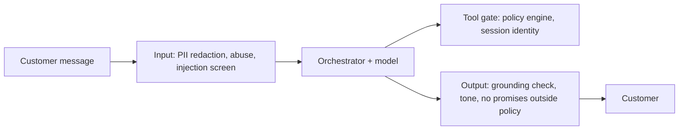

A support bot that worked in the demo fails in three predictable ways in production: it answers confidently from the wrong article, it gets manipulated by a customer or by text it reads, or a dependency goes down during the busiest hour of the year. The design is not finished until each of these has a measurement, a guardrail and a fallback.

## The evaluation plan, in layers

Evaluate offline before shipping and online after, with each layer answering a different question.

| Layer | What it measures | How | When |
|---|---|---|---|
| Retrieval | Recall@3 on labelled questions | 500+ real questions mapped to the correct article | Every index or chunking change |
| Answer quality | Correct, grounded, policy-compliant | Rubric scored by an LLM judge, calibrated against humans | Every prompt or model change |
| Actions | Right tool, right arguments, no unsafe action | Scripted conversations with expected tool calls | Every tool or policy change |
| Online | Containment, 7-day repeat contact, CSAT, escalation rate | Production logs, A/B tests | Continuously |

How big should the offline answer set be? To estimate a pass rate $\hat{p}$ to within a margin $E$ at 95% confidence, the normal approximation gives

$$
n = \frac{z^2\,p\,(1-p)}{E^2}
$$

where $z = 1.96$ for 95% confidence and $p$ is the pass rate you expect. With $p = 0.8$ and $E = 0.03$: $n = 3.8416 \times 0.16 / 0.0009 \approx 683$. So a 700-conversation suite tells you the pass rate to about ±3 points; a 100-conversation suite only to about ±8, which is too coarse to see most prompt changes. Build the set from real transcripts, stratified by intent, and keep a separate hard set of escalation-worthy conversations so you can check the bot still knows when to step aside.

## Guardrails

Put guardrails at the boundaries where untrusted text enters or consequential output leaves:



Three points interviewers listen for. First, **indirect injection** is the real risk: the model reads order notes, product reviews and email threads that strangers wrote, so screen retrieved and tool-returned text too, and never let it change which tools are available. Second, redact card numbers and passwords before they reach logs, because traces are kept for evaluation. Third, output checks should be cheap and deterministic where possible (a regex for refund amounts and dates the policy does not allow) with a small-model judge for the rest.

## Failure modes and fallbacks

| Failure | Detection | Response |
|---|---|---|
| Primary model provider down or slow | Error rate, p95 TTFT over budget | Fail over to a second provider or a self-hosted model |
| Retrieval returns stale or conflicting articles | Version checks, contradiction alerts | Expire old versions; escalate on conflict |
| Tool API (orders) down | Health checks, timeouts | Tell the customer, offer a callback, do not guess |
| Traffic spike on a sale day | Queue depth, provider rate-limit errors | Pre-provisioned quota, shed non-urgent work, raise escalation threshold |
| Loop or runaway conversation | Step and token caps per turn | Hard stop, hand to a human |

Fallback availability compounds. If the primary provider is available 99.9% of the time and an independent fallback 99.5%, the chance both are down at once is $0.001 \times 0.005 = 5 \times 10^{-6}$, so combined availability is $99.9995\%$, provided the failover itself works and the failures really are independent (they are not if both sit behind the same region or the same gateway).

## Scaling for the worst day

Provider capacity is usually sold as tokens per minute. Average load is 13.9 turns per second; at the normal 3x peak that is $41.7 \times 2{,}500 \times 60 = 6.25$ million input tokens per minute. A sale day can hit 10x the average, 139 turns per second, which is about **20.8 million input tokens per minute**. Negotiate that quota before the sale, not during it, and decide in advance what degrades first: drop the reranker, shorten history, route simple intents to the small model, and lengthen the human queue only as a last resort.

## In practice

The most common evaluation mistake is grading answers in isolation and never checking the hand-off. A bot that is 90% correct but escalates the other 10% silently (no summary, wrong queue) feels broken to customers. Score escalation quality as its own metric.

```quiz
{"q": "You expect a pass rate near 0.8 and want a 95% confidence margin of about ±3 points. Roughly how many evaluation conversations do you need?", "options": ["About 100", "About 300", "About 700", "About 7,000"], "answer": 2, "explain": "n = 1.96² × 0.8 × 0.2 / 0.03² ≈ 683. With 100 the margin is about ±8 points, too coarse to see most changes. 7,000 would give about ±1 point, more than needed."}
```

```quiz
{"q": "Primary provider availability is 99.9% and an independent fallback is 99.5%. What is the combined availability, and what assumption matters most?", "options": ["99.4%; that failures add", "99.9995%; that the two fail independently and failover works", "99.5%; the weaker one limits the system", "100%; with two providers you never go down"], "answer": 1, "explain": "Both must be down at once: 0.001 × 0.005 = 0.000005, so 99.9995% available. That only holds if failures are independent (different regions, no shared gateway) and the failover path is tested."}
```
