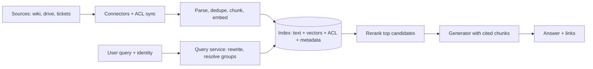

Draw the system in two halves. The **write path** (ingestion) turns documents from many sources into searchable chunks with permissions attached. The **read path** (query) turns a question into a ranked list of chunks the asker is allowed to see, then into a cited answer. They meet in one place, the index, and the interview is largely about what you store there.



Each chunk in the index carries more than text and a vector. A typical record holds `chunk_id`, `doc_id`, `source`, `title`, `text`, `vector`, `doc_version`, `modified_at` and `allowed_principals` (the users and groups who may open the parent document). That last field is what makes the system safe, and it is why enterprise search is not just support-bot RAG at a larger scale.

## The latency budget

The requirement was results under 1 s at p95 and an answer's first token under 1.5 s. Treat the read path as a sum of stages and give each one a budget:

$$
T_{first} = \sum_i t_i = t_{id} + t_{embed} + t_{retrieve} + t_{rerank} + t_{prefill} + t_{token}
$$

Each $t$ is the time spent in one stage: identity lookup, query embedding, scatter-gather retrieval, reranking, generator prefill and the first decoded token.

```steps
Budget for the first token (p95, hypothetical numbers)
Resolve identity and groups from a cache: $t_{id} = 10$ ms. Normalise the query with rules, not a model, on the fast path: $5$ ms.
---
Embed the query with a small embedding model: $t_{embed} = 20$ ms. Run BM25 and vector search in parallel on 4 shards, each with the ACL filter applied: $t_{retrieve} = 60$ ms (the slowest shard sets the time).
---
Fuse the two lists and rerank the top 30 with a cross-encoder: $t_{rerank} = 180$ ms (computed in a later topic).
---
Send 8 chunks (about 4,500 tokens) to the generator. Prefill takes about $t_{prefill} = 450$ ms and the first token follows $t_{token} = 30$ ms later.
---
Total: $10 + 5 + 20 + 60 + 180 + 450 + 30 = 755$ ms, leaving about 745 ms of the 1.5 s budget for network, queueing and tail effects.
```

Search results (the ranked links) can be shown right after the rerank, at about 275 ms. Showing them early while the answer streams makes the page feel fast, which is a cheap and effective trick.

## Why shard and replicate

The estimate gave 60 million chunks and about 54 GB of int8 vectors plus graph. Divide by the number of shards $S$ to get memory per shard:

$$
M_{shard} = \frac{M_{index}}{S} = \frac{54\ \text{GB}}{4} = 13.5\ \text{GB}
$$

Each shard fits comfortably in one 32 GB machine, with room for the text store's cache. Run $R = 2$ replicas of each shard so a machine failure or a rolling upgrade does not drop a quarter of the corpus, giving $4 \times 2 = 8$ nodes. If a node costs a hypothetical \$0.50 an hour, that is $8 \times 0.50 \times 730 = \$2{,}920$ a month, about a tenth of the answer-generation bill (\$29,280). Search infrastructure is the cheap part; do not over-optimise it.

A query fans out to one replica of every shard (**scatter-gather**) and merges the results. The latency of a scatter-gather is the maximum over shards, so a single slow node hurts every query. Use hedged requests (send to the second replica if the first has not answered by the p95 time) and you cut the tail at the cost of a few percent extra load.

## One query, end to end

```steps
"What is our policy on deleting EU customer data?"
Identity: the gateway authenticates the employee and the query service looks up their principals: the user id plus 14 groups, such as `eng-eu`, `all-staff`, `legal-readers`. This list becomes the filter.
---
Retrieve: embed the query; run BM25 over text and approximate nearest-neighbour search over vectors, each restricted to chunks whose `allowed_principals` intersects the user's principals. Each shard returns its top 50; the merged candidate list holds 100 chunks.
---
Fuse and rerank: reciprocal rank fusion combines the two lists, the top 30 go to a cross-encoder reranker, and the best 8 survive. Chunks from the same document are grouped so one long page cannot fill all the slots.
---
Re-check: for each surviving chunk, a live permission check against the source (or the 5-minute-fresh ACL cache) confirms access still holds. Any chunk that fails is dropped before the model sees it.
---
Generate: the model gets instructions, the question and 8 chunks with ids, and must answer only from them, citing ids. A check confirms each cited id is in the provided set.
---
Respond: stream the answer with links to the source documents; log the query, chunk ids, versions and scores for evaluation.
```

Notice that permission is enforced twice: at retrieval (so the right candidates are found) and again just before generation (so a revocation in the last few minutes is honoured). The second check is cheap, eight lookups, and closes the freshness gap in the permission mirror.

## In practice

The component that breaks most often is not search, it is **connectors**: APIs rate-limit, tokens expire, and a source quietly stops syncing. Treat each connector as a service with its own lag metric (time since the last successful sync of changes) and alert when it exceeds the freshness target. An index that is silently three days stale is worse than one that is visibly down.

```quiz
{"q": "The slowest of 4 shards takes 60 ms and the others about 25 ms. What is the retrieval stage latency of a scatter-gather query, ignoring merge time?", "options": ["About 25 ms", "About 34 ms (the average)", "About 60 ms", "About 135 ms (the sum)"], "answer": 2, "explain": "Shards are queried in parallel and the answer is ready only when the last one replies, so the maximum (60 ms) sets the latency. The sum would apply to sequential queries; the average hides the straggler that every user waits for."}
```

```quiz
{"q": "Why check permissions again after reranking, when retrieval already filtered by ACL?", "options": ["Because the reranker may reorder by access", "Because the ACL in the index can lag the source by minutes, and a live check closes that gap cheaply", "Because filtered vector search is unreliable", "Because the model might invent permissions"], "answer": 1, "explain": "The index holds a mirror of permissions that is only as fresh as the last sync. Re-checking the 8 surviving chunks costs little and honours a revocation made after the last sync. The reranker does not look at access at all."}
```
