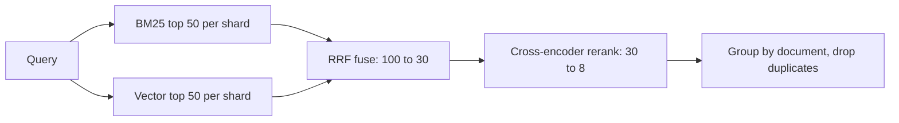

Enterprise queries come in two shapes. "Q3 OKR template" and "error E42" are **lookup** queries where exact words matter. "How do we handle data-deletion requests in the EU?" is a **semantic** query where the right page may never use those words. Term-based search (BM25) is strong on the first kind, embedding search on the second, and you cannot tell in advance which a query is. So you run both and fuse the results.

## Reciprocal rank fusion

BM25 scores and cosine similarities live on different scales, so adding them is meaningless. **Reciprocal rank fusion (RRF)** ignores scores and uses only ranks. A document's fused score is

$$
\text{RRF}(d) = \sum_{m \in \text{methods}} \frac{1}{k_0 + \text{rank}_m(d)}
$$

where $\text{rank}_m(d)$ is the position (1 is best) of $d$ in method $m$'s list, and $k_0$ is a constant, usually 60, that stops the top few ranks from dominating. A document missing from a list contributes nothing for that method.

```steps
RRF by hand with k0 = 60
Two ranked lists. BM25: A, B, C, D, E. Embedding search: C, E, B, F, A.
---
Document C is rank 3 in BM25 and rank 1 in embeddings: $1/63 + 1/61 = 0.015873 + 0.016393 = 0.032266$.
---
Document B is rank 2 and rank 3: $1/62 + 1/63 = 0.016129 + 0.015873 = 0.032002$. Document A is rank 1 and rank 5: $1/61 + 1/65 = 0.016393 + 0.015385 = 0.031778$. Document E is rank 5 and rank 2: $1/65 + 1/62 = 0.031514$.
---
Documents D and F each appear in one list only (rank 4): $1/64 = 0.015625$ each, about half the score of anything both methods liked.
---
Fused order: C, B, A, E, then D and F tied. Documents that both methods rank reasonably beat a document that only one method loved, which is the point.
```

The sim below runs the same idea on a small help-centre corpus with six labelled queries.

```sim
retrieval-compare
{"preset": "getin", "method": "hybrid", "k": 3}
```

Try this: start on the query "I can't get into my account" and read the three columns. Switch the preset to "what is E42" and see which single method wins there. Then compare mean recall across all six queries: hybrid should stay close to the best method on each query, even though no single method is best on all of them.

## Reranking: retrieve wide, read narrow

First-stage retrieval scores the query and a chunk **independently** (the chunk's vector was computed long ago), which makes it fast and also limits its precision. A **cross-encoder reranker** reads the query and one candidate together and outputs a relevance score, which is far more accurate but costs a model pass per candidate. So you use it only on a short list.

The compute is easy to estimate. A transformer pass costs about $2P$ floating-point operations per token for a model with $P$ parameters. For a reranker with $P = 300$ million scoring $m = 30$ candidates of $\ell = 400$ tokens each (chunk plus query):

$$
\text{FLOPs} = 2\,P\,m\,\ell = 2 \times 3\times 10^{8} \times 30 \times 400 = 7.2 \times 10^{12}
$$

On a GPU delivering an effective 40 teraFLOP/s (well below peak, because small batches use the hardware poorly), that is $7.2 / 40 = 0.18$ s, the 180 ms in the latency budget. At 9 peak queries per second the fleet must sustain $9 \times 7.2 = 64.8$ TFLOP/s, so $64.8 / 40 = 1.6$, rounded up to 2 GPUs, plus one spare: **3 GPUs**, about $3 \times 2.50 \times 730 = \$5{,}475$ a month at the hypothetical price. Doubling the depth $m$ doubles both latency and cost, so depth is a dial you tune against recall.

| Rerank depth $m$ | Latency (ms) | FLOPs per query | Recall of the right chunk in final 8 (illustrative) |
|---|---|---|---|
| 0 (no rerank) | 0 | 0 | 0.72 |
| 15 | 90 | 3.6 T | 0.84 |
| 30 | 180 | 7.2 T | 0.90 |
| 60 | 360 | 14.4 T | 0.92 |

The shape is the usual one: a big gain from the first few candidates, diminishing returns after. Here 30 is the knee; 60 doubles the cost for two points. Your own numbers come from running your labelled queries at each depth, never from a table like this one.

## Putting it together



Two details matter in practice. First, **deduplicate by document** after reranking, otherwise one long page can occupy all eight slots with neighbouring chunks and push out other sources. Second, boost with metadata cautiously: recency and source authority ("the official policy site beats a chat export") are real signals, but encode them as small additive terms you can ablate, not as hand-tuned rules nobody remembers.

## In practice

The classic failure is a reranker that was never evaluated against the first stage: it reorders confidently, looks sophisticated and lowers recall on the lookup queries where BM25 was already right. Measure recall@8 with and without it per query type. And watch the queue: a reranker is a GPU service on the critical path, so give it a timeout and a fallback of "skip reranking, use the fused order" for the rare slow request.

```quiz
{"q": "Document X is rank 2 in BM25 and absent from the embedding list. Document Y is rank 10 in both. With k0 = 60, which has the higher RRF score?", "options": ["X, since rank 2 is much better than rank 10", "Y, because it appears in both lists", "They are equal", "Cannot be computed without the raw scores"], "answer": 1, "explain": "X: 1/62 = 0.01613. Y: 2 × 1/70 = 0.02857. Appearing in both lists beats a single good rank. RRF needs only ranks, never raw scores."}
```

```quiz
{"q": "A 300M-parameter reranker scores 30 candidates of 400 tokens each. About how many FLOPs is that (2 × parameters × tokens)?", "options": ["7.2 × 10^9", "7.2 × 10^12", "7.2 × 10^15", "3.6 × 10^12"], "answer": 1, "explain": "Tokens = 30 × 400 = 12,000. FLOPs = 2 × 3×10^8 × 12,000 = 7.2×10^12. Forgetting the factor of 2 gives 3.6×10^12."}
```
