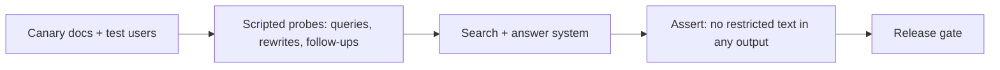

An enterprise search assistant has two quite different ways to fail. It can be **unhelpful** (the right document exists and was not found), and it can be **unsafe** (it showed someone content they should not see). The first is measured with quality metrics and improved gradually. The second is a binary invariant, tested adversarially, and one violation is an incident. The evaluation plan needs both halves.

## Retrieval metrics by hand

Build a labelled set of queries, each with the chunks or documents a human judged relevant. Then score the ranked list that retrieval returns.

**Recall@k** is the share of relevant items that appear in the top $k$:

$$
\text{recall@}k = \frac{|\text{relevant} \cap \text{top-}k|}{|\text{relevant}|}
$$

**Mean reciprocal rank (MRR)** rewards putting the first relevant result high. With $\text{rank}_q$ the position of the first relevant result for query $q$ among $Q$ queries:

$$
\text{MRR} = \frac{1}{Q}\sum_{q=1}^{Q} \frac{1}{\text{rank}_q}
$$

**nDCG** handles graded relevance (3 = perfect, 0 = irrelevant) and discounts lower positions logarithmically:

$$
\text{DCG}@k = \sum_{i=1}^{k} \frac{\text{rel}_i}{\log_2(i+1)}, \qquad \text{nDCG}@k = \frac{\text{DCG}@k}{\text{IDCG}@k}
$$

where $\text{rel}_i$ is the relevance grade at position $i$ and $\text{IDCG}$ is the DCG of the best possible ordering.

```steps
Three metrics, one small example
Recall: a query has 5 relevant chunks and the top 5 contains 3 of them: recall@5 $= 3/5 = 0.60$.
---
MRR: four queries whose first relevant result sits at ranks 2, 1, 3 and not at all. Reciprocal ranks: $0.5, 1, 0.333, 0$. $\text{MRR} = (0.5 + 1 + 0.333 + 0)/4 = 0.458$.
---
nDCG: the top 5 results have grades $[3, 0, 2, 1, 0]$. $\text{DCG} = 3/1 + 0/1.585 + 2/2 + 1/2.322 + 0 = 3 + 0 + 1 + 0.431 = 4.431$ (using $\log_2 2, \log_2 3, \log_2 4, \log_2 5$ for positions 1 to 4, the zero grades contribute nothing).
---
The ideal order is $[3, 2, 1, 0, 0]$: $\text{IDCG} = 3 + 2/1.585 + 1/2 = 3 + 1.262 + 0.5 = 4.762$. So $\text{nDCG}@5 = 4.431 / 4.762 = 0.930$.
```

Use each for its job. Recall@$k$ for the *retrieval stage* tells you whether the answer generator even has the right material (it is the ceiling on everything after). MRR and nDCG for the *final ranking shown to the user*, since people read from the top.

How many labelled queries? To estimate recall around 0.90 within $\pm 0.03$ at 95% confidence: $n = 1.96^2 \times 0.9 \times 0.1 / 0.03^2 \approx 384$ queries. Source them from real search logs, stratified by lookup versus semantic queries and by department, and keep 10% as a never-tuned holdout.

## Evaluating the answer

Retrieval metrics do not say whether the answer is correct. Add two checks.

**Claim support (groundedness).** Split the answer into claims and ask whether the cited chunks support each. If an answer makes 5 claims and 4 are supported, groundedness is $4/5 = 0.80$. A judge model does this at scale, calibrated against a few hundred human labels.

**Citation precision.** Of the chunk ids cited, how many actually contain the claim they are attached to? An answer that cites three chunks, one of them irrelevant, has citation precision $2/3$. Wrong citations are worse than none because they borrow the authority of the source.

Also track **abstention quality**: when the corpus does not contain the answer, did the system say so? Include 10 to 15% unanswerable questions in the set.

## Safety: the leak test

Treat permission correctness as a security property and test it like one.

- **Canary documents.** Plant documents with unique phrases in restricted spaces (for example, a fake "Project Heron salary band" page visible only to a test group). Run scripted queries as users outside that group, many phrasings each, and assert that the phrase never appears in results, answers, citations, logs shown to users, suggestions or caches.
- **Differential tests.** Run the same query as two users with different access and verify that each result set is a subset of what that user can open directly in the source.
- **Revocation tests.** Remove a user from a group and measure how long until the content disappears, against the 5-minute target.

How many probes before you can claim a leak rate is low? With zero leaks observed in $n$ independent probes, the "rule of three" gives an approximate 95% upper bound of $3/n$ on the true rate. To claim the leak rate is below $10^{-4}$ you need $n = 3 / 10^{-4} = 30{,}000$ probes with none leaking. Cheap to generate automatically, so run it on every release, and remember it only covers the paths you probe.



## Failure modes

| Failure | Cause | Detection | Response |
|---|---|---|---|
| Stale answer | Connector lag, missed delete | Per-connector sync lag metric, version in citation | Alert on lag over target; show "last updated" |
| Leak via group lag | Cached principals outlive membership | Revocation test, canary probes | Short principal TTL, live check on final chunks |
| Leak via derived content | Cache or summary built from restricted text | Differential tests on cached paths | Key caches by ACL; summaries inherit ACL |
| Prompt injection in a document | A page contains instructions for the model | Screening retrieved text, red-team documents | Treat chunks as data; no tools reachable from search |
| Recall collapse for a source | New parser dropped tables or a connector changed format | Per-source recall dashboards, empty-text rate | Rollback parser; backfill |
| Duplicate crowding | Many copies of one outdated page | Dedup ratio, top-8 distinct document count | Near-duplicate hashing, prefer newest version |
| Reranker or model outage | GPU failure, provider outage | Health checks, timeouts | Fall back to fused order; show results without an answer |

The last row is a good design principle: search results without a generated answer are still useful, so when the generator is down the product degrades to classic search instead of failing.

## In practice

Teams discover that the most valuable evaluation asset is the **no-result and thumbs-down queue**: every query that returned nothing the user clicked, reviewed weekly. It finds missing sources, vocabulary mismatches ("PTO" versus "vacation") and broken parsers faster than any benchmark. Also store the ids and versions of retrieved chunks with every answer; without them, a complaint cannot be investigated.

```quiz
{"q": "The top 5 results have relevance grades [3, 0, 2, 1, 0] and the ideal order is [3, 2, 1, 0, 0]. DCG is 4.431 and IDCG is 4.762. What is nDCG@5?", "options": ["0.43", "0.93", "1.07", "0.60"], "answer": 1, "explain": "nDCG = DCG / IDCG = 4.431 / 4.762 = 0.930. A ratio above 1 is impossible because IDCG is the best achievable. 0.60 would be a recall-style fraction, not a normalised gain."}
```

```quiz
{"q": "You ran 30,000 independent leak probes and observed zero leaks. What can you honestly claim?", "options": ["The leak rate is exactly zero", "With about 95% confidence the leak rate on probed paths is below about 1 in 10,000", "The system is safe against every possible attack", "The leak rate is below 1 in 30,000"], "answer": 1, "explain": "The rule of three bounds the rate by 3/n = 10^-4 at roughly 95% confidence, and only for the kinds of probes you ran. It cannot prove zero, and it says nothing about paths you did not test. Claiming 1 in 30,000 forgets the factor of three."}
```
