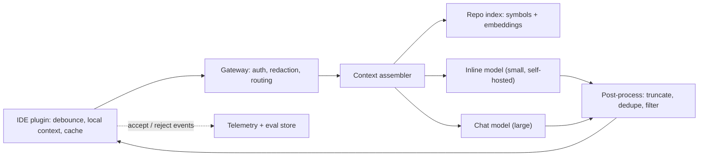

With the two products sized, draw one architecture that serves both, then show where they diverge. The shared parts are the IDE plugin, identity and policy, the repository index and telemetry. The split is the model path: a small self-hosted model close to developers for inline, a large model (API or self-hosted) for chat.

The design principle behind every box is the same: **do as much as possible on the developer's machine, before the network**. The IDE already has the open files, the cursor position, the recently edited tabs and the language server's symbol table. Shipping that to a server to be rediscovered would cost latency the inline budget cannot spare.



## The components

| Component | Inline path | Chat path |
|---|---|---|
| IDE plugin | Debounces keystrokes, gathers prefix, suffix and neighbour tabs, cancels stale requests | Collects selection, open files, user question |
| Gateway | Auth, secret redaction, per-user rate limit, region routing | Same, plus conversation storage |
| Context assembler | Ranks local snippets, adds a few index hits, packs into ~2,000 tokens | Runs repo search, reads files, packs ~8,000 tokens |
| Repo index | Symbol table and embedding index, refreshed on push | Same index, more of it |
| Model | Small FIM-trained model, 40 output tokens, low temperature | Large chat model, streams ~500 tokens |
| Post-processing | Cut at end of block, drop if it repeats the suffix, filter secrets and licence matches | Render markdown, link file references |

The repository index deserves a size estimate. With about 500 million lines split into chunks of 60 lines, there are

$$
C = \frac{5 \times 10^8}{60} \approx 8.33 \times 10^6 \ \text{chunks}, \qquad S = C \cdot d \cdot b
$$

where $C$ is the chunk count, $d = 768$ the embedding dimension and $b$ the bytes per value. At float32 ($b = 4$) the raw vectors take $8.33\times10^6 \times 768 \times 4 \approx 25.6$ GB; quantised to int8 ($b=1$), 6.4 GB. Embedding the whole codebase once is about $5 \times 10^8$ lines $\times$ 10 tokens per line $= 5$ B tokens, which at a hypothetical \$0.02 per million is only \$100. Re-indexing is cheap, so freshness is a scheduling problem, not a budget one: re-embed changed files on every push to the default branch.

## One inline completion, end to end

```steps
A developer pauses after typing `def parse_header(line):`
**IDE, 0 ms.** The keystroke timer starts. If another key arrives within the debounce window (say 75 ms), the timer restarts and nothing is sent. Any request already in flight for an older cursor position is cancelled.
---
**IDE, 75 ms.** The pause is long enough. The plugin takes about 110 lines above the cursor (the prefix), 30 lines below (the suffix), and the best-matching snippets from other open tabs. It checks a local cache keyed on the prefix hash: a hit would show ghost text immediately.
---
**Network and gateway, +40 ms.** About 30 ms of round trip to the nearest region plus 10 ms in the gateway, which authenticates the developer, scans for strings that look like keys or tokens and replaces them with placeholders, then routes to the nearest inline cluster.
---
**Context assembler and model, +124 ms.** The assembler adds two index hits (the definition of a `Header` class from another file), formats the prompt as prefix-suffix-middle, and sends it. The server finds most of the prefix already in its prefix cache from the previous keystroke, so prefill is short. The model decodes until it emits an end-of-middle token or a line limit.
---
**Post-processing and render, +5 ms.** The completion is cut at the end of the function body, checked against the suffix so it does not duplicate the next line, and shown as ghost text. Telemetry records shown, accepted or dismissed, and how much of the text survives 30 seconds later.
```

Total from the last keystroke to ghost text is about 75 + 40 + 124 + 5 = 244 ms, inside the 250 ms p50 target. The debounce interval counts against the user's experience even though no server is involved, which is why it is tuned carefully (more in the latency topic).

## Where the two paths diverge

Chat sends the question plus context to a large model and streams the answer. It can afford a retrieval step that takes 200 to 400 ms, a reranker, and even tool calls (open a file, run a search) because the user expects to wait a second or two. It also keeps state: a conversation history that grows each turn and must be truncated or summarised.

Inline is stateless per request, which is what makes it cacheable and cancellable. If you are tempted to add a step to the inline path, ask what it costs in milliseconds and what it adds to acceptance rate. Most additions belong in chat.

## In practice

Cancellation is the unglamorous feature with the biggest effect on cost. Developers type in bursts; without cancellation the server finishes completions for cursor positions that no longer exist. If 30% of requests are superseded before they return, cancelling them on the server (abort the decode, free the KV cache) saves close to 30% of decode work. It requires a streaming or cancellable RPC from plugin to server, so decide on it early.

```quiz
{"q": "A codebase has 500 million lines, chunked every 60 lines and embedded at 768 dimensions in int8. Roughly how large is the raw vector data?", "options": ["About 0.8 GB", "About 6.4 GB", "About 25.6 GB", "About 384 GB"], "answer": 1, "explain": "$5\\times10^8 / 60 \\approx 8.33$ M chunks, each $768 \\times 1$ byte, so $\\approx 6.4$ GB. 25.6 GB is the float32 size (4 bytes per value); 384 GB would come from embedding every line separately in float32."}
```

```quiz
{"q": "Why does the inline path benefit so much from server-side cancellation?", "options": ["Because cancelled requests are billed at half price", "Because developers keep typing, many requests target a cursor position that is gone before the answer returns, and aborting them frees decode work and KV memory", "Because cancellation improves the model's accuracy", "Because the gateway cannot rate-limit without it"], "answer": 1, "explain": "Typing produces superseded requests. Finishing them wastes GPU time and KV memory for text nobody will see. Cancellation does nothing for accuracy; it is a capacity and cost measure."}
```
