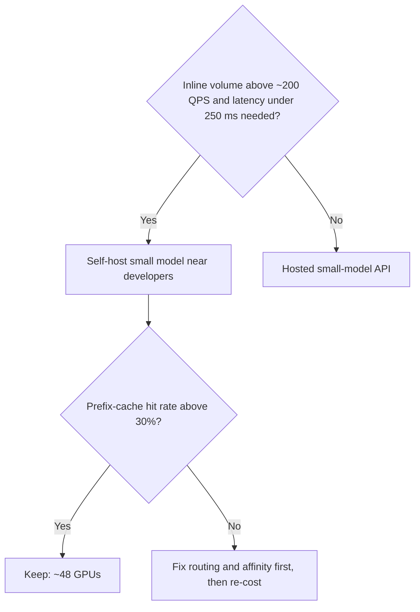

By now you have two sized products, an architecture, three deep dives and an evaluation plan. The last five minutes of an interview are where candidates either collapse into a feature list or show judgement. Judgement means naming the decisions, saying which way you lean and under what numbers you would flip.

## Summary of the design

| Item | Inline completion | Chat |
|---|---|---|
| Peak QPS | ~1,042 | ~52 |
| Tokens per request | 2,000 in / 40 out | 8,000 in / 500 out |
| Model | 8B-class code model, self-hosted | Large model, API |
| Latency target | p50 < 250 ms | TTFT < 1.5 s |
| Hypothetical cost | ~\$87,600 per month self-hosted (48 GPUs with prefix caching) | ~\$220,000 per month |
| Biggest lever | Prefix cache, context budget | Retrieval quality, answer length |

## The decisions and how to defend them

| Decision | Option A | Option B | Lean, and flip condition |
|---|---|---|---|
| Inline hosting | Self-host small model | Hosted small-model API | Self-host for latency and volume; flip to API if volume is below roughly 200 QPS, where GPUs idle |
| Context for inline | Current file only | File + neighbours + repo index | Add retrieval only if the internal eval shows gains that justify its latency cost (15 ms in our budget) |
| Chat model | One large model | Cascade: small first, escalate | Cascade if most questions are simple lookups; measure on a sample |
| Suggestion length | Single line | Multi-line blocks | Multi-line raises value per accept but lowers acceptance; tune by retention, not acceptance |
| Telemetry | Log prompts for training and eval | Log only events (accept/reject) | Events by default; prompts only with consent and redaction |
| Index freshness | Rebuild nightly | Incremental on push | Incremental: stale symbols are a top source of bad suggestions |

A good habit is to attach a number to every flip condition. "If the prefix-cache hit rate falls to zero, the self-hosted fleet grows from 48 to about 120 GPUs, the cost passes the API bill, and I would switch" is a sentence an interviewer remembers. The saving from caching is $(120 - 48) \times 730 \times \$2.50 \approx \$131{,}000$ per month, where 120 and 48 are the GPU counts without and with a 60% prefix-cache hit rate, 730 the hours per month and \$2.50 the hypothetical hourly price.



## What the interviewer probes

Expect these follow-ups and prepare a two-sentence answer for each.

1. **"Why not one model for both?"** Different latency classes. The large model cannot answer in 250 ms, and the small one answers repository questions poorly.
2. **"What happens when the developer types faster than your response?"** Cancel in-flight requests, shift cached suggestions, and track the overtake rate.
3. **"How do you know the context assembler is any good?"** Internal eval built from history: remove code, rebuild context, run tests. Ablate each source (neighbours, index hits, recency) and report the effect on pass@1.
4. **"Your acceptance rate went up 5 points and nobody is happier. Why?"** Probably shorter, safer suggestions or gaming. Check retention, characters per suggestion and downstream defects.
5. **"A customer says their private code appears in suggestions for another company."** Walk through data separation: no cross-tenant training on prompts, per-tenant indexes, retention limits, and the verbatim-match filter for public code.
6. **"How does it scale ten times?"** Inline scales almost linearly with GPUs, so the questions are regional capacity, index size (shard by repository) and the telemetry pipeline.
7. **"What would you build first?"** Chat over a basic index is a few weeks of work; inline needs the latency engineering. Ship one, measure, then the other.

## In practice

Most interview answers fail not on knowledge but on structure: they dive into FIM tokens before stating that inline and chat are different products. State the split first, run the numbers per product, and let each deep dive answer a risk you flagged earlier. The structure in [the framework lesson](/learn/llm-system-design/design-framework) exists to make that automatic.

```quiz
{"q": "Self-hosted inline needs about 48 GPUs at a 60% prefix-cache hit rate. If the hit rate drops to 0% because requests are no longer routed by affinity, roughly how many GPUs are needed?", "options": ["About 48", "About 80", "About 120", "About 240"], "answer": 2, "explain": "With no cache, all 2,000 input tokens need prefill: about 120 GPUs (the cold estimate). With a 60% hit rate only 40% do, giving about 48. Cache routing is therefore worth about 72 GPUs, roughly 131,000 dollars per month at the hypothetical GPU price."}
```

```quiz
{"q": "Which statement is the strongest way to close a design decision in an interview?", "options": ["\"We would use the best model available.\"", "\"We self-host inline for latency and volume; if volume fell below about 200 QPS the GPUs would idle and I would switch to a hosted API.\"", "\"Both options have pros and cons.\"", "\"It depends on the requirements.\""], "answer": 1, "explain": "It makes a choice, gives the reason and states a measurable condition for changing it. The others avoid committing or give no reasoning."}
```

When you are ready to see these ideas run, open the sandbox build for this case.

```sandbox
code-assistant
```
