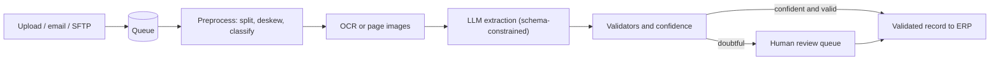

A batch extraction pipeline is a chain of small, restartable stages joined by queues. The design goal is not speed; it is that **no document is ever lost, processed twice into the database, or stuck without anyone knowing**. The LLM is one stage out of about eight, and often the most reliable one: most production incidents live in file handling, OCR and downstream integration.



## The stages and their jobs

| Stage | Job | What goes wrong |
|---|---|---|
| Intake | Accept files, compute a content hash, write the original to object storage | Duplicates, corrupt files, password-protected PDFs |
| Preprocess | Split bundles into documents, rotate and deskew, classify type (invoice, contract, other) | A 40-page scan holding eight invoices |
| OCR / render | Text with positions, or page images | Handwriting, low-contrast photos |
| Extraction | Prompt with the document type's schema, return JSON | Wrong value, missed field, invalid output |
| Validation | Check types, formats, arithmetic and business rules; attach confidence | Rules that are too strict or too loose |
| Routing | Auto-accept or send to review | Threshold set by habit instead of by cost |
| Review | A person confirms or corrects highlighted fields | Slow tooling, queue growth |
| Delivery | Write to the ERP idempotently, keep an audit trail | Double posting |

Two design choices deserve a sentence each. Keep the **original file and every intermediate artifact** (OCR text, model output, validator verdicts, reviewer edits) with the document ID: you will need them for audits, for debugging, and as the source of your evaluation set. And key every write by the content hash plus document ID so a retried message cannot create a second record.

## One invoice, step by step

```steps
A 3-page scanned invoice, from upload to database
**Intake.** A supplier emails a PDF. The system stores it, computes the hash $h$, finds no earlier document with the same $h$, and enqueues document `D-48213`.
---
**Preprocess.** The classifier labels it an invoice (confidence 0.99). Page 2 is rotated 90 degrees and is corrected. No bundle splitting is needed.
---
**OCR.** The scan is converted to text with page and position metadata, about 2,300 tokens in total (the digital pages would have been read directly).
---
**Extraction.** The prompt carries the invoice schema and the OCR text. Constrained decoding forces valid JSON with fields `vendor`, `invoice_number`, `date`, line items, `tax`, `total` and an `evidence` page and quote for each value.
---
**Validation.** The line items are 120.00, 45.50 and 30.25, summing to 195.75; tax at 8% is 15.66; the total should be 211.41 and the extracted total is 211.41. The date parses; the vendor matches a known supplier. Every token-level confidence is above 0.9. The record is auto-accepted.
---
**Delivery.** The record is written to the ERP under an idempotency key, with a link back to the stored original and the evidence quotes. Total elapsed: 14 seconds.
```

If the extracted total had been 211.14 (digits swapped), the arithmetic check would fail and the document would go to the review queue with the total field highlighted and the page region cropped, so the reviewer does not read the whole document.

## Reliability arithmetic

Every stage can fail transiently (a timeout, a rate limit). If each of 5 stages succeeds first time with probability $s = 0.995$, then the chance that a document passes the whole chain without a retry is

$$
s^{5} = 0.995^5 \approx 0.975
$$

where $s$ is per-stage first-attempt success and the exponent is the number of stages. So about 2.5% of documents need at least one retry, 25,000 a month at a million documents. That is fine only if retries are automatic, bounded (say 3 attempts with exponential backoff) and end in a **dead-letter queue** that a human monitors. The principle is the same as in [failures and recovery for agents](/learn/agents/failures-and-recovery): safe retries require idempotent stages.

## Latency per document

With stage times of 2 s preprocessing, 4 s OCR, 6 s LLM (400 output tokens at about 15 ms each) and 1 s validation and delivery, a document takes about 13 to 15 seconds when nothing waits in a queue. The 4-hour turnaround target is therefore almost entirely **queueing and review time**, not compute. This is why capacity planning here is about queue depth: if peak arrival is 1.16 docs/s and workers complete 2 docs/s the queue drains; if a vendor outage cuts workers to 0.5 docs/s the queue grows by 0.66 documents each second, 2,400 documents an hour.

## In practice

Process each document type through its own schema and prompt, selected by the classifier; one giant "extract everything" prompt is harder to evaluate and to version. Treat the classifier as a gate: documents it labels "other" or classifies with low confidence go to a person rather than to the invoice schema, because a contract extracted with an invoice schema produces confident nonsense.

```quiz
{"q": "Five pipeline stages each succeed on the first attempt with probability 0.99. What fraction of documents pass all five without any retry?", "options": ["99%", "95.1%", "94.9%", "90%"], "answer": 1, "explain": "$0.99^5 = 0.951$. At a million documents that is about 49,000 needing a retry, which is why retries must be automatic and idempotent. 99% ignores that failures compound across stages."}
```

```quiz
{"q": "Why key the database write by the document's content hash and ID rather than just inserting the extracted record?", "options": ["It makes the record smaller", "A retried or duplicated message would otherwise create a second record, such as a double payment", "It speeds up the LLM call", "It improves OCR accuracy"], "answer": 1, "explain": "Queues deliver at least once, and suppliers resend invoices. An idempotency key makes a repeated write a no-op instead of a duplicate."}
```
