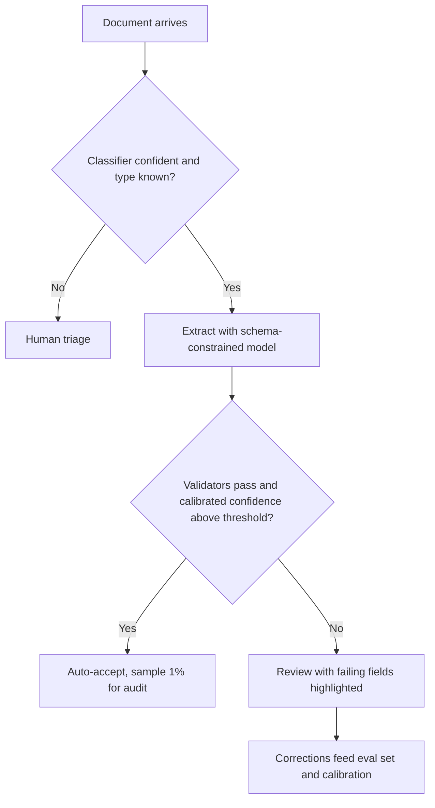

The extraction case rewards candidates who notice early that the interesting numbers are not the model's. The model costs a cent a document; the review team, the error cost and the long tail of messy inputs decide whether the system works. Use the last minutes of the interview to make the decisions explicit.

## The design in one table

| Item | Choice | Number |
|---|---|---|
| Volume | 1 M documents/month, 4 pages | 4 M pages, peak 1.16 docs/s |
| Pipeline | OCR plus small model, escalate 25% to a large model | \$7,820 per month model plus OCR |
| Output | Schema-constrained JSON with evidence quotes | 0% malformed by construction |
| Validation | Arithmetic, format, business rules, duplicate check | Catches almost all single-field numeric errors |
| Routing | Calibrated confidence threshold from error cost | Review any document with $p > 1.6\%$ |
| Review | 20% of documents, 90 s each | 46 reviewers, \$90,000 per month |
| Result | 5,500 wrong records per month | 99.45% record accuracy |

## The decisions and how to defend them

| Decision | Option A | Option B | Lean, and flip condition |
|---|---|---|---|
| Reading the page | Vision model reads images directly | OCR then text model | Digital PDFs: text layer, no OCR. Scans: compare both on your own labelled set; vision saves the OCR bill (\$6,000 a month here) and avoids OCR errors, but costs more tokens |
| Model size | One large model | Small model with escalation | Cascade if the small model's accuracy on the easy 75% matches the large one's within about a point; measure it |
| Structure | Constrained decoding | Free text, validate and retry | Constrained whenever supported; retry costs latency and still fails sometimes |
| Confidence | Token probabilities | Self-consistency (2 to 3 samples) | Start with token probabilities; add sampling for the fields where review pays off most, since it multiplies model cost by 2 to 3 (still small next to review) |
| Review threshold | Fixed 0.9 | Derived from error cost | Derived; re-derive when $C_{\text{err}}$ or reviewer cost changes |
| Execution | Real-time API | Batch queue | Batch unless users wait on the result; batch pricing (hypothetically 50% off) halves the model line |
| Build vs buy | Commercial document-AI service | Own pipeline | Buy for standard invoices if accuracy on your set is enough; build when the schema is custom, volume is high or data cannot leave your environment |



## What the interviewer probes

1. **"Why not just send everything to the biggest model and trust it?"** Even at 97% per field, $0.97^{12}$ means 30.6% of records have an error. Without a filter in front of the database, thousands of wrong records a day get through, each costing real money.
2. **"How do you pick the confidence threshold?"** From the cost rule $p^{*} = p_{\text{res}} + C_{\text{rev}}/C_{\text{err}}$ on calibrated scores, then verify with a sweep on labelled data, as in the review-maths topic.
3. **"The model is 99% confident and wrong on a new supplier. How do you find out?"** Random audits of auto-accepted documents, per-supplier monitoring of validator failures and review rate, and reviewer feedback. Confidence cannot see out-of-distribution patterns.
4. **"What happens when the model refuses or the output is cut off?"** Constrained decoding does not prevent a length cutoff. Treat stop-reason "length" as failure: retry with a higher limit or split the document; send refusals to review.
5. **"How would you handle a 300-page contract?"** Split into sections, run extraction per section with the section-specific schema, merge deterministically, flag conflicts (two different effective dates) for a person. Do not rely on one giant context.
6. **"Cut cost by half."** The model line is under \$8,000, so first lower review time $t$ and review rate $r$: a 30% cut in review time saves more than eliminating all model spend. Then consider batch pricing and the small-model-first cascade.
7. **"Prove it works before launch."** Stratified labelled set of about 1,000 documents, per-field F1 and record accuracy, calibration curve, then a shadow period where outputs are compared with human entry before any record is auto-accepted.

## In practice

The strongest answers sequence the work: ship with 100% review and the model as an assistant (reviewers correct pre-filled fields; this alone cuts handling time), measure calibration on real corrections, then lower the review rate step by step where the data shows it is safe. Going straight to auto-accept is how pipelines earn an incident report.

```quiz
{"q": "Which change most reduces total monthly cost in this design?", "options": ["Switch the small model to an even cheaper one, saving about \\$300 a month", "Cut reviewer time per document from 90 s to 60 s, saving about \\$30,000 a month at a 20% review rate", "Remove OCR for digital PDFs only, saving a few hundred dollars", "Use a longer prompt"], "answer": 1, "explain": "Review is \\$90,000 a month; a one-third cut in review time saves \\$30,000. Model savings are in the hundreds because model spend is under \\$8,000 in total."}
```

```quiz
{"q": "Why start a new extraction system with 100% human review and pre-filled fields?", "options": ["It is cheapest", "It produces labelled corrections for calibration and shows where the model is safe to trust, before any record is auto-accepted", "Constrained decoding requires it", "Reviewers are faster than models"], "answer": 1, "explain": "Reviewers' corrections are the labelled data you need to calibrate confidence and choose thresholds. Starting at 100% review is the most expensive option, not the cheapest, but it is the safe way to earn the data."}
```

Now build and break a version of this pipeline yourself.

```sandbox
doc-extraction
```
